<!-- SPDX-License-Identifier: GPL-3.0-or-later -->
<!-- GENERATED FILE -- written by validation/benchmarks/make_report.py; DO NOT EDIT. Regenerate it instead. -->
# Benchmark report

> **Generated — do not edit.** Written by `validation/benchmarks/make_report.py` from the harnesses `validation/benchmarks/t[1-6]_*.py`, together with `REPORT.json` beside it (the same rows, machine-readable: the M2 baseline). `BENCHMARK_PLAN.md` §3: *the report is regenerated, never hand-edited* — `make_report.py --check` fails on any difference other than the date, the revision, a runtime or the environment.

- **generated:** 2026-10-28T00:02:48Z
- **git revision:** `fbc24f2` + uncommitted changes (dirty)
- **environment:** Python 3.10.12; numpy 2.2.6; scipy 1.15.3; PYTHIA 8.317 (pythia8-config --version); LHAPDF 6.5.5; HepMC3 3.03.00 (pyhepmc 2.16.1); lipolgen 0.1.0 (LHAPDF tier on, PYTHIA tier on)
- **LHAPDF sets present:** `CT18NLO`, `EPPS21nlo_CT18Anlo_Li6`, `NNPDFpol11_100` (searched: `/home/cpeng/Projects/polli/deps/install/share/LHAPDF`)
- **opt-in (expensive) rows:** run (`--all` / `LIPOLGEN_BENCH=1`)
- **this file was made by:** `cd LiPolGen && source env.sh && python3 validation/benchmarks/make_report.py --all --plots`
- **figures:** 19 of 23 rows carry one, linked under the row's heading in *Detail* (`--plots`: each harness's own `plot()` after `run()`, PNGs in `figures/`; a view of REPORT.json, never compared by `--check`)
- **check it:** `cd LiPolGen && source env.sh && python3 validation/benchmarks/make_report.py --check`; **M2 compare:** `cd LiPolGen && source env.sh && python3 validation/benchmarks/make_report.py --all --compare docs/benchmarking/REPORT.json`

**23 harnesses:** 13 pass, 10 fail, 0 blocked, 0 blocked (environment), 0 error, 0 skipped (opt-in).

## The rows

One row per harness. *plan row* is the `BENCHMARK_PLAN.md` §4 row number when the harness wires a §4 row. The generator column is the harness's own value text; the sub-rows and the configuration are under *Detail*.

| harness | tier | plan row | status | generator (the number) | reference | tolerance | runtime |
|---|---|---|---|---|---|---|---|
| [`t1_g1d_world`](#t1_g1d_world) | T1 | — | **FAIL** | toy (shipped ToyG1, g1_nucleus(d)/2): compass 107.8/15 (p = 4.17e-16), hermes 69.4/15 (p = 5.75e-09), e143 54.9/28 (p = 0.00173) on Q2 &gt;= 1, W2 &gt;= 4 [diagonal]; sub-rows: mstw FAIL compass 53.2/15 (p = 3.52e-06), hermes 47.1/15 (p = 3.5e-05), e143 50.2/28 (p = 0.00607); ct18nlo FAIL compass 20.2/11 (p = 0.0429), hermes 64.3/11 (p = 1.46e-09), e143 59.0/24 (p = 8.96e-05); nnpdfpol FAIL compass 45.0/15 (p = 7.67e-05), hermes 52.6/15 (p = 4.53e-06), e143 51.0/28 (p = 0.00505) | g1d per nucleon: COMPASS (D-2), HERMES (D-1), E143 (D-6) via nnpdf-data 4.1.5; SMC recorded only; 15 + 15 + 28 points in the DIS cut | p(chi2, ndf) &gt;= 0.01 on the DIS cut for each of compass, hermes, e143, stat (+) sys diagonal | 0.49 s |
| [`t1_hermes_f2d`](#t1_hermes_f2d) | T1 | 14 | **FAIL** | toy (shipped ToyF2) on F2d: chi2/ndf = 5303.5/68, p = 0 on Q2 &gt;= 1, W2 &gt;= 4 [per-bin diagonal + correlated 7.5 % normalisation]; sub-rows: mstw 318.9/68 (p = 4.03e-34); ct18nlo 1788.2/45 (p = 0); HERMES b1 inversion: F2d_implied/F2d_HERMES = 0.929 / 1.039 / 0.986 / 0.958 / 1.006 / 1.006 -&gt; PER NUCLEON | HERMES F2d (and F2p) per nucleon, JHEP 05 (2011) 126, HEPData ins894309 Tables 2 (d) and 1 (p), 68 of 81 deuteron points in the DIS cut | p(chi2, ndf) &gt;= 0.01 on the DIS cut, per-bin errors diagonal + the overall normalisation fully correlated | 0.44 s |
| [`t1_nmc_f2d`](#t1_nmc_f2d) | T1 | — | **FAIL** | toy (shipped ToyF2): chi2/ndf = 8307.9/155, p = 0 on Q2 &gt;= 1, W2 &gt;= 4 [diagonal]; sub-rows: mstw 416.5/155 (p = 8.21e-26); ct18nlo 3401.8/146 (p = 0) | NMC F2d per nucleon, NPB 483 (1997) 3, HEPData ins424154 tables 17-32 via nnpdf-data 4.1.5 (NMC_NC_NOTFIXED_D), 155 of 158 points in the DIS cut | p(chi2, ndf) &gt;= 0.01 on the DIS cut, stat (+) sys diagonal | 0.47 s |
| [`t1_nmc_f2d_over_f2p`](#t1_nmc_f2d_over_f2p) | T1 | — | **FAIL** | toy (shipped ToyF2): chi2/ndf = 2161.4/211, p = 0 on Q2 &gt;= 1, W2 &gt;= 4 [diagonal]; sub-rows: mstw 247.2/211 (p = 0.0444; frozen hook 260.7); ct18nlo 215.5/189 (p = 0.0904; frozen hook 239.5) | NMC F2d/F2p (per nucleon), NPB 487 (1997) 3, HEPData ins426595 tables 2-21 via nnpdf-data 4.1.5 (NMC_NC_NOTFIXED), 211 of 260 points in the DIS cut | p(chi2, ndf) &gt;= 0.01 on the DIS cut, stat (+) sys diagonal | 0.56 s |
| [`t1_r_world`](#t1_r_world) | T1 | 12 | **PASS** | r_sigma_lt (shipped R) on NMC R: chi2/ndf = 12.54/10, p = 0.25 [diagonal, DIS cut]; r1998 (clip) on NMC 6.20/10 (p = 0.798); h1[r_sigma_lt] 8.82/8 (p = 0.358); h1[r1998] 8.18/8 (p = 0.416); r1990[r_sigma_lt] 209.76/68 (p = 2.28e-16); r1990[r1998] 63.05/68 (p = 0.647); e140[r_sigma_lt] 29.66/9 (p = 0.000502); e140[r1998] 12.71/9 (p = 0.176); bias (1+r1998)/(1+r_sigma_lt) at the sweet spots 1.1848 / 1.1780 / 1.0762 / 0.9563 | NMC R, NPB 483 (1997) 3, HEPData ins424154 Table 33 (PRIMARY, 10 of 10 points in the DIS cut); H1 F_L, PLB 665 (2008) 139, HEPData ins786161 Table 9 (+ Tables 1-8 recorded) (EXTRAPOLATION, 8 of 8 points in the DIS cut); Whitlow et al. R (global SLAC), PLB 250 (1990) 193, HEPData ins296980 Tables 3-13 (CLOSURE, 68 of 89 points in the DIS cut); SLAC E140 R (deuterium), PRD 49 (1994) 5641, HEPData ins360765 Tables 23-25 (CLOSURE, 9 of 11 points in the DIS cut) | p(chi2, ndf) &gt;= 0.01 per data set on Q2 &gt;= 1, W2 &gt;= 4 GeV2, stat (+) sys diagonal; status = r_sigma_lt on the PRIMARY nmc set | 1.43 s |
| [`t2_boeglin_nk`](#t2_boeglin_nk) | T2 | 16 | **PASS** | n(k = p_m) x s, one free scale: hulthen (default) chi2 = 21.98/21 (p = 0.4, s = 0.481); av18 11.54 (p = 0.951); cdbonn 8.89 (p = 0.99) | Boeglin et al. PRL 107 (2011) 262501 Fig. 2, d(e,e'p)n sigma_red at Q^2 = 3.5 GeV^2, theta_nq = 35 deg (10) and 45 deg (12 points), p_m = 0.055-0.538 GeV/c, digitized from the vector PDF | p(chi2, 21) &gt;= 0.01 with one free scale, the bars (+) an allowance A = 0.2 of each point for FSI and the CC1 off-shell prescription (declared in the hashed design block) | 0.38 s |
| [`t2_bonus_spectator_shape`](#t2_bonus_spectator_shape) | T2 | 10 | **FAIL** | Hulthen 40 mb GlauberFsiWeight over its backward mean inside the data's 1-sigma flat band in 4/12 (4 GeV) and 0/16 (5 GeV) DIS blocks; worst v/delta 2.62 (4 GeV Q2=1.66,W\*=2.44,ps=0.135), 3.44 (5 GeV Q2=1.66,W\*=2.03,ps=0.078); backward chi2 flat 739.4, tree shape 226.3 on 84 dof | CLAS BONuS R_D/S vs cos theta_pq, Tkachenko PRC 89 (2014) 045206 Suppl. (100 blocks; 32 in the DIS window W\* &gt;= 2, Q2 &gt;= 1, 28 with backward bins) | max over cos &lt;= -0.3 of abs(w/mean_bw(w) - 1) &lt;= delta = S sigma(Rbar)/Rbar (stat, S = max(1, sqrt(chi2/ndf))), every block, both beams | 2.11 s |
| [`t2_deeps_spectator_tail`](#t2_deeps_spectator_tail) | T2 | 11 | **FAIL** | shape chi2/ndf = 627.85/187 (p = 4.93e-49), Hulthen default, LC n(k) E_k/(2-alpha), cos_pq &lt;= -0.3; AV18 579.12/187, CD-Bonn 278.81/187 | CLAS Deeps F2N x P(p_s), Klimenko PRC 73 (2006) 035212 (60 blocks at Q2 = 1.8/2.8, 245 PWIA-window points) | p(chi2, ndf) &gt;= 0.01, default wave, one free scale per (Q2, W\*, cos) group | 0.97 s |
| [`t2_deuteron_static`](#t2_deuteron_static) | T2 | — | **FAIL** | eta: cdbonn 0.025571 (-0.07 sigma), av18 0.025045 (-1.39 sigma), hulthen 0.032478 (+17.20 sigma); Q_d (impulse approx., recorded): 0.270493 (-5.42 %) / 0.269670 (-5.71 %) / 0.290349 (+1.52 %) fm^2 | eta_d = 0.0256 +- 0.0004 (Rodning-Knutson PRC 41 (1990) 898, Eq. (10)), Q_d = +0.2860 +- 0.0015 fm^2 (Bishop-Cheung PRA 20 (1979) 381, confirming Reid-Vaida); read from the papers 2026-10-26, Q_d corrected from 0.2859(3) | abs(eta - eta_d) &lt;= 2 sigma for each of cdbonn, av18, hulthen; Q_d recorded, not asserted | 1.48 s |
| [`t2_hermes_b1_table2`](#t2_hermes_b1_table2) | T2 | 3 | **FAIL** | cdks_conv_mstw: chi2/ndf b1 = 22.26/6, A_zz = 22.01/6; 2/6 b1 bins within tol | HERMES PRL 95 (2005) 242001 Table II, 6 bins, per nucleon | per bin sqrt(stat^2+syst^2) | 5.49 s |
| [`t3_li6_charge_ff_fb`](#t3_li6_charge_ff_fb) | T3 | 5 | **FAIL** | HoSpin1FF first C0 zero q0 = 3.0998 fm^-1 (shipped; T11 window [2.9, 3.3] not moved) | band [2.6944 (UVa FB zero), 2.8284 (Li71 minimum)] fm^-1 | q0 inside the band (must not contradict) | 0.06 s |
| [`t3_li6_ff_wiringa_schiavilla`](#t3_li6_ff_wiringa_schiavilla) | T3 | 15 | **PASS** | HoSpin1FF C0 zero q0 = 3.0998 fm^-1 (shipped ho); vmc-ft: no zero below 5 fm^-1 | Wiringa-Schiavilla PRL 81 (1998) 4317 Fig. 1, digitized from the vector PDF: the IA+MEC C0 line is drawn non-zero to q_last = 2.9190 fm^-1 (first zero &gt; q_last; not located above it); IA to 3.2000 | q0 &gt;= q_last - (0.0047619 + 0.1) = 2.8143 fm^-1 (the plan's \|q0 - q0_WS\| &lt;= delta + 0.1 on the zeros the figure allows; the upper side is not tested; declared in the hashed design block) | 0.41 s |
| [`t3_li6_rms_devries`](#t3_li6_rms_devries) | T3 | — | **PASS** | HoSpin1FF.for_ion(li6()) C0 slope, nucleon-folded (G_E^p + G_E^n): r_ch = 2.57100 fm (+- 1.4e-09 numerical) | de Vries ADNDT 36 (1987) Table I 2.54(5) / 2.56(5) / 2.57(10) fm; Angeli-Marinova 2.589(39) fm (closure, recorded); survey transcription | abs(r - r_i) &lt;= 2 sigma_i for each de Vries row (i.e. r in [2.46, 2.64] fm) | 0.06 s |
| [`t3_li_magnetization_rfy`](#t3_li_magnetization_rfy) | T3 | 6 | **PASS** | HoSpin1FF F_mag^2 (q_z = 1.30 fm^-1, b = 1.85 fm; unfitted starting values) at RFY Table I's 7 points: chi2 = 13.35 / 6 with one free scale s = 1.419 +- 0.206 (p = 0.0378); s = 1: chi2 = 17.49 / 7 (p = 0.0145); 7Li: not implemented in the tree | Rand-Frosch-Yearian, Phys. Rev. 144 (1966) 859, Table I: 6Li F_M^2 at q^2 = 0.72-1.92 fm^-2 (q = 0.85-1.39 fm^-1), 7 points, read from the page image; Table II (7Li, 24 points) recorded | p(chi2, 6) &gt;= 0.01 with one free scale, the paper's errors, diagonal (declared in the hashed design block) | 0.36 s |
| [`t3_nmc_li6_over_d`](#t3_nmc_li6_over_d) | T3 | 4 | **PASS** | chi2/ndf = 4.6269/4 (x &gt;= 0.30, p = 0.328); on-grid 26.941/15 (p = 0.029) | NMC F2(6Li)/F2(D), HEPData ins394050 Table 1 (15 of 24 on grid) | p(chi2, ndf) &gt;= 0.01 on both sets | 0.79 s |
| [`t4_djangoh_rad_noRad`](#t4_djangoh_rad_norad) | T4 | 7 | **PASS** | R = sigma_tail(LiPolGen)/sigma_tail(DJANGOH) per Q2 bin: polrad-full 1.0199 / 1.0261 / 1.0219 / 1.0098; t-peak (shipped) 0.6118 / 0.8968 / 1.0112 / 1.0067 | DJANGOH 4.6.21 elastic radiative tail IEL31+IEL32+IEL33 (fixed alpha), fraction of its own Born in the matched window: 0.04073 / 0.01644 / 0.01710 / 0.02189; control reproduces the 8 ePIC numbers: 8/8 | polrad-full: abs(R - 1) &lt;= 0.03 + 2 delta_b each bin; t-peak (a one-sided ceiling; the tree calls it a lower bound): R &lt;= 1.03 + 2 delta_b each bin; delta_b = DJANGOH's relative integration error (3.7e-04 / 4.8e-04 / 4.4e-04 / 3.9e-04) | 20.21 s |
| [`t4_pythia_ep_closure`](#t4_pythia_ep_closure) | T4 | — | **PASS** | max \|bridge/stock - 1\| = 0.076 (W2 n_ch_eta[-2,0)) over 15 compared sub-rows, 0 fail; &lt;n_ch&gt; W1 1.007; &lt;n_ch&gt; W2 0.997 | stock PYTHIA 8.317 e p WeakBosonExchange:ff2ff(t:gmZ), D-1 settings, e 10 x p 100, PDF:pSet 13, 20000 + 20000 events | \|bridge/stock - 1\| &lt;= 0.20 per observable per window, at matched (x, Q2) (D-1) | 13.92 s |
| [`t5_delta_moment_bound`](#t5_delta_moment_bound) | T5 | 13 | **PASS** | shipped toy_delta_gluon (scale 0.01) per nucleon, 6Li: M2 = int x Delta dx = 1.2383e-04 / 1.3108e-04 / 1.3805e-04 at Q2 = 2 / 5 / 10 GeV2, \|M2\|/B = 0.0644 / 0.0803 / 0.0941 (Jaffe-Manohar Delta, the kernel's since D4; V6, the pre-D4 kernel / the letter as printed, x2: 0.1289 / 0.1605 / 0.1881); helicity-state rates min W = 0.949400 (A_T in [-0.101, 0.0506]) | gluonic Soffer-type bound, n = 2 moment: Detmold-Shanahan PRD 94 (2016) 014507 Eqs. (13), (32) [(36)]; f1^g CT18NLO, g1^g = P_eff x NNPDFpol11 Delta g, f1LL^g = 0, Tr Q^2 = 2/3, alpha_s CT18NLO; helicity positivity -2 &lt;= A_T &lt;= 1 (Cosyn et al. EPJ A 61 (2025) 83 Eq. (2)) | a bound under assumptions: PASS iff 1 - \|M2\|/B &gt;= -1e-12 at each Q2 = 2, 5, 10 GeV2 for the shipped toy AND every helicity-state rate &gt;= -1e-12 (-2 &lt;= A_T &lt;= 1) on the vendored grid; the letter's moment_A/B carry their own status, recorded | 2.82 s |
| [`t5_epios_source_modes`](#t5_epios_source_modes) | T5 | 1 | **PASS** | max moment round-trip residual 0.000e+00 over 8 modes (min population 0) | EPIOS Table II ideal (P_z, P_zz), 8 modes | 1e-12 | 0.06 s |
| [`t5_est_identity`](#t5_est_identity) | T5 | 9 | **PASS** | max\|spin_temperature_pzz(1,Pz) - closed form\| = 1.138e-14 at Pz = -0.5996 over 19999 interior points | P_zz = 2 - sqrt(4 - 3 P_z^2) (EST, analytic) | 2.30647e-14 | 0.12 s |
| [`t5_sum_rules`](#t5_sum_rules) | T5 | — | **FAIL** | bc_ww closure max\|resid\|/tol = 0.667 over 45 cells (PASS); Bjorken ToyG1 Q2=5: int_{1e-6}^1 (g1p-g1n) = 0.6430, last decade +0.2198 (divergent: g1n ~ x^-1.217) | BC: -x_min int g1/u du (exact truncation of int g2^WW); Bjorken: g_A/6 C_Bj(alpha_s) = 0.1854 +- 0.0023 at Q2=5 | BC: Peano trapezoid bound (h^2/8)L^2 int\|D^2 g1\| + quad errors; Bjorken: converged (last decade &lt;= 1 %) and within 10 % | 1.36 s |
| [`t5_weighted_unweighted`](#t5_weighted_unweighted) | T5 | — | **PASS** | unweighted sigma = 89.1934 +- 0.0512 pb (N = 3032577) vs weighted (Mode W) 89.1674 +- 0.0516 pb (N = 2987706, &lt;w&gt; = 1.01472): pull +0.359 | same physics point, the other route: 6Li inclusive config 1, x &gt;= 0.1, y &gt;= 0.5, helicity-flip apar+ (exact sigma_tot_pb 89.1671 pb; a no-op Mode W would pull +18.3) | \|pull\| &lt;= 3 | 2.56 s |
| [`t6_hepmc3_convention`](#t6_hepmc3_convention) | T6 | — | **PASS** | 23/23 clauses hold on 8 files, 800 events (lipolgen-run, all CLI channels, T2 + T0 + --rc) | docs/HEPMC3_CONVENTION.md sha256 56d3a91a9bdf789b; 23 clauses | every clause on every event; numeric identities at the doc's 1e-9 (L137-138), four-momentum per component relative to max(1, summed beam E) | 4.61 s |

## Detail

### t1_g1d_world

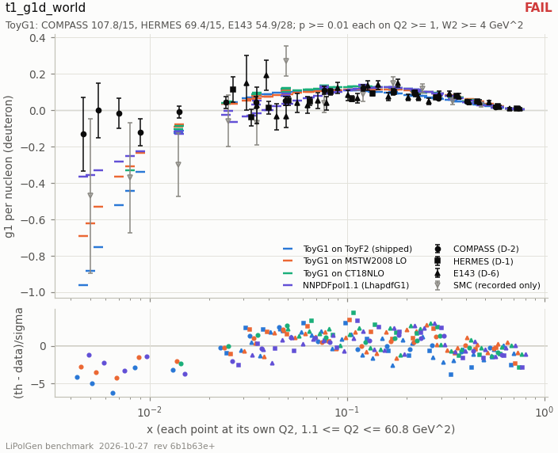

- **status:** **FAIL**
- **vendored data (sha256 of every byte):** `data/nnpdf_COMPASS15_NC_NOTFIXED_MUD.json` `35ef52704ee46f4f7cd49803fc452e3a759a10fa91547f4378307e16b45c7892`; `data/nnpdf_E143_NC_NOTFIXED_ED.json` `5b5d7faefef49e3b8c3c17cdac3f277921799c2b3d42c721eb7366eccb623915`; `data/nnpdf_HERMES_NC_7GEV_ED.json` `5b397977b8937866a92bf02693d1e7103b1c871933be0b9df32e3e4f5e0cc0e8`; `data/nnpdf_SMC_NC_NOTFIXED_MUD.json` `8543a2919d8d9b6be0d31b77bf701679498499e054b876149655e01a0911c4fb`

| sub-row | status | values / reason |
|---|---|---|
| `toy` | **FAIL** | label = ToyG1 on ToyF2 (shipped default); q2_floor = 1; kernel_max_rel_diff = 0; world_chi2 = 232.16; world_ndf = 58; world_p = 1.0827e-22 |
| `toy/compass` | **FAIL** | all.n = 15; all.chi2 = 107.849; all.p = 4.16788e-16; all.chi2_cov = n/a; all.p_cov = n/a; all.worst_pull = -6.20059; all.worst_x = 0.00699; all.worst_q2 = 1.39; dis.n = 15; dis.chi2 = 107.849; dis.p = 4.16788e-16; dis.chi2_cov = n/a; dis.p_cov = n/a; dis.worst_pull = -6.20059; dis.worst_x = 0.00699; dis.worst_q2 = 1.39; dis_no_dstate.n = 15; dis_no_dstate.chi2 = 126.37; dis_no_dstate.p = 1.08961e-19; dis_no_dstate.chi2_cov = n/a; dis_no_dstate.p_cov = n/a; dis_no_dstate.worst_pull = -6.66364; dis_no_dstate.worst_x = 0.00699; dis_no_dstate.worst_q2 = 1.39; verdict_differs_under_full_cov = false |
| `toy/hermes` | **FAIL** | all.n = 15; all.chi2 = 69.3839; all.p = 5.74999e-09; all.chi2_cov = 104.46; all.p_cov = 1.85198e-15; all.worst_pull = -3.82896; all.worst_x = 0.3598; all.worst_q2 = 7.24; dis.n = 15; dis.chi2 = 69.3839; dis.p = 5.74999e-09; dis.chi2_cov = 104.46; dis.p_cov = 1.85198e-15; dis.worst_pull = -3.82896; dis.worst_x = 0.3598; dis.worst_q2 = 7.24; dis_no_dstate.n = 15; dis_no_dstate.chi2 = 71.1673; dis_no_dstate.p = 2.7653e-09; dis_no_dstate.chi2_cov = 111.031; dis_no_dstate.p_cov = 1.02198e-16; dis_no_dstate.worst_pull = 3.54256; dis_no_dstate.worst_x = 0.1059; dis_no_dstate.worst_q2 = 2.97; verdict_differs_under_full_cov = false |
| `toy/e143` | **FAIL** | all.n = 28; all.chi2 = 54.927; all.p = 0.00173472; all.chi2_cov = 51.5262; all.p_cov = 0.00434788; all.worst_pull = -2.58094; all.worst_x = 0.182; all.worst_q2 = 4.34; dis.n = 28; dis.chi2 = 54.927; dis.p = 0.00173472; dis.chi2_cov = 51.5262; dis.p_cov = 0.00434788; dis.worst_pull = -2.58094; dis.worst_x = 0.182; dis.worst_q2 = 4.34; dis_no_dstate.n = 28; dis_no_dstate.chi2 = 55.5093; dis_no_dstate.p = 0.00147565; dis_no_dstate.chi2_cov = 54.6984; dis_no_dstate.p_cov = 0.00184783; dis_no_dstate.worst_pull = 2.35372; dis_no_dstate.worst_x = 0.049; dis_no_dstate.worst_q2 = 1.78; verdict_differs_under_full_cov = false |
| `toy/smc` | **PASS** (recorded, not in the verdict) | all.n = 13; all.chi2 = 46.1559; all.p = 1.34037e-05; all.chi2_cov = n/a; all.p_cov = n/a; all.worst_pull = -5.4317; all.worst_x = 0.002; all.worst_q2 = 0.5; dis.n = 12; dis.chi2 = 16.6525; dis.p = 0.163143; dis.chi2_cov = n/a; dis.p_cov = n/a; dis.worst_pull = -1.83408; dis.worst_x = 0.049; dis.worst_q2 = 10; dis_no_dstate.n = 12; dis_no_dstate.chi2 = 16.5038; dis_no_dstate.p = 0.169237; dis_no_dstate.chi2_cov = n/a; dis_no_dstate.p_cov = n/a; dis_no_dstate.worst_pull = 1.90061; dis_no_dstate.worst_x = 0.077; dis_no_dstate.worst_q2 = 14.4; verdict_differs_under_full_cov = false |
| `mstw` | **FAIL** | label = ToyG1 on MstwSF (MSTW2008 LO, PYTHIA 8.317 pdfdata; the --unpol-sf mstw g1); q2_floor = 1; kernel_max_rel_diff = 0; world_chi2 = 150.615; world_ndf = 58; world_p = 3.61869e-10 |
| `mstw/compass` | **FAIL** | all.n = 15; all.chi2 = 53.237; all.p = 3.52132e-06; all.chi2_cov = n/a; all.p_cov = n/a; all.worst_pull = -4.26403; all.worst_x = 0.00699; all.worst_q2 = 1.39; dis.n = 15; dis.chi2 = 53.237; dis.p = 3.52132e-06; dis.chi2_cov = n/a; dis.p_cov = n/a; dis.worst_pull = -4.26403; dis.worst_x = 0.00699; dis.worst_q2 = 1.39; dis_no_dstate.n = 15; dis_no_dstate.chi2 = 66.2986; dis_no_dstate.p = 2.02092e-08; dis_no_dstate.chi2_cov = n/a; dis_no_dstate.p_cov = n/a; dis_no_dstate.worst_pull = -4.5869; dis_no_dstate.worst_x = 0.00699; dis_no_dstate.worst_q2 = 1.39; verdict_differs_under_full_cov = false |
| `mstw/hermes` | **FAIL** | all.n = 15; all.chi2 = 47.1342; all.p = 3.50414e-05; all.chi2_cov = 68.8271; all.p_cov = 7.22068e-09; all.worst_pull = 3.37598; all.worst_x = 0.1059; all.worst_q2 = 2.97; dis.n = 15; dis.chi2 = 47.1342; dis.p = 3.50414e-05; dis.chi2_cov = 68.8271; dis.p_cov = 7.22068e-09; dis.worst_pull = 3.37598; dis.worst_x = 0.1059; dis.worst_q2 = 2.97; dis_no_dstate.n = 15; dis_no_dstate.chi2 = 64.0401; dis_no_dstate.p = 5.02998e-08; dis_no_dstate.chi2_cov = 94.6119; dis_no_dstate.p_cov = 1.35733e-13; dis_no_dstate.worst_pull = 3.92619; dis_no_dstate.worst_x = 0.1059; dis_no_dstate.worst_q2 = 2.97; verdict_differs_under_full_cov = false |
| `mstw/e143` | **FAIL** | all.n = 28; all.chi2 = 50.2437; all.p = 0.0060742; all.chi2_cov = 51.3395; all.p_cov = 0.00456668; all.worst_pull = 2.82365; all.worst_x = 0.259; all.worst_q2 = 5.26; dis.n = 28; dis.chi2 = 50.2437; dis.p = 0.0060742; dis.chi2_cov = 51.3395; dis.p_cov = 0.00456668; dis.worst_pull = 2.82365; dis.worst_x = 0.259; dis.worst_q2 = 5.26; dis_no_dstate.n = 28; dis_no_dstate.chi2 = 61.4966; dis_no_dstate.p = 0.000261336; dis_no_dstate.chi2_cov = 60.9935; dis_no_dstate.p_cov = 0.000303612; dis_no_dstate.worst_pull = 3.22924; dis_no_dstate.worst_x = 0.259; dis_no_dstate.worst_q2 = 5.26; verdict_differs_under_full_cov = false |
| `mstw/smc` | **PASS** (recorded, not in the verdict) | all.n = 13; all.chi2 = 20.6699; all.p = 0.0797187; all.chi2_cov = n/a; all.p_cov = n/a; all.worst_pull = -2.5037; all.worst_x = 0.002; all.worst_q2 = 0.5; dis.n = 12; dis.chi2 = 14.4014; dis.p = 0.275812; dis.chi2_cov = n/a; dis.p_cov = n/a; dis.worst_pull = -1.92466; dis.worst_x = 0.049; dis.worst_q2 = 10; dis_no_dstate.n = 12; dis_no_dstate.chi2 = 14.7566; dis_no_dstate.p = 0.255017; dis_no_dstate.chi2_cov = n/a; dis_no_dstate.p_cov = n/a; dis_no_dstate.worst_pull = 1.84943; dis_no_dstate.worst_x = 0.077; dis_no_dstate.worst_q2 = 14.4; verdict_differs_under_full_cov = false |
| `ct18nlo` | **FAIL** | label = ToyG1 on LhapdfSF(CT18NLO); q2_floor = 1.67702; kernel_max_rel_diff = 0; world_chi2 = 143.433; world_ndf = 46; world_p = 6.05607e-12 |
| `ct18nlo/compass` | **PASS** | all.n = 15; all.chi2 = 52.606; all.p = 4.48306e-06; all.chi2_cov = n/a; all.p_cov = n/a; all.worst_pull = -4.02636; all.worst_x = 0.00699; all.worst_q2 = 1.39; dis.n = 11; dis.chi2 = 20.1805; dis.p = 0.0429258; dis.chi2_cov = n/a; dis.p_cov = n/a; dis.worst_pull = 2.67972; dis.worst_x = 0.0487; dis.worst_q2 = 6.06; dis_no_dstate.n = 11; dis_no_dstate.chi2 = 28.8265; dis_no_dstate.p = 0.00241494; dis_no_dstate.chi2_cov = n/a; dis_no_dstate.p_cov = n/a; dis_no_dstate.worst_pull = 3.01996; dis_no_dstate.worst_x = 0.0487; dis_no_dstate.worst_q2 = 6.06; verdict_differs_under_full_cov = false |
| `ct18nlo/hermes` | **FAIL** | all.n = 15; all.chi2 = 78.3829; all.p = 1.37811e-10; all.chi2_cov = 125.453; all.p_cov = 1.64475e-19; all.worst_pull = 4.35385; all.worst_x = 0.1059; all.worst_q2 = 2.97; dis.n = 11; dis.chi2 = 64.2977; dis.p = 1.46034e-09; dis.chi2_cov = 100.828; dis.p_cov = 1.22406e-16; dis.worst_pull = 4.35385; dis.worst_x = 0.1059; dis.worst_q2 = 2.97; dis_no_dstate.n = 11; dis_no_dstate.chi2 = 85.9997; dis_no_dstate.p = 1.00903e-13; dis_no_dstate.chi2_cov = 134.528; dis_no_dstate.p_cov = 2.10515e-23; dis_no_dstate.worst_pull = 4.97484; dis_no_dstate.worst_x = 0.1059; dis_no_dstate.worst_q2 = 2.97; verdict_differs_under_full_cov = false |
| `ct18nlo/e143` | **FAIL** | all.n = 28; all.chi2 = 64.6137; all.p = 0.000101511; all.chi2_cov = 65.0538; all.p_cov = 8.86272e-05; all.worst_pull = 3.02528; all.worst_x = 0.259; all.worst_q2 = 5.26; dis.n = 24; dis.chi2 = 58.9552; dis.p = 8.95758e-05; dis.chi2_cov = 59.0282; dis.p_cov = 8.74917e-05; dis.worst_pull = 3.02528; dis.worst_x = 0.259; dis.worst_q2 = 5.26; dis_no_dstate.n = 24; dis_no_dstate.chi2 = 74.3472; dis_no_dstate.p = 4.7121e-07; dis_no_dstate.chi2_cov = 71.4846; dis_no_dstate.p_cov = 1.29996e-06; dis_no_dstate.worst_pull = 3.44547; dis_no_dstate.worst_x = 0.259; dis_no_dstate.worst_q2 = 5.26; verdict_differs_under_full_cov = false |
| `ct18nlo/smc` | **PASS** (recorded, not in the verdict) | all.n = 13; all.chi2 = 15.1819; all.p = 0.296135; all.chi2_cov = n/a; all.p_cov = n/a; all.worst_pull = 1.91576; all.worst_x = 0.077; all.worst_q2 = 14.4; dis.n = 11; dis.chi2 = 14.13; dis.p = 0.225885; dis.chi2_cov = n/a; dis.p_cov = n/a; dis.worst_pull = 1.91576; dis.worst_x = 0.077; dis.worst_q2 = 14.4; dis_no_dstate.n = 11; dis_no_dstate.chi2 = 14.729; dis_no_dstate.p = 0.195243; dis_no_dstate.chi2_cov = n/a; dis_no_dstate.p_cov = n/a; dis_no_dstate.worst_pull = 2.11122; dis_no_dstate.worst_x = 0.077; dis_no_dstate.worst_q2 = 14.4; verdict_differs_under_full_cov = false |
| `nnpdfpol` | **FAIL** | label = LhapdfG1(NNPDFpol11_100); q2_floor = 1; kernel_max_rel_diff = 0; world_chi2 = 148.534; world_ndf = 58; world_p = 6.9932e-10 |
| `nnpdfpol/compass` | **FAIL** | all.n = 15; all.chi2 = 44.9962; all.p = 7.66775e-05; all.chi2_cov = n/a; all.p_cov = n/a; all.worst_pull = -3.66746; all.worst_x = 0.0141; all.worst_q2 = 2.19; dis.n = 15; dis.chi2 = 44.9962; dis.p = 7.66775e-05; dis.chi2_cov = n/a; dis.p_cov = n/a; dis.worst_pull = -3.66746; dis.worst_x = 0.0141; dis.worst_q2 = 2.19; dis_no_dstate.n = 15; dis_no_dstate.chi2 = 56.3872; dis_no_dstate.p = 1.04226e-06; dis_no_dstate.chi2_cov = n/a; dis_no_dstate.p_cov = n/a; dis_no_dstate.worst_pull = -3.95485; dis_no_dstate.worst_x = 0.0141; dis_no_dstate.worst_q2 = 2.19; verdict_differs_under_full_cov = false |
| `nnpdfpol/hermes` | **FAIL** | all.n = 15; all.chi2 = 52.5812; all.p = 4.52562e-06; all.chi2_cov = 78.4885; all.p_cov = 1.31839e-10; all.worst_pull = 3.36153; all.worst_x = 0.1059; all.worst_q2 = 2.97; dis.n = 15; dis.chi2 = 52.5812; dis.p = 4.52562e-06; dis.chi2_cov = 78.4885; dis.p_cov = 1.31839e-10; dis.worst_pull = 3.36153; dis.worst_x = 0.1059; dis.worst_q2 = 2.97; dis_no_dstate.n = 15; dis_no_dstate.chi2 = 67.4753; dis_no_dstate.p = 1.25314e-08; dis_no_dstate.chi2_cov = 103.694; dis_no_dstate.p_cov = 2.59149e-15; dis_no_dstate.worst_pull = 3.91069; dis_no_dstate.worst_x = 0.1059; dis_no_dstate.worst_q2 = 2.97; verdict_differs_under_full_cov = false |
| `nnpdfpol/e143` | **FAIL** | all.n = 28; all.chi2 = 50.9561; all.p = 0.00504885; all.chi2_cov = 52.2255; all.p_cov = 0.00361283; all.worst_pull = 3.03754; all.worst_x = 0.259; all.worst_q2 = 5.26; dis.n = 28; dis.chi2 = 50.9561; dis.p = 0.00504885; dis.chi2_cov = 52.2255; dis.p_cov = 0.00361283; dis.worst_pull = 3.03754; dis.worst_x = 0.259; dis.worst_q2 = 5.26; dis_no_dstate.n = 28; dis_no_dstate.chi2 = 61.9241; dis_no_dstate.p = 0.000229936; dis_no_dstate.chi2_cov = 61.8409; dis_no_dstate.p_cov = 0.000235751; dis_no_dstate.worst_pull = 3.45862; dis_no_dstate.worst_x = 0.259; dis_no_dstate.worst_q2 = 5.26; verdict_differs_under_full_cov = false |
| `nnpdfpol/smc` | **PASS** (recorded, not in the verdict) | all.n = 13; all.chi2 = 13.4201; all.p = 0.415911; all.chi2_cov = n/a; all.p_cov = n/a; all.worst_pull = -2.13162; all.worst_x = 0.049; all.worst_q2 = 10; dis.n = 12; dis.chi2 = 13.4165; dis.p = 0.339508; dis.chi2_cov = n/a; dis.p_cov = n/a; dis.worst_pull = -2.13162; dis.worst_x = 0.049; dis.worst_q2 = 10; dis_no_dstate.n = 12; dis_no_dstate.chi2 = 13.8057; dis_no_dstate.p = 0.31329; dis_no_dstate.chi2_cov = n/a; dis_no_dstate.p_cov = n/a; dis_no_dstate.worst_pull = -2.04891; dis_no_dstate.worst_x = 0.049; dis_no_dstate.worst_q2 = 10; verdict_differs_under_full_cov = false |

### t1_hermes_f2d

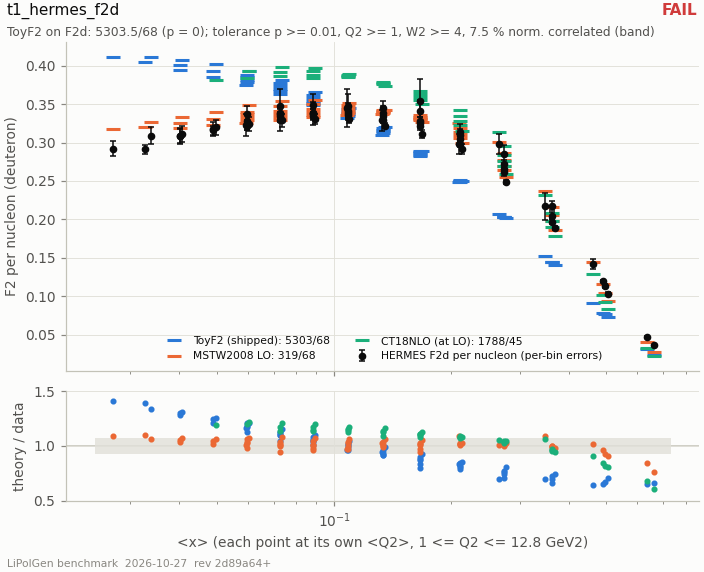

- **status:** **FAIL**
- **vendored data (sha256 of every byte):** `data/hepdata_ins894309_hermes_f2.json` `d32f7ea09a18ee59bf2515071ea149c29dad9a3def3490e64bf46384a7b26875`; `data/hermes2005_b1d_table2.json` `20b9104edf52414822e88305f7144566568ee2979bd531f77dd79f3a92006fc5`; `data/whitlow1990_r1990.json` `ce330eeef6305315a78d66422ff81fe8307bf71fdca4b8ef6e781e71698591d9`
- **config:** data_file_sha256 = d32f7ea09a18ee59bf2515071ea149c29dad9a3def3490e64bf46384a7b26875; b1_file_sha256 = 20b9104edf52414822e88305f7144566568ee2979bd531f77dd79f3a92006fc5; r1990_file_sha256 = ce330eeef6305315a78d66422ff81fe8307bf71fdca4b8ef6e781e71698591d9

| sub-row | status | values / reason |
|---|---|---|
| `toy` | **FAIL** | name = toy; label = ToyF2 (shipped default); q2_floor = 1; kernel_max_rel_diff = 0 |
| `toy/deuteron` | **FAIL** | n = 68; chi2 = 5303.46; p = 0; norm_pull = 0.690468; chi2_pp = 5718.45; p_pp = 0; chi2_quad = 455.165; p_quad = 1.19338e-58; mean_ratio = 0.965437; worst_pull_pp = -26.5753; worst_x = 0.49; worst_q2 = 6.026 |
| `toy/proton` | **FAIL** | n = 68; chi2 = 5678.47; p = 0; norm_pull = 1.07813; chi2_pp = 6692.88; p_pp = 0; chi2_quad = 515.078; p_quad = 6.77153e-70; mean_ratio = 0.943914; worst_pull_pp = -29.0142; worst_x = 0.49; worst_q2 = 6.026 |
| `mstw` | **FAIL** | name = mstw; label = MstwSF (MSTW2008 LO, PYTHIA 8.317 pdfdata, i_fit 3); q2_floor = 1; kernel_max_rel_diff = 0 |
| `mstw/deuteron` | **FAIL** | n = 68; chi2 = 318.868; p = 4.02669e-34; norm_pull = -0.277514; chi2_pp = 385.907; p_pp = 5.80239e-46; chi2_quad = 31.4303; p_quad = 0.999957; mean_ratio = 1.01267; worst_pull_pp = -9.32104; worst_x = 0.6641; worst_q2 = 12.778 |
| `mstw/proton` | **FAIL** | n = 68; chi2 = 247.791; p = 2.86959e-22; norm_pull = -0.44597; chi2_pp = 421.364; p_pp = 2.07293e-52; chi2_quad = 31.6735; p_quad = 0.99995; mean_ratio = 1.02506; worst_pull_pp = 7.77486; worst_x = 0.1347; worst_q2 = 4.618 |
| `ct18nlo` | **FAIL** | name = ct18nlo; label = LhapdfSF(CT18NLO); q2_floor = 1.67702; kernel_max_rel_diff = 0 |
| `ct18nlo/deuteron` | **FAIL** | n = 45; chi2 = 1788.23; p = 0; norm_pull = -1.00691; chi2_pp = 2535.05; p_pp = 0; chi2_quad = 154.542; p_quad = 6.24561e-14; mean_ratio = 1.05894; worst_pull_pp = 16.543; worst_x = 0.1347; worst_q2 = 4.618 |
| `ct18nlo/proton` | **FAIL** | n = 45; chi2 = 1760.91; p = 0; norm_pull = -1.27387; chi2_pp = 2962.99; p_pp = 0; chi2_quad = 171.899; p_quad = 1.01073e-16; mean_ratio = 1.08297; worst_pull_pp = 18.7739; worst_x = 0.1347; worst_q2 = 4.618 |
| `b1_inversion` | **RECORDED** | name = b1_inversion; reading = per nucleon; geometric_mean = 0.98637; min_ratio = 0.928562; max_ratio = 1.0385; ratios = 0.928562 / 1.0385 / 0.98583 / 0.957806 / 1.0057 / 1.00572; rule = per nucleon iff every ratio in [0.8, 1.25]; per deuteron iff in [1.6, 2.5] |

### t1_nmc_f2d

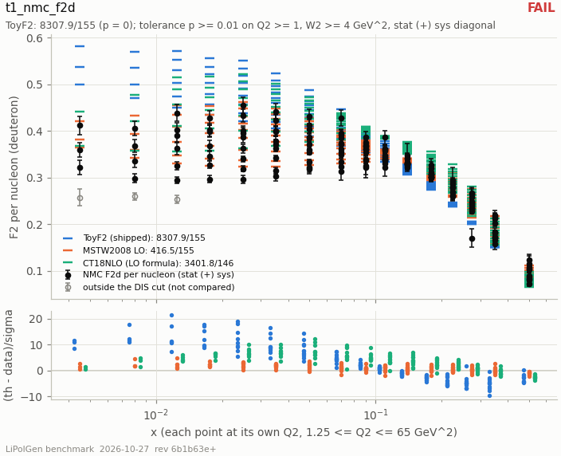

- **status:** **FAIL**
- **vendored data (sha256 of every byte):** `data/nnpdf_NMC_NC_NOTFIXED_D.json` `d38b3c0c06ca4e123983cffd2f647d82d14f272e8ee04e13f73f9fd098af8e3d`

| sub-row | status | values / reason |
|---|---|---|
| `toy` | **FAIL** | label = ToyF2 (shipped default); q2_floor = 1; all.n = 158; all.chi2 = 9582.57; all.p = 0; all.chi2_cov = 24996; all.p_cov = 0; all.mean_ratio = 1.07418; all.worst_pull = 26.0729; all.worst_x = 0.008; all.worst_q2 = 0.75; dis.n = 155; dis.chi2 = 8307.9; dis.p = 0; dis.chi2_cov = 21100.7; dis.p_cov = 0; dis.mean_ratio = 1.06018; dis.worst_pull = 21.4617; dis.worst_x = 0.0125; dis.worst_q2 = 1.25; kernel_max_rel_diff = 0 |
| `mstw` | **FAIL** | label = MstwSF (MSTW2008 LO, PYTHIA 8.317 pdfdata, i_fit 3); q2_floor = 1; all.n = 158; all.chi2 = 485.451; all.p = 5.46777e-35; all.chi2_cov = 1090.25; all.p_cov = 5.18242e-139; all.mean_ratio = 1.02876; all.worst_pull = 5.93528; all.worst_x = 0.008; all.worst_q2 = 0.75; dis.n = 155; dis.chi2 = 416.459; dis.p = 8.21357e-26; dis.chi2_cov = 858.536; dis.p_cov = 6.94928e-98; dis.mean_ratio = 1.02545; dis.worst_pull = 4.96173; dis.worst_x = 0.0125; dis.worst_q2 = 1.25; kernel_max_rel_diff = 0 |
| `ct18nlo` | **FAIL** | label = LhapdfSF(CT18NLO); q2_floor = 1.67702; all.n = 158; all.chi2 = 3523.99; all.p = 0; all.chi2_cov = 6838.21; all.p_cov = 0; all.mean_ratio = 1.07888; all.worst_pull = 12.2692; all.worst_x = 0.05; all.worst_q2 = 2.5; dis.n = 146; dis.chi2 = 3401.76; dis.p = 0; dis.chi2_cov = 4553.94; dis.p_cov = 0; dis.mean_ratio = 1.08624; dis.worst_pull = 12.2692; dis.worst_x = 0.05; dis.worst_q2 = 2.5; kernel_max_rel_diff = 0 |

### t1_nmc_f2d_over_f2p

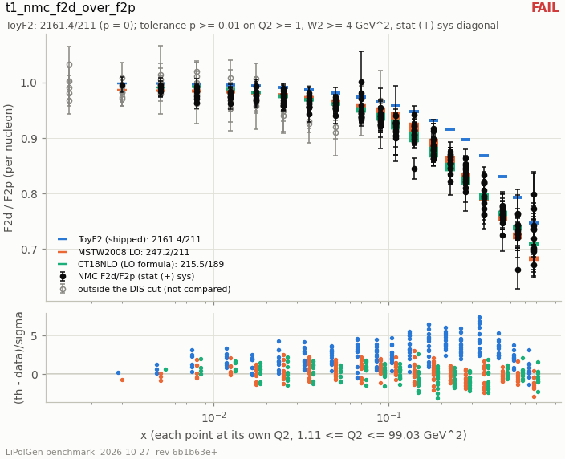

- **status:** **FAIL**
- **vendored data (sha256 of every byte):** `data/nnpdf_NMC_NC_NOTFIXED.json` `47e833cfb399eb984455e09ed37d8833edd20445607cefe0a103545cd8e43900`

| sub-row | status | values / reason |
|---|---|---|
| `toy` | **FAIL** | label = ToyF2 (shipped default); q2_floor = 1; all.n = 260; all.chi2 = 2251.99; all.p = 0; all.chi2_cov = 1464.97; all.p_cov = 6.80022e-167; all.mean_diff = 0.0351552; all.worst_pull = 7.42661; all.worst_x = 0.35; all.worst_q2 = 14.85; all.chi2_legacy_diag = 2245.92; all.chi2_legacy_cov = 990.572; all.p_legacy_cov = 9.33888e-86; dis.n = 211; dis.chi2 = 2161.44; dis.p = 0; dis.chi2_cov = 1154.29; dis.p_cov = 9.28003e-130; dis.mean_diff = 0.0391701; dis.worst_pull = 7.42661; dis.worst_x = 0.35; dis.worst_q2 = 14.85; dis.chi2_legacy_diag = 2155.29; dis.chi2_legacy_cov = 950.707; dis.p_legacy_cov = 2.45165e-94; all_frozen.n = 260; all_frozen.chi2 = 2251.99; all_frozen.p = 0; all_frozen.chi2_cov = 1464.97; all_frozen.p_cov = 6.80022e-167; all_frozen.mean_diff = 0.0351552; all_frozen.worst_pull = 7.42661; all_frozen.worst_x = 0.35; all_frozen.worst_q2 = 14.85; all_frozen.chi2_legacy_diag = 2245.92; all_frozen.chi2_legacy_cov = 990.572; all_frozen.p_legacy_cov = 9.33888e-86; dis_frozen.n = 211; dis_frozen.chi2 = 2161.44; dis_frozen.p = 0; dis_frozen.chi2_cov = 1154.29; dis_frozen.p_cov = 9.28003e-130; dis_frozen.mean_diff = 0.0391701; dis_frozen.worst_pull = 7.42661; dis_frozen.worst_x = 0.35; dis_frozen.worst_q2 = 14.85; dis_frozen.chi2_legacy_diag = 2155.29; dis_frozen.chi2_legacy_cov = 950.707; dis_frozen.p_legacy_cov = 2.45165e-94; max_abs_frozen_minus_q2 = 1.11022e-16; kernel_max_rel_diff = 0 |
| `mstw` | **PASS** | label = MstwSF (MSTW2008 LO, PYTHIA 8.317 pdfdata, i_fit 3); q2_floor = 1; all.n = 260; all.chi2 = 297.896; all.p = 0.0530191; all.chi2_cov = 305.145; all.p_cov = 0.0284317; all.mean_diff = 0.0016849; all.worst_pull = 3.06959; all.worst_x = 0.14; all.worst_q2 = 46.95; all.chi2_legacy_diag = 297.213; all.chi2_legacy_cov = 269.588; all.p_legacy_cov = 0.328324; dis.n = 211; dis.chi2 = 247.179; dis.p = 0.0444218; dis.chi2_cov = 251.635; dis.p_cov = 0.0290014; dis.mean_diff = 0.000627172; dis.worst_pull = 3.06959; dis.worst_x = 0.14; dis.worst_q2 = 46.95; dis.chi2_legacy_diag = 246.498; dis.chi2_legacy_cov = 224.677; dis.p_legacy_cov = 0.246927; all_frozen.n = 260; all_frozen.chi2 = 310.178; all_frozen.p = 0.0177867; all_frozen.chi2_cov = 317.801; all_frozen.p_cov = 0.00826963; all_frozen.mean_diff = 0.00167267; all_frozen.worst_pull = 3.42309; all_frozen.worst_x = 0.14; all_frozen.worst_q2 = 46.95; all_frozen.chi2_legacy_diag = 309.591; all_frozen.chi2_legacy_cov = 282.396; all_frozen.p_legacy_cov = 0.162479; dis_frozen.n = 211; dis_frozen.chi2 = 260.702; dis_frozen.p = 0.0111915; dis_frozen.chi2_cov = 269.079; dis_frozen.p_cov = 0.00421108; dis_frozen.mean_diff = 0.000400036; dis_frozen.worst_pull = 3.42309; dis_frozen.worst_x = 0.14; dis_frozen.worst_q2 = 46.95; dis_frozen.chi2_legacy_diag = 260.108; dis_frozen.chi2_legacy_cov = 239.138; dis_frozen.p_legacy_cov = 0.0892618; max_abs_frozen_minus_q2 = 0.0158072; kernel_max_rel_diff = 0 |
| `ct18nlo` | **PASS** | label = LhapdfSF(CT18NLO); q2_floor = 1.67702; all.n = 260; all.chi2 = 295.361; all.p = 0.0649639; all.chi2_cov = 317.557; all.p_cov = 0.00848358; all.mean_diff = 0.000289167; all.worst_pull = 3.18221; all.worst_x = 0.008; all.worst_q2 = 0.64; all.chi2_legacy_diag = 294.85; all.chi2_legacy_cov = 290.171; all.p_legacy_cov = 0.0961021; dis.n = 189; dis.chi2 = 215.508; dis.p = 0.0903941; dis.chi2_cov = 226.204; dis.p_cov = 0.033293; dis.mean_diff = -0.00122211; dis.worst_pull = -3.07475; dis.worst_x = 0.18; dis.worst_q2 = 5.49; dis.chi2_legacy_diag = 214.689; dis.chi2_legacy_cov = 202.52; dis.p_legacy_cov = 0.237752; all_frozen.n = 260; all_frozen.chi2 = 321.445; all_frozen.p = 0.00560404; all_frozen.chi2_cov = 342.406; all_frozen.p_cov = 0.000452474; all_frozen.mean_diff = 0.000671017; all_frozen.worst_pull = -3.29512; all_frozen.worst_x = 0.18; all_frozen.worst_q2 = 5.49; all_frozen.chi2_legacy_diag = 320.793; all_frozen.chi2_legacy_cov = 300.31; all_frozen.p_legacy_cov = 0.0433854; dis_frozen.n = 189; dis_frozen.chi2 = 239.52; dis_frozen.p = 0.00752728; dis_frozen.chi2_cov = 250.791; dis_frozen.p_cov = 0.00175431; dis_frozen.mean_diff = -0.00127637; dis_frozen.worst_pull = -3.29512; dis_frozen.worst_x = 0.18; dis_frozen.worst_q2 = 5.49; dis_frozen.chi2_legacy_diag = 238.569; dis_frozen.chi2_legacy_cov = 220.018; dis_frozen.p_legacy_cov = 0.0606314; max_abs_frozen_minus_q2 = 0.0166052; kernel_max_rel_diff = 0 |

### t1_r_world

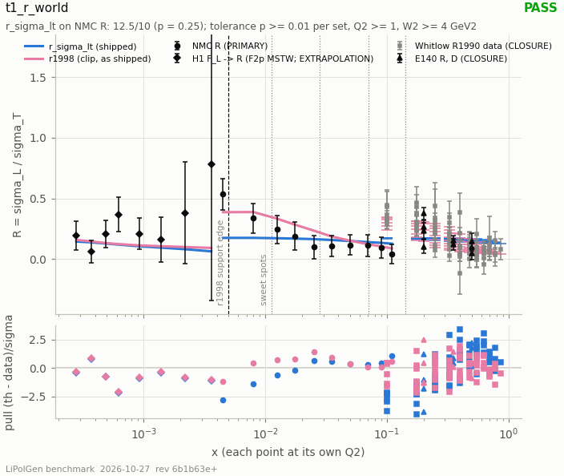

- **status:** **PASS**
- **vendored data (sha256 of every byte):** `data/hepdata_ins296980_whitlow_r.json` `e24ed0929d20da172e5a0e14a283b7d57767a458f08613c9165c25c8aa1435a7`; `data/hepdata_ins360765_e140_r.json` `e5326261b6d604a5ac167293b5577141d2afda6bf7c7b66068e357285c7410f9`; `data/hepdata_ins424154_nmc_r.json` `9a6120c15e817127ef9c9458e26609bd076793f96c8bbc163c20c88f940be952`; `data/hepdata_ins786161_h1_fl.json` `3ea1b6f997ff4f23193b8618520474462a9d7cbe694cddf0d2e701ec9ea76ca6`
- **config:** lipolgen = 0.1.0; python = 3.10.12; data_file_sha256.nmc = 9a6120c15e817127ef9c9458e26609bd076793f96c8bbc163c20c88f940be952; data_file_sha256.h1 = 3ea1b6f997ff4f23193b8618520474462a9d7cbe694cddf0d2e701ec9ea76ca6; data_file_sha256.r1990 = e24ed0929d20da172e5a0e14a283b7d57767a458f08613c9165c25c8aa1435a7; data_file_sha256.e140 = e5326261b6d604a5ac167293b5577141d2afda6bf7c7b66068e357285c7410f9; kernel_config = e(10) x 6Li(99.5/u); kernel_s = 3980

| sub-row | status | values / reason |
|---|---|---|
| `nmc` | **PASS** | name = nmc; label = PRIMARY; n_points = 10; n_dis = 10; n_extrapolated_r1998 = 1; r_sigma_lt.chi2 = 12.5436; r_sigma_lt.ndf = 10; r_sigma_lt.p = 0.250319; r_sigma_lt.status = pass; r_sigma_lt.worst_pull = -2.80931; r_sigma_lt.worst_x = 0.0045; r_sigma_lt.worst_q2 = 1.38; r_sigma_lt.mean_diff = -0.0318641; r_sigma_lt.chi2_correlated = 60.216; r_sigma_lt.p_correlated = 3.29875e-09; r1998.chi2 = 6.20211; r1998.ndf = 10; r1998.p = 0.798007; r1998.status = pass; r1998.worst_pull = 1.42845; r1998.worst_x = 0.025; r1998.worst_q2 = 4.5; r1998.mean_diff = 0.0398146; r1998.chi2_correlated = 21.2813; r1998.p_correlated = 0.0192151; r1998_unclipped.chi2 = 6.19106; r1998_unclipped.ndf = 10; r1998_unclipped.p = 0.798964; r1998_unclipped.status = pass; r1998_unclipped.worst_pull = 1.42845; r1998_unclipped.worst_x = 0.025; r1998_unclipped.worst_q2 = 4.5; r1998_unclipped.mean_diff = 0.0398759; r1998_unclipped.chi2_correlated = 21.221; r1998_unclipped.p_correlated = 0.0196044 |
| `h1` | **PASS** | name = h1; label = EXTRAPOLATION; n_points = 8; n_dis = 8; n_extrapolated_r1998 = 8; r_sigma_lt.chi2 = 8.81805; r_sigma_lt.ndf = 8; r_sigma_lt.p = 0.357877; r_sigma_lt.status = pass; r_sigma_lt.worst_pull = -2.1423; r_sigma_lt.worst_x = 0.00062; r_sigma_lt.worst_q2 = 25; r_sigma_lt.mean_diff = -0.137215; r_sigma_lt.chi2_correlated = 13.3703; r_sigma_lt.p_correlated = 0.0997293; r1998.chi2 = 8.18124; r1998.ndf = 8; r1998.p = 0.415969; r1998.status = pass; r1998.worst_pull = -2.09942; r1998.worst_x = 0.00062; r1998.worst_q2 = 25; r1998.mean_diff = -0.125197; r1998.chi2_correlated = 13.4293; r1998.p_correlated = 0.0979074; r1998_unclipped.chi2 = 8.10529; r1998_unclipped.ndf = 8; r1998_unclipped.p = 0.423253; r1998_unclipped.status = pass; r1998_unclipped.worst_pull = -2.08553; r1998_unclipped.worst_x = 0.00062; r1998_unclipped.worst_q2 = 25; r1998_unclipped.mean_diff = -0.12375; r1998_unclipped.chi2_correlated = 13.5279; r1998_unclipped.p_correlated = 0.0949317; f2_verdict = mstw; f2_mstw.r_sigma_lt = 8.82/8 (p = 0.358); f2_mstw.r1998 = 8.18/8 (p = 0.416); f2_mstw.r1998_unclipped = 8.11/8 (p = 0.423); f2_toy.r_sigma_lt = 6.96/8 (p = 0.541); f2_toy.r1998 = 6.48/8 (p = 0.594); f2_toy.r1998_unclipped = 6.46/8 (p = 0.595); f2_ct18nlo.r_sigma_lt = 8.48/8 (p = 0.388); f2_ct18nlo.r1998 = 7.85/8 (p = 0.448); f2_ct18nlo.r1998_unclipped = 7.78/8 (p = 0.456) |
| `r1990` | **FAIL** | name = r1990; label = CLOSURE; n_points = 89; n_dis = 68; n_extrapolated_r1998 = 0; r_sigma_lt.chi2 = 209.758; r_sigma_lt.ndf = 68; r_sigma_lt.p = 2.27574e-16; r_sigma_lt.status = fail; r_sigma_lt.worst_pull = -4.04134; r_sigma_lt.worst_x = 0.175; r_sigma_lt.worst_q2 = 1.25; r_sigma_lt.mean_diff = -0.0142857; r1998.chi2 = 63.0512; r1998.ndf = 68; r1998.p = 0.647119; r1998.status = pass; r1998.worst_pull = -2.15094; r1998.worst_x = 0.175; r1998.worst_q2 = 1.25; r1998.mean_diff = -0.0245484; r1998_unclipped.chi2 = 63.0512; r1998_unclipped.ndf = 68; r1998_unclipped.p = 0.647119; r1998_unclipped.status = pass; r1998_unclipped.worst_pull = -2.15094; r1998_unclipped.worst_x = 0.175; r1998_unclipped.worst_q2 = 1.25; r1998_unclipped.mean_diff = -0.0245484 |
| `e140` | **FAIL** | name = e140; label = CLOSURE; n_points = 11; n_dis = 9; n_extrapolated_r1998 = 0; r_sigma_lt.chi2 = 29.6571; r_sigma_lt.ndf = 9; r_sigma_lt.p = 0.000501699; r_sigma_lt.status = fail; r_sigma_lt.worst_pull = -3.82229; r_sigma_lt.worst_x = 0.2; r_sigma_lt.worst_q2 = 1; r_sigma_lt.mean_diff = -0.00660935; r_sigma_lt.chi2_correlated = 29.4592; r_sigma_lt.p_correlated = 0.000541994; r1998.chi2 = 12.7147; r1998.ndf = 9; r1998.p = 0.175947; r1998.status = pass; r1998.worst_pull = 2.45425; r1998.worst_x = 0.2; r1998.worst_q2 = 2.5; r1998.mean_diff = 0.00487823; r1998.chi2_correlated = 12.0682; r1998.p_correlated = 0.209493; r1998_unclipped.chi2 = 12.7147; r1998_unclipped.ndf = 9; r1998_unclipped.p = 0.175947; r1998_unclipped.status = pass; r1998_unclipped.worst_pull = 2.45425; r1998_unclipped.worst_x = 0.2; r1998_unclipped.worst_q2 = 2.5; r1998_unclipped.mean_diff = 0.00487823; r1998_unclipped.chi2_correlated = 12.0682; r1998_unclipped.p_correlated = 0.209493 |
| `bias[spot 2 x=0.0112 Q2=1.14]` | **RECORDED** | name = bias[spot 2 x=0.0112 Q2=1.14]; x = 0.0112; q2 = 1.14; y_mid_config = 0.0255743; r_sigma_lt = 0.175987; r1998 = 0.39326; r1998_spread = 0.0820717; r1998_fit_error = 0.0307952; ratio_1pR = 1.18476; kernel_a2_ratio = 0.844092; closed_form_a2_ratio = 0.844092; in_r1998_support = true; nmc_nearest_r = 0.246; nmc_nearest_x = 0.0125; nmc_nearest_q2 = 2.2; nmc_nearest_err = 0.116056 |
| `bias[spot 1 x=0.0282 Q2=1.14]` | **RECORDED** | name = bias[spot 1 x=0.0282 Q2=1.14]; x = 0.0282; q2 = 1.14; y_mid_config = 0.0101572; r_sigma_lt = 0.175987; r1998 = 0.385264; r1998_spread = 0.062039; r1998_fit_error = 0.0284048; ratio_1pR = 1.17796; kernel_a2_ratio = 0.848932; closed_form_a2_ratio = 0.848932; in_r1998_support = true; nmc_nearest_r = 0.099; nmc_nearest_x = 0.025; nmc_nearest_q2 = 4.5; nmc_nearest_err = 0.0955196 |
| `bias[spot 3 x=0.0708 Q2=3.13]` | **RECORDED** | name = bias[spot 3 x=0.0708 Q2=3.13]; x = 0.0708; q2 = 3.13; y_mid_config = 0.0111078; r_sigma_lt = 0.169396; r1998 = 0.258549; r1998_spread = 0.00803259; r1998_fit_error = 0.0163821; ratio_1pR = 1.07624; kernel_a2_ratio = 0.929165; closed_form_a2_ratio = 0.929165; in_r1998_support = true; nmc_nearest_r = 0.113; nmc_nearest_x = 0.07; nmc_nearest_q2 = 14.1; nmc_nearest_err = 0.0904268 |
| `bias[spot 4 x=0.141 Q2=14.3]` | **RECORDED** | name = bias[spot 4 x=0.141 Q2=14.3]; x = 0.141; q2 = 14.3; y_mid_config = 0.025482; r_sigma_lt = 0.139969; r1998 = 0.0901742; r1998_spread = 0.00520754; r1998_fit_error = 0.00777492; ratio_1pR = 0.956319; kernel_a2_ratio = 1.04566; closed_form_a2_ratio = 1.04566; in_r1998_support = true; nmc_nearest_r = 0.043; nmc_nearest_x = 0.11; nmc_nearest_q2 = 20.6; nmc_nearest_err = 0.0785493 |

### t2_boeglin_nk

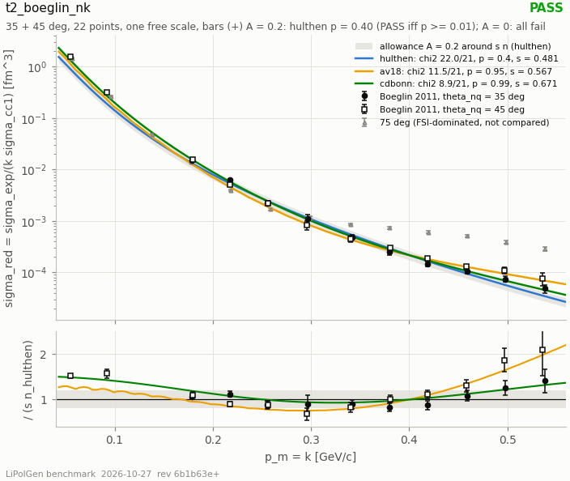

- **status:** **PASS**
- **vendored data (sha256 of every byte):** `data/boeglin2011_deuteron_pmiss.csv` `07a6fedecabeadb5124b2dcd3bdce0865e4986151448cad48b13066b9b653334`
- **config:** lipolgen = 0.1.0; python = 3.10.12; data_file_sha256 = 07a6fedecabeadb5124b2dcd3bdce0865e4986151448cad48b13066b9b653334; design_block_sha256 = 437eab47375bd87d96e194c1b5706dd87a52f7b116101776e7adf4920089625d; bg_pdf_sha256 = b9abd4132e4736ac195d608d43354d3774c2ca233a587495adb1e31395c70f91; bg_page = 5; allowance = 0.2; k_identification = instant form, k = p_m (the paper's PWIA reduction)

| sub-row | status | values / reason |
|---|---|---|
| `nk[hulthen]` | **PASS** | name = nk[hulthen]; chi2 = 21.9837; ndf = 21; p = 0.400449; s = 0.481148; s_err = 0.0242033; max_abs_pull = 1.91459 |
| `nk[av18]` | **PASS** (recorded, not in the verdict) | name = nk[av18]; chi2 = 11.5375; ndf = 21; p = 0.95127; s = 0.566668; s_err = 0.0281358; max_abs_pull = 1.53648 |
| `nk[cdbonn]` | **PASS** (recorded, not in the verdict) | name = nk[cdbonn]; chi2 = 8.88738; ndf = 21; p = 0.990073; s = 0.671447; s_err = 0.0332299; max_abs_pull = 1.51652 |
| `closure[paper CD-Bonn PWIA / tree cdbonn n]` | **RECORDED** (recorded, not in the verdict) | name = closure[paper CD-Bonn PWIA / tree cdbonn n]; mean = 0.90193; min = 0.87582; max = 0.934274 |
| `paper[Paris PWIA / CD-Bonn PWIA]` | **RECORDED** (recorded, not in the verdict) | name = paper[Paris PWIA / CD-Bonn PWIA]; mean = 1.16054; min = 0.939071; max = 1.71447 |
| `theory[paper CD-Bonn PWIA vs hulthen]` | **RECORDED** (recorded, not in the verdict) | name = theory[paper CD-Bonn PWIA vs hulthen]; s = 0.678975; min_ratio = 0.823027; max_ratio = 1.29991 |
| `theory[paper CD-Bonn PWIA vs av18]` | **RECORDED** (recorded, not in the verdict) | name = theory[paper CD-Bonn PWIA vs av18]; s = 0.751392; min_ratio = 0.644199; max_ratio = 1.26915 |
| `theory[paper CD-Bonn PWIA vs cdbonn]` | **RECORDED** (recorded, not in the verdict) | name = theory[paper CD-Bonn PWIA vs cdbonn]; s = 0.901764; min_ratio = 0.97123; max_ratio = 1.03605 |
| `no_allowance[hulthen]` | **RECORDED** (recorded, not in the verdict) | name = no_allowance[hulthen]; chi2 = 185.907; ndf = 21; p = 2.09561e-28; s = 0.528416 |
| `no_allowance[av18]` | **RECORDED** (recorded, not in the verdict) | name = no_allowance[av18]; chi2 = 66.4996; ndf = 21; p = 1.26486e-06; s = 0.615786 |
| `no_allowance[cdbonn]` | **RECORDED** (recorded, not in the verdict) | name = no_allowance[cdbonn]; chi2 = 60.3476; ndf = 21; p = 1.1313e-05; s = 0.693362 |
| `panel_a[35 deg, hulthen]` | **RECORDED** (recorded, not in the verdict) | name = panel_a[35 deg, hulthen]; chi2 = 4.24317; ndf = 9; p = 0.894691; s = 0.468202 |
| `panel_a[35 deg, av18]` | **RECORDED** (recorded, not in the verdict) | name = panel_a[35 deg, av18]; chi2 = 7.10808; ndf = 9; p = 0.625868; s = 0.52192 |
| `panel_a[35 deg, cdbonn]` | **RECORDED** (recorded, not in the verdict) | name = panel_a[35 deg, cdbonn]; chi2 = 1.18075; ndf = 9; p = 0.998895; s = 0.64979 |
| `panel_b[45 deg, hulthen]` | **RECORDED** (recorded, not in the verdict) | name = panel_b[45 deg, hulthen]; chi2 = 17.4717; ndf = 11; p = 0.0946778; s = 0.493315 |
| `panel_b[45 deg, av18]` | **RECORDED** (recorded, not in the verdict) | name = panel_b[45 deg, av18]; chi2 = 1.70482; ndf = 11; p = 0.999294; s = 0.614868 |
| `panel_b[45 deg, cdbonn]` | **RECORDED** (recorded, not in the verdict) | name = panel_b[45 deg, cdbonn]; chi2 = 7.31114; ndf = 11; p = 0.773356; s = 0.691612 |
| `ms_fsi[CD-Bonn FSI / PWIA]` | **RECORDED** (recorded, not in the verdict) | name = ms_fsi[CD-Bonn FSI / PWIA]; min = 0.746105; max = 1.1086; mean = 0.855088; allowance = 0.2 |
| `ratio_route[data / paper CD-Bonn PWIA, 35 deg]` | **RECORDED** (recorded, not in the verdict) | name = ratio_route[data / paper CD-Bonn PWIA, 35 deg]; mean = 0.734752; min = 0.660709; max = 0.825671 |
| `ratio_route[data / paper CD-Bonn PWIA, 45 deg]` | **RECORDED** (recorded, not in the verdict) | name = ratio_route[data / paper CD-Bonn PWIA, 45 deg]; mean = 0.836996; min = 0.575853; max = 1.25507 |
| `fsi_corrected[hulthen x MS FSI/PWIA, A = 0]` | **RECORDED** (recorded, not in the verdict) | name = fsi_corrected[hulthen x MS FSI/PWIA, A = 0]; chi2 = 95.6377; ndf = 21; p = 1.69024e-11; s = 0.633142 |
| `fsi_corrected[av18 x MS FSI/PWIA, A = 0]` | **RECORDED** (recorded, not in the verdict) | name = fsi_corrected[av18 x MS FSI/PWIA, A = 0]; chi2 = 76.6977; ndf = 21; p = 2.85564e-08; s = 0.708167 |
| `fsi_corrected[cdbonn x MS FSI/PWIA, A = 0]` | **RECORDED** (recorded, not in the verdict) | name = fsi_corrected[cdbonn x MS FSI/PWIA, A = 0]; chi2 = 24.399; ndf = 21; p = 0.274131; s = 0.812105 |
| `nk_smooth_table[hulthen, post hoc]` | **PASS** (recorded, not in the verdict) | name = nk_smooth_table[hulthen, post hoc]; post_hoc = true; chi2 = 23.4207; ndf = 21; p = 0.321966; s = 0.501508 |
| `nk_smooth_table[av18, post hoc]` | **PASS** (recorded, not in the verdict) | name = nk_smooth_table[av18, post hoc]; post_hoc = true; chi2 = 14.609; ndf = 21; p = 0.842048; s = 0.586612 |
| `nk_smooth_table[cdbonn, post hoc]` | **PASS** (recorded, not in the verdict) | name = nk_smooth_table[cdbonn, post hoc]; post_hoc = true; chi2 = 8.88738; ndf = 21; p = 0.990073; s = 0.671447 |
| `cell_bias[hulthen, post hoc]` | **RECORDED** (recorded, not in the verdict) | name = cell_bias[hulthen, post hoc]; post_hoc = true; min = 1.0051; max = 1.16048 |
| `cell_bias[av18, post hoc]` | **RECORDED** (recorded, not in the verdict) | name = cell_bias[av18, post hoc]; post_hoc = true; min = 1.00317; max = 1.18076 |
| `panel_c[75 deg]` | **NOT COMPARED** (recorded, not in the verdict) | **reason:** FSI-dominated by the paper's own account; vendored and drawn; name = panel_c[75 deg]; n_points = 13 |

### t2_bonus_spectator_shape

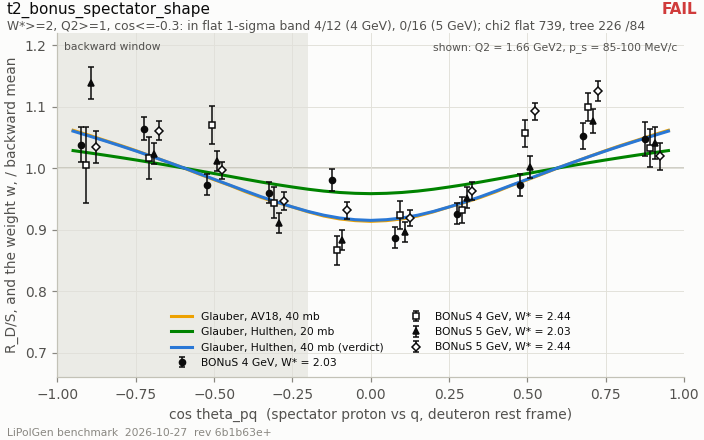

- **status:** **FAIL**
- **vendored data (sha256 of every byte):** `data/bonus2014_tkachenko_supplemental.json` `3636ff08adbd1d7b526b30076e03512164e036c31392e291fbd0fcf6f88d3201`; `data/clas_db_deuteron_query_2026-09-23.json` `340e04a5ae8ada1eabf4d90c2c76c82b07bda48d28c7f43cdffd881c8ee3fa11`; `data/clas_deeps_klimenko2006_f2P.json` `1d98fd11e1b11b1e070e5504f4919b98b87dbabfe29cdca347522ea4f8737256`
- **config:** wave = Hulthen pair, P_D = 0.045 (deuteron_channel() default); sigma_xn_mb = 40; w_star_min = 2; q2_min = 1; backward_cos_max = -0.3; forward_cos_gt = 0; errors = stat; weight_entry = lipolgen.GlauberFsiWeight.weight (library evaluation, no generation)

| sub-row | status | values / reason |
|---|---|---|
| `4GeV/hulthen-40mb` | **FAIL** | wave = Hulthen pair, P_D = 0.045 (deuteron_channel() default); sigma_xn_mb = 40; errors = stat; n_blocks = 12; n_pass = 4; worst_block = Q2=1.66,W\*=2.44,ps=0.135; worst_v_over_delta = 2.62191; chi2_flat_sum = 205.71; chi2_tree_sum = 109.745; ndf_sum = 36; ps = 0.078 / 0.093 / 0.11 / 0.135; v_by_ps = 0.0343603 / 0.0548292 / 0.0848002 / 0.140624; min_delta_by_ps = 0.0138435 / 0.0255109 / 0.050636 / 0.0536341; n_pass_by_ps = 1 / 1 / 1 / 1 |
| `5GeV/hulthen-40mb` | **FAIL** | wave = Hulthen pair, P_D = 0.045 (deuteron_channel() default); sigma_xn_mb = 40; errors = stat; n_blocks = 16; n_pass = 0; worst_block = Q2=1.66,W\*=2.03,ps=0.078; worst_v_over_delta = 3.44139; chi2_flat_sum = 533.66; chi2_tree_sum = 116.586; ndf_sum = 48; ps = 0.078 / 0.093 / 0.11 / 0.135; v_by_ps = 0.0343603 / 0.0548292 / 0.0848002 / 0.140624; min_delta_by_ps = 0.00998442 / 0.0256989 / 0.0504976 / 0.0671543; n_pass_by_ps = 0 / 0 / 0 / 0 |
| `4GeV/av18-40mb` | **FAIL** (recorded, not in the verdict) | wave = AV18 (deuteron_channel(source=VmcAV18), fdeut.av18); sigma_xn_mb = 40; errors = stat; n_blocks = 12; n_pass = 3; worst_block = Q2=1.66,W\*=2.44,ps=0.135; worst_v_over_delta = 2.80656; chi2_flat_sum = 205.71; chi2_tree_sum = 112.433; ndf_sum = 36; ps = 0.078 / 0.093 / 0.11 / 0.135; v_by_ps = 0.0355448 / 0.0555172 / 0.0870995 / 0.150527; min_delta_by_ps = 0.0138435 / 0.0255109 / 0.050636 / 0.0536341; n_pass_by_ps = 1 / 1 / 1 / 0 |
| `5GeV/av18-40mb` | **FAIL** (recorded, not in the verdict) | wave = AV18 (deuteron_channel(source=VmcAV18), fdeut.av18); sigma_xn_mb = 40; errors = stat; n_blocks = 16; n_pass = 0; worst_block = Q2=1.66,W\*=2.03,ps=0.078; worst_v_over_delta = 3.56003; chi2_flat_sum = 533.66; chi2_tree_sum = 109.19; ndf_sum = 48; ps = 0.078 / 0.093 / 0.11 / 0.135; v_by_ps = 0.0355448 / 0.0555172 / 0.0870995 / 0.150527; min_delta_by_ps = 0.00998442 / 0.0256989 / 0.0504976 / 0.0671543; n_pass_by_ps = 0 / 0 / 0 / 0 |
| `4GeV/hulthen-20mb` | **FAIL** (recorded, not in the verdict) | wave = Hulthen pair, P_D = 0.045 (deuteron_channel() default); sigma_xn_mb = 20; errors = stat; n_blocks = 12; n_pass = 8; worst_block = Q2=1.66,W\*=2.44,ps=0.135; worst_v_over_delta = 1.2635; chi2_flat_sum = 205.71; chi2_tree_sum = 129.182; ndf_sum = 36; ps = 0.078 / 0.093 / 0.11 / 0.135; v_by_ps = 0.016602 / 0.0264467 / 0.0407216 / 0.0677665; min_delta_by_ps = 0.0138435 / 0.0255109 / 0.050636 / 0.0536341; n_pass_by_ps = 2 / 2 / 3 / 1 |
| `5GeV/hulthen-20mb` | **FAIL** (recorded, not in the verdict) | wave = Hulthen pair, P_D = 0.045 (deuteron_channel() default); sigma_xn_mb = 20; errors = stat; n_blocks = 16; n_pass = 13; worst_block = Q2=1.66,W\*=2.03,ps=0.078; worst_v_over_delta = 1.66279; chi2_flat_sum = 533.66; chi2_tree_sum = 274.116; ndf_sum = 48; ps = 0.078 / 0.093 / 0.11 / 0.135; v_by_ps = 0.016602 / 0.0264467 / 0.0407216 / 0.0677665; min_delta_by_ps = 0.00998442 / 0.0256989 / 0.0504976 / 0.0671543; n_pass_by_ps = 3 / 3 / 4 / 3 |
| `4GeV/hulthen-40mb stat+syst` | **FAIL** (recorded, not in the verdict) | wave = Hulthen pair, P_D = 0.045 (deuteron_channel() default); sigma_xn_mb = 40; errors = stat (+) syst; n_blocks = 12; n_pass = 8; worst_block = Q2=1.66,W\*=2.03,ps=0.135; worst_v_over_delta = 2.32405; chi2_flat_sum = 23.4865; chi2_tree_sum = 19.0192; ndf_sum = 36; ps = 0.078 / 0.093 / 0.11 / 0.135; v_by_ps = 0.0343603 / 0.0548292 / 0.0848002 / 0.140624; min_delta_by_ps = 0.0600753 / 0.0586707 / 0.0594083 / 0.0605081; n_pass_by_ps = 3 / 3 / 1 / 1 |
| `5GeV/hulthen-40mb stat+syst` | **FAIL** (recorded, not in the verdict) | wave = Hulthen pair, P_D = 0.045 (deuteron_channel() default); sigma_xn_mb = 40; errors = stat (+) syst; n_blocks = 16; n_pass = 8; worst_block = Q2=1.66,W\*=2.03,ps=0.135; worst_v_over_delta = 1.80652; chi2_flat_sum = 33.8923; chi2_tree_sum = 9.13277; ndf_sum = 48; ps = 0.078 / 0.093 / 0.11 / 0.135; v_by_ps = 0.0343603 / 0.0548292 / 0.0848002 / 0.140624; min_delta_by_ps = 0.0578903 / 0.057309 / 0.0574677 / 0.0778425; n_pass_by_ps = 4 / 4 / 0 / 0 |
| `forward rise (recorded)` | **RECORDED** (recorded, not in the verdict) | 4GeV/ps=0.078 = rho_data 1.036 +- 0.012, rho_tree 0.990..0.990, same sign in 1/3; 4GeV/ps=0.093 = rho_data 0.973 +- 0.010, rho_tree 0.984..0.984, same sign in 2/3; 4GeV/ps=0.11 = rho_data 1.020 +- 0.013, rho_tree 0.974..0.974, same sign in 1/3; 4GeV/ps=0.135 = rho_data 1.026 +- 0.017, rho_tree 0.955..0.955, same sign in 1/3; 5GeV/ps=0.078 = rho_data 1.031 +- 0.008, rho_tree 0.990..0.990, same sign in 1/4; 5GeV/ps=0.093 = rho_data 0.994 +- 0.007, rho_tree 0.984..0.984, same sign in 3/4; 5GeV/ps=0.11 = rho_data 0.974 +- 0.008, rho_tree 0.974..0.974, same sign in 2/4; 5GeV/ps=0.135 = rho_data 1.030 +- 0.012, rho_tree 0.955..0.955, same sign in 1/4 |
| `PWIA prescription instant/LC (recorded, not FSI)` | **RECORDED** (recorded, not in the verdict) | wave = Hulthen pair, P_D = 0.045 (deuteron_channel() default); max_dev_by_ps = 0.0226626 / 0.0308804 / 0.0409163 / 0.0570552; ends_ratio_by_ps = 1.04574 / 1.06265 / 1.08353 / 1.11766; weight_ends_ratio_by_ps = 1.07104 / 1.11398 / 1.17903 / 1.31027 |
| `F2n/F2p ToyF2 vs W*>1.8 table (recorded)` | **RECORDED** (recorded, not in the verdict) | n = 10; chi2_abs = 40.4518; p_abs = 1.41051e-05; scale = 0.90199; chi2_scaled = 8.29779; ndf_scaled = 9; tree_over_data_first = 1.19046; tree_over_data_last = 1.28552; n_w_ge_2 = 5; chi2_abs_w_ge_2 = 35.4613; chi2_scaled_w_ge_2 = 1.69763 |
| `out of model (census)` | **RECORDED** (recorded, not in the verdict) | blocks = 100; dis_window = 32; verdict_blocks = 28; dis_no_backward = 4; out_of_model = 68; out_of_model_q2_below_1 = 20; out_of_model_resonance = 48 |

### t2_deeps_spectator_tail

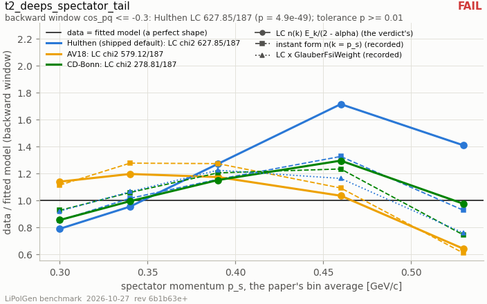

- **status:** **FAIL**
- **vendored data (sha256 of every byte):** `data/clas_deeps_klimenko2006_f2P.json` `1d98fd11e1b11b1e070e5504f4919b98b87dbabfe29cdca347522ea4f8737256`
- **config:** wave = Hulthen pair, P_D = 0.045 (deuteron_channel() default); prescription = LC (Frankfurt-Strikman), coded in harness; pwia_cos_max = -0.3; transverse_abs_cos = 0.3; errors = stat (+) syst in quadrature; fsi_sigma_xn_mb = 40

| sub-row | status | values / reason |
|---|---|---|
| `hulthen/lc` | **FAIL** | chi2 = 627.849; ndf = 187; p = 4.93231e-49; groups = 57; data_over_model_by_ps = 0.789572 / 0.954214 / 1.27138 / 1.71487 / 1.40871; wave = Hulthen pair, P_D = 0.045 (deuteron_channel() default); chi2_stat_only = 14008.8 |
| `hulthen/instant-form` | **FAIL** (recorded, not in the verdict) | chi2 = 322.541; ndf = 187; p = 2.77794e-09; groups = 57; data_over_model_by_ps = 0.851599 / 1.01567 / 1.15678 / 1.32659 / 0.926344; wave = Hulthen pair, P_D = 0.045 (deuteron_channel() default) |
| `av18/lc` | **FAIL** (recorded, not in the verdict) | chi2 = 579.116; ndf = 187; p = 1.10858e-41; groups = 57; data_over_model_by_ps = 1.13954 / 1.19642 / 1.17374 / 1.03502 / 0.640805; wave = AV18 (deuteron_channel(source=VmcAV18), fdeut.av18); chi2_stat_only = 4451.2 |
| `av18/instant-form` | **FAIL** (recorded, not in the verdict) | chi2 = 805.157; ndf = 187; p = 1.39847e-77; groups = 57; data_over_model_by_ps = 1.11402 / 1.27687 / 1.27354 / 1.09241 / 0.608269; wave = AV18 (deuteron_channel(source=VmcAV18), fdeut.av18) |
| `cdbonn/lc` | **FAIL** (recorded, not in the verdict) | chi2 = 278.812; ndf = 187; p = 1.51812e-05; groups = 57; data_over_model_by_ps = 0.854732 / 0.994558 / 1.15116 / 1.29548 / 0.975052; wave = CD-Bonn (cdbonn_wave(), Machleidt 2001 App. D); chi2_stat_only = 6312.31 |
| `cdbonn/instant-form` | **FAIL** (recorded, not in the verdict) | chi2 = 359.881; ndf = 187; p = 4.81072e-13; groups = 57; data_over_model_by_ps = 0.926314 / 1.05905 / 1.20473 / 1.23375 / 0.743046; wave = CD-Bonn (cdbonn_wave(), Machleidt 2001 App. D) |
| `hulthen/lc x GlauberFsiWeight` | **FAIL** (recorded, not in the verdict) | chi2 = 422.923; ndf = 187; p = 2.60582e-20; groups = 57; data_over_model_by_ps = 0.920588 / 1.06498 / 1.22438 / 1.16342 / 0.75773 |
| `transverse window (recorded)` | **RECORDED** (recorded, not in the verdict) | n_points = 359; same_side_of_1_all = false; ps=0.30 = data/PWIA 0.760 +- 0.015, tree 1.681; ps=0.34 = data/PWIA 1.198 +- 0.022, tree 3.115; ps=0.39 = data/PWIA 1.760 +- 0.032, tree 6.048; ps=0.46 = data/PWIA 2.642 +- 0.048, tree 12.404; ps=0.53 = data/PWIA 2.957 +- 0.060, tree 18.936 |

### t2_deuteron_static

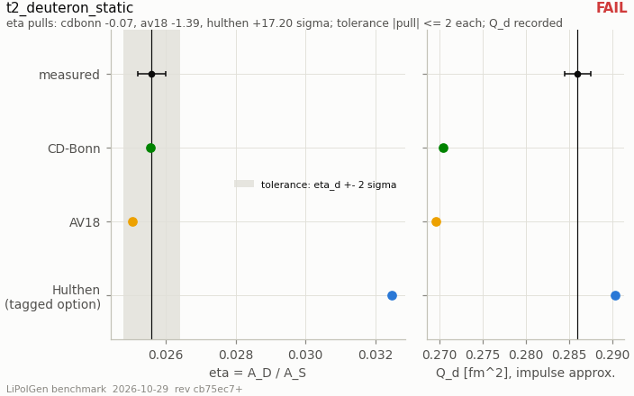

- **status:** **FAIL**
- **vendored data (sha256 of every byte):** `data/deuteron_static_measured.json` `3e62013f573e76f8e622bff87cca8d954b6616ae3578d99b17368d9e06062e0f`
- **config:** lipolgen = 0.1.0; numpy = 2.2.6; python = 3.10.12; data_file_sha256 = 3e62013f573e76f8e622bff87cca8d954b6616ae3578d99b17368d9e06062e0f

| sub-row | status | values / reason |
|---|---|---|
| `cdbonn` | **PASS** | label = CD-Bonn closed form (lg.cdbonn_wave(), Machleidt PRC 63 (2001) 024001 App. D); eta = 0.0255714; eta_source = tree: CdBonnWave.eta() = D_1/C_1; eta_numerical_error = 0; eta_check_r60 = 0.0255714; q_d = 0.270493; q_d_quad_error = 7.43849e-15; p_d = 0.0485621; norm = 1; p_d_tree = 0.0485621; a_s = 0.88473; kappa_fm = 0.231538; cross_checks.q_tree_default = 0.270178; cross_checks.q_tree_default_note = lg.alpha_d_quadrupole_fm2 on cdbonn_fdeut_table(), r_max 20 fm, dk 0.1 fm^-1 (tests/test_b1_nuclear.cpp item 5); cross_checks.q_tree_converged = 0.270494; cross_checks.q_tree_converged_note = the same routine on dk = 0.02 fm^-1, r_max = 60 fm, n_r = 6000; config.r_max_fm = 80; config.n_intervals = 100000; eta_pull = -0.0715534; eta_status = pass; q_d_distance = -0.0155066; q_d_rel_distance = -0.0542189 |
| `av18` | **PASS** | label = AV18 table (vmc/deuteron/fdeut.av18, r-space block; the tree reads its k block); eta = 0.0250447; eta_source = this harness: w/(u h(kappa r)) averaged over r in [20, 40] fm of the file's r block; eta_numerical_error = 2.94678e-08; kappa_fm = 0.231607; a_s = 0.885057; q_d = 0.26967; q_d_quad_error = 9.92824e-10; p_d = 0.0575986; norm = 0.999998; p_d_tree = 0.0575999; header.ebind = 2.22457; header.dstate = 0.057599; header.qm = 0.269673; header.mu = 0.84699; header.as = 0.885056; header.eta = 0.025045; header.rd = 1.96736; header.r4 = 55.3761; cross_checks.header_eta = 0.025045; cross_checks.header_qm = 0.269673; cross_checks.header_dstate = 0.057599; cross_checks.header_as = 0.885056; cross_checks.q_tree_kblock = 0.269362; cross_checks.q_tree_kblock_note = lg.alpha_d_quadrupole_fm2 on the k block the generator reads (deuteron_channel(source=VmcAV18)), default numerics (test…; cross_checks.eta_kblock_r = 0.0249839; cross_checks.eta_kblock_note = w/(u h(kappa r)) at r = 20 fm from the k block through ClusterPartialWave's spline and a 20001-point bare-j_L transform; config.file = /home/cpeng/Projects/polli/PoliGen/data/vmc/deuteron/fdeut.av18; config.eta_window_fm = 20 / 40; eta_pull = -1.38832; eta_status = pass; q_d_distance = -0.0163297; q_d_rel_distance = -0.057097 |
| `hulthen` | **FAIL** | label = Hulthen pair (deuteron_channel() default: beta = 0.30 GeV, P_D = 0.045, kappa = 0.045702 GeV), TaggedModel normalisation; eta = 0.0324784; eta_source = this harness: -N_2 A/N_0, the k^2 = -kappa^2 pole residues, N_L read from TaggedModel; eta_numerical_error = 6.32532e-12; eta_check_r80 = 0.0324784; kappa_fm = 0.231604; beta_gev = 0.3; p_d_nominal = 0.045; n0 = 0.298545; n2 = 0.0358768; n0_continuum_over_tree = 0.99997; q_d = 0.290349; q_d_quad_error = 1.22291e-13; p_d = 0.0450804; norm = 1.00014; config.beta_gev = 0.3; config.p_d = 0.045; config.k_grid_gev = 0.0001 / 1.2 / 280; config.r_max_fm = 80; config.n_intervals = 100000; cross_checks.q_tree_tables = 0.289791; cross_checks.q_tree_tables_note = lg.alpha_d_quadrupole_fm2 on the TaggedModel tables (k &lt;= 1.2 GeV), default numerics; eta_pull = 17.1961; eta_status = fail; q_d_distance = 0.00434905; q_d_rel_distance = 0.0152065 |

### t2_hermes_b1_table2

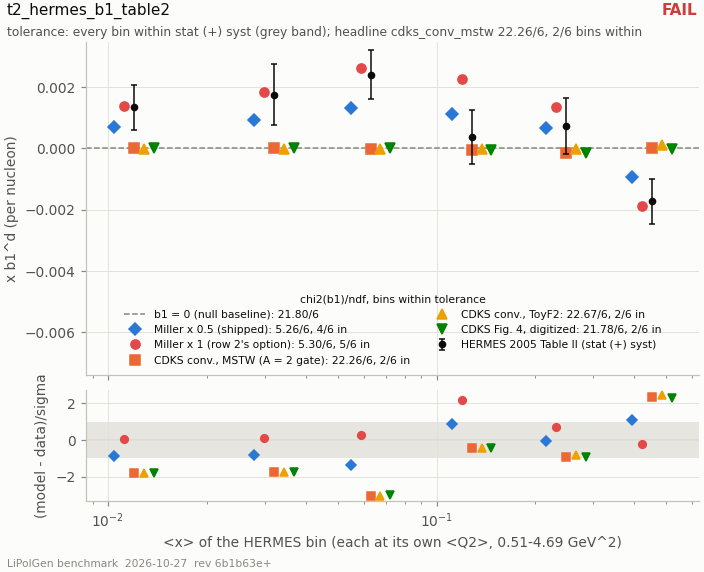

- **status:** **FAIL**
- **vendored data (sha256 of every byte):** `data/hermes2005_b1d_table2.json` `20b9104edf52414822e88305f7144566568ee2979bd531f77dd79f3a92006fc5`; `data/whitlow1990_r1990.json` `ce330eeef6305315a78d66422ff81fe8307bf71fdca4b8ef6e781e71698591d9`

| sub-row | status | values / reason |
|---|---|---|
| `cdks_conv_mstw` | **FAIL** | chi2_b1 = 22.2637; within_b1 = 2; chi2_azz = 22.0087; within_azz = 2; chi2_azz_r1998 = 22.0079; ndf = 6 |
| `cdks_conv_default` | **FAIL** | chi2_b1 = 22.6692; within_b1 = 2; chi2_azz = 22.3919; within_azz = 2; chi2_azz_r1998 = 22.3926; ndf = 6 |
| `miller_shipped` | **FAIL** | chi2_b1 = 5.26186; within_b1 = 4; chi2_azz = 5.54993; within_azz = 4; chi2_azz_r1998 = 5.4104; ndf = 6 |
| `miller_x1` | **FAIL** | chi2_b1 = 5.29707; within_b1 = 5; chi2_azz = 4.5139; within_azz = 5; chi2_azz_r1998 = 4.58653; ndf = 6 |
| `cdks_digitized` | **FAIL** | chi2_b1 = 21.7817; within_b1 = 2; chi2_azz = 21.559; within_azz = 2; chi2_azz_r1998 = 21.5484; ndf = 6 |
| `null_b1_zero` | **FAIL** | chi2_b1 = 21.7994; within_b1 = 2; chi2_azz = 21.5857; within_azz = 2; chi2_azz_r1998 = 21.5857; ndf = 6 |

### t3_li6_charge_ff_fb

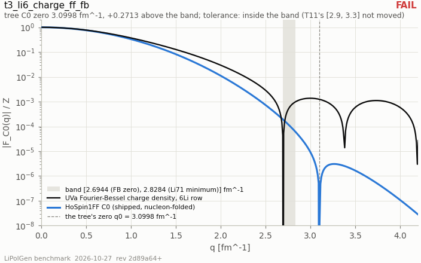

- **status:** **FAIL**
- **vendored data (sha256 of every byte):** `data/uva_ncd_fb_data_li6.dat` `6d5174b80f1a0da2197354feb244307ede17d38a1a9169e546abc18e78da7160`

### t3_li6_ff_wiringa_schiavilla

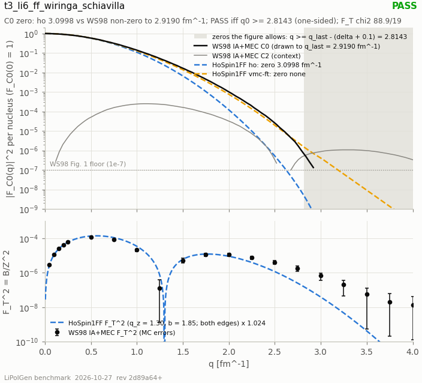

- **status:** **PASS**
- **vendored data (sha256 of every byte):** `data/rfy1966_li_magnetic_ff.csv` `a3ada6b099c50e8fd6c90453e6fd964f8436b97675d1bdb17c0a75bc4e593aa8`; `data/ws1998_li6_formfactors.csv` `c51d31f9e6e2328dcae7818c4bf1f2a3f759780d6ea5da0d7c0715797dee219b`
- **config:** lipolgen = 0.1.0; python = 3.10.12; data_file_sha256 = c51d31f9e6e2328dcae7818c4bf1f2a3f759780d6ea5da0d7c0715797dee219b; rfy_file_sha256 = a3ada6b099c50e8fd6c90453e6fd964f8436b97675d1bdb17c0a75bc4e593aa8; design_block_sha256 = a9f1b3d79dc8a771ef2dbbc0c4397ec0aff44290de90048e165d23b647556a0b; ws_pdf_sha256 = fc51cb930e81b16238bb02561e81d4f9160a7d1708e813f8380ba669991d20e8; ws_page = 10; slot_rows = 68; slot_q_min = 0.119048; slot_q_max = 2.91905; m_a_fm = 28.3866

| sub-row | status | values / reason |
|---|---|---|
| `c0_zero[ho]` | **PASS** | name = c0_zero[ho]; q0_tree = 3.09977; q_last = 2.91905; bound = 2.81429; distance_above_bound = 0.285485 |
| `c0_zero[vmc-ft]` | **PASS** (recorded, not in the verdict) | **reason:** no C0 zero below 5 fm^-1: none where the VMC C0 is drawn non-zero; name = c0_zero[vmc-ft]; q0_tree = n/a; q_last = 2.91905; bound = 2.81429; distance_above_bound = n/a |
| `c0_zero_vs_IA[ho]` | **RECORDED** (recorded, not in the verdict) | name = c0_zero_vs_IA[ho]; q0_tree = 3.09977; q_last_ia = 3.2; bound = 3.09524; rule_met = true |
| `c0_zero_vs_IA[vmc-ft]` | **RECORDED** (recorded, not in the verdict) | name = c0_zero_vs_IA[vmc-ft]; q0_tree = n/a; q_last_ia = 3.2; bound = 3.09524; rule_met = true |
| `zero_extrapolation[IA+MEC]` | **RECORDED** (recorded, not in the verdict) | name = zero_extrapolation[IA+MEC]; n_fits_with_root = 2; min_root = 2.97349; max_root = 3.02515; e1_line_last2_root = 3.02515; e2_line_last5_root = 2.97349; e3_quad_last5_root = n/a; e4_quad_last10_root = n/a |
| `c0_ceiling[ho]` | **RECORDED** (recorded, not in the verdict) | name = c0_ceiling[ho]; max_tree_f2_above_q_last = 6.30969e-10; at_q = 2.92013; floor_f2 = 1e-07; above_floor = false |
| `c0_ceiling[vmc-ft]` | **RECORDED** (recorded, not in the verdict) | name = c0_ceiling[vmc-ft]; max_tree_f2_above_q_last = 7.00349e-07; at_q = 2.92013; floor_f2 = 1e-07; above_floor = true |
| `slope_radius[IA+MEC]` | **RECORDED** (recorded, not in the verdict) | name = slope_radius[IA+MEC]; r_ws = 2.56991; r_ws_err_dig = 0.00913095; r_ws_variants_min = 2.52434; r_ws_variants_max = 2.69487; r_ho_same_fit = 2.57081; r_vmcft_same_fit = 2.56445; r_ho_richardson = 2.571; r_vmcft_richardson = 2.57099 |
| `slope_radius[IA]` | **RECORDED** (recorded, not in the verdict) | name = slope_radius[IA]; r_ws = 2.55765; r_ws_err_dig = 0.0091747; r_ws_variants_min = 2.50812; r_ws_variants_max = 2.6756; r_ho_same_fit = 2.57081; r_vmcft_same_fit = 2.56445; r_ho_richardson = 2.571; r_vmcft_richardson = 2.57099 |
| `c0_shape[ho vs IA]` | **RECORDED** (recorded, not in the verdict) | name = c0_shape[ho vs IA]; chi2 = 7.56372e+06; ndf = 79; s = 14.146; ratio_at_q1 = 0.0945911; ratio_at_q2 = 0.755844; ratio_at_q25 = 7.74553; ratio_at_q_last = 1126.96 |
| `c0_shape[ho vs IA+MEC]` | **RECORDED** (recorded, not in the verdict) | name = c0_shape[ho vs IA+MEC]; chi2 = 1.89395e+06; ndf = 72; s = 4.79783; ratio_at_q1 = 0.267487; ratio_at_q2 = 1.71663; ratio_at_q25 = 10.9972; ratio_at_q_last = 43.2002 |
| `c0_shape[vmc-ft vs IA]` | **RECORDED** (recorded, not in the verdict) | name = c0_shape[vmc-ft vs IA]; chi2 = 92763.9; ndf = 79; s = 1.49153; ratio_at_q1 = 0.753566; ratio_at_q2 = 1.15493; ratio_at_q25 = 1.77268; ratio_at_q_last = 0.901416 |
| `c0_shape[vmc-ft vs IA+MEC]` | **RECORDED** (recorded, not in the verdict) | name = c0_shape[vmc-ft vs IA+MEC]; chi2 = 73403.6; ndf = 72; s = 1.0582; ratio_at_q1 = 1.01871; ratio_at_q2 = 1.25394; ratio_at_q25 = 1.2032; ratio_at_q_last = 0.179386 |
| `m1_shape[fm vs IA+MEC F_T^2]` | **RECORDED** (recorded, not in the verdict) | name = m1_shape[fm vs IA+MEC F_T^2]; chi2 = 88.9074; ndf = 19; p = 5.17722e-11; s_hat = 1.02436; s_err = 0.0156199; chi2_s1 = 91.3394; ndf_s1 = 20; p_s1 = 4.31901e-11; ws_zero_symbol_q = 1.24762; tree_qz = 1.3 |
| `c2[fq vs IA+MEC C2]` | **RECORDED** (recorded, not in the verdict) | name = c2[fq vs IA+MEC C2]; ratio_low_q_mean = 5.8722; ratio_low_q_min = 5.72299; ratio_low_q_max = 6.06363; ws_zero_lo = 2.51905; ws_zero_hi = 2.67619; tree_c2_zero = 3.09977; ws_second_lobe_q = 3.23809; ws_second_lobe_f2 = 1.08063e-06; tree_f2_at_ws_lobe = 4.15635e-14 |
| `closure_mu[IA+MEC]` | **FAIL** (recorded, not in the verdict) | name = closure_mu[IA+MEC]; mu = 0.895187; printed = 0.832; rel = 0.0759457 |
| `closure_mu[IA]` | **FAIL** (recorded, not in the verdict) | name = closure_mu[IA]; mu = 0.879008; printed = 0.829; rel = 0.0603227 |
| `closure_mu[IA+MEC, nominal q, post hoc]` | **PASS** (recorded, not in the verdict) | name = closure_mu[IA+MEC, nominal q, post hoc]; post_hoc = true; mu = 0.841427; printed = 0.832; rel = 0.0113303; max_offset_from_grid = 0.002381 |
| `closure_mu[IA, nominal q, post hoc]` | **PASS** (recorded, not in the verdict) | name = closure_mu[IA, nominal q, post hoc]; post_hoc = true; mu = 0.826842; printed = 0.829; rel = -0.00260277; max_offset_from_grid = 0.002381 |
| `m1_shape[nominal q, post hoc]` | **RECORDED** (recorded, not in the verdict) | name = m1_shape[nominal q, post hoc]; post_hoc = true; chi2 = 77.7025; ndf = 19; p = 4.61293e-09; s_hat = 1.00977 |
| `closure_Q[IA+MEC]` | **FAIL** (recorded, not in the verdict) | name = closure_Q[IA+MEC]; abs_q_fm2 = 0.490144; printed_fm2 = -0.23; rel = 1.13106; times_sqrt2_over_3 = 0.231056 |
| `closure_lines_vs_symbols[IA+MEC]` | **PASS** (recorded, not in the verdict) | name = closure_lines_vs_symbols[IA+MEC]; n = 11; max_abs_pull = 0.542001 |
| `closure_rfy_table1[q]` | **PASS** (recorded, not in the verdict) | name = closure_rfy_table1[q]; max_abs_dq = 0.00496912; limit = 0.0095 |
| `closure_rfy_table1[ratio]` | **PASS** (recorded, not in the verdict) | name = closure_rfy_table1[ratio]; ratio_mean = 0.711609; ratio_min = 0.709189; ratio_max = 0.714383; spread_limit = 1.042 |

### t3_li6_rms_devries

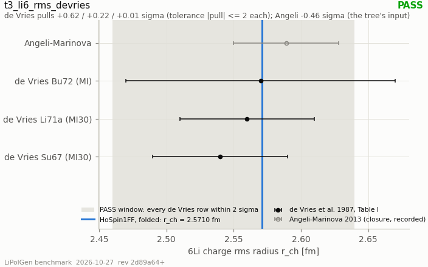

- **status:** **PASS**
- **vendored data (sha256 of every byte):** `data/devries1987_li6_rms.json` `ffab49a1b67d92a209de3341de994c6b1fc115fe7f69044ef054d3154a53ad3c`
- **config:** lipolgen = 0.1.0; python = 3.10.12; data_file_sha256 = ffab49a1b67d92a209de3341de994c6b1fc115fe7f69044ef054d3154a53ad3c

| sub-row | status | values / reason |
|---|---|---|
| `Su67` | **PASS** | compilation = de Vries, de Jager, de Vries, ADNDT 36 (1987) 495, Table I; model = MI30; rms_fm = 2.54; sigma_fm = 0.05; as_printed = 2.54(5); q_range_fm-1 = 0.69 / 2.52; source_key = Su67; source_key_survey_expansion = Suelzle 1967; transcribed_from = docs/benchmarking/03_data_nuclear.md:186; pull = 0.620016; within = true; within_1sigma = true |
| `Li71a` | **PASS** | compilation = de Vries, de Jager, de Vries, ADNDT 36 (1987) 495, Table I; model = MI30; rms_fm = 2.56; sigma_fm = 0.05; as_printed = 2.56(5); q_range_fm-1 = 0.56 / 3.66; source_key = Li71a; source_key_survey_expansion = Li-Sick-Whitney-Yearian; transcribed_from = docs/benchmarking/03_data_nuclear.md:187; pull = 0.220016; within = true; within_1sigma = true |
| `Bu72` | **PASS** | compilation = de Vries, de Jager, de Vries, ADNDT 36 (1987) 495, Table I; model = MI; rms_fm = 2.57; sigma_fm = 0.1; as_printed = 2.57(10); q_range_fm-1 = 0.09 / 0.9; source_key = Bu72; source_key_survey_expansion = n/a; transcribed_from = docs/benchmarking/03_data_nuclear.md:188; pull = 0.010008; within = true; within_1sigma = true |

### t3_li_magnetization_rfy

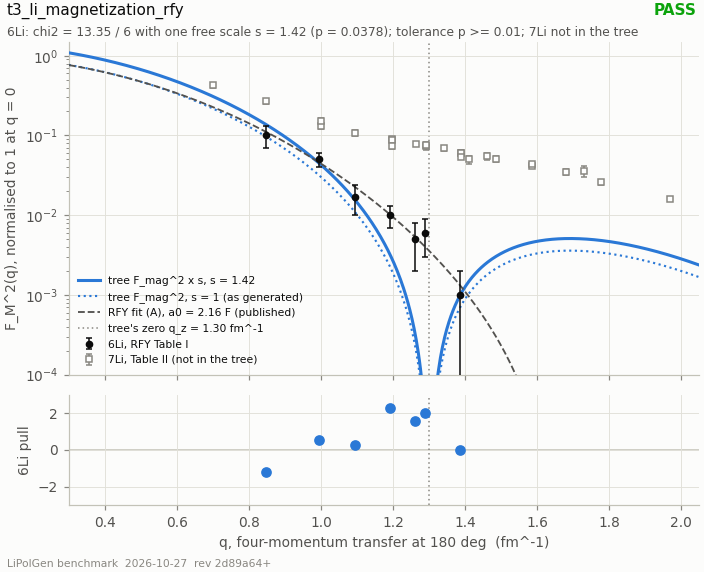

- **status:** **PASS**
- **vendored data (sha256 of every byte):** `data/rfy1966_li_magnetic_ff.csv` `a3ada6b099c50e8fd6c90453e6fd964f8436b97675d1bdb17c0a75bc4e593aa8`; `data/rfy1966_li_magnetization.csv` `8f6874262d2ce32cab4645c8095c177be5e35c2f01f2bf270d13c64ac5bed1e8`
- **config:** lipolgen = 0.1.0; python = 3.10.12; data_ff_sha256 = a3ada6b099c50e8fd6c90453e6fd964f8436b97675d1bdb17c0a75bc4e593aa8; data_a0_sha256 = 8f6874262d2ce32cab4645c8095c177be5e35c2f01f2bf270d13c64ac5bed1e8; design_block_sha256 = d00b1307a0e397dcad2830513abdcbe21da9fb7eef3d1931e5976a7a0b3a3589; fm_qz_fm = 1.3; fm_b_fm = 1.85; tree_r_mag_li6_fm_uncompared = 2.94687; radius_rule = retired 2026-10-26 (harness header); q2_abscissa = printed (RFY Table I); recomputed recorded

| sub-row | status | values / reason |
|---|---|---|
| `li6_shape[free scale]` | **PASS** | name = li6_shape[free scale]; chi2 = 13.3509; ndf = 6; p = 0.0377898; s_hat = 1.41884; s_err = 0.205765; n_points = 7; pulls = -1.21118 / 0.526979 / 0.242674 / 2.27056 / 1.55768 / 1.9913 / 0.0166748 |
| `li6_absolute[s = 1]` | **RECORDED** (recorded, not in the verdict) | name = li6_absolute[s = 1]; chi2 = 17.4942; ndf = 7; p = 0.0144726 |
| `li6_shape[q2 from E0]` | **RECORDED** (recorded, not in the verdict) | name = li6_shape[q2 from E0]; chi2 = 13.2481; ndf = 6; p = 0.0392608; s_hat = 1.42268 |
| `q2_column_check` | **PASS** (recorded, not in the verdict) | name = q2_column_check; max_abs_dq2_fm2 = 0.00580898; limit_fm2 = 0.006; n_rows = 31 |
| `li7[Table II]` | **NOT COMPARED** (recorded, not in the verdict) | **reason:** not implemented in the tree: HoSpin1FF.for_ion(li7()) throws (HoSpin1FF::for_ion: ion '7Li' has no measured-moment block in rc.hpp (today only 6Li does), and a_fm, alpha, mu_n, q_fm2); name = li7[Table II]; n_points = 24; q2_min_fm2 = 0.49; q2_max_fm2 = 3.87 |
| `closure[6Li Table VII]` | **PASS** (recorded, not in the verdict) | name = closure[6Li Table VII]; fits = 6Li VII (A) a0=2.16 R1=0.53 / 6Li VII (C) a0=1.70 R1=-0.02 / 6Li VII (B) a0=1.78 R1=0.10 / 6Li VII (C) a0=1.90 R1=0.25 / 6Li VII (C) a0=2.00 R1=0.36 / 6Li VII (B) a0=2.10 R1=0.47 / 6Li VII (C) a0=2.20 R1=0.57 / 6Li VII alpha+d(1s) q0=0.39; chi2_table = 1.436 / 8.43023 / 6.04412 / 3.26516 / 2.01684 / 1.52609 / 1.46518 / 2.44143; chi2_paper = 1.7 / 8.4 / 6 / 3.4 / 2.3 / 1.8 / 1.7 / 2.8; n_points = 7; margin = 1 |
| `closure[7Li Table VIII]` | **FAIL** (recorded, not in the verdict) | name = closure[7Li Table VIII]; fits = 7Li VIII (A) a0=1.70 / 7Li VIII (C) a0=1.62 / 7Li VIII (C) a0=1.66 / 7Li VIII (B) a0=1.72 / 7Li VIII (C) a0=1.78; chi2_table = 21.8145 / 29.3743 / 26.9088 / 21.4753 / 25.6836; chi2_paper = 23.3 / 30.8 / 25.6 / 23.5 / 30; n_points = 24; margin = 1 |
| `closure_refit[7Li Table VIII, post-hoc]` | **PASS** (recorded, not in the verdict) | name = closure_refit[7Li Table VIII, post-hoc]; fits = 7Li VIII (A) a0=1.70 / 7Li VIII (C) a0=1.62 / 7Li VIII (C) a0=1.66 / 7Li VIII (B) a0=1.72 / 7Li VIII (C) a0=1.78; chi2_min = 21.3578 / 28.8165 / 24.5313 / 20.3277 / 20.1952; chi2_paper = 23.3 / 30.8 / 25.6 / 23.5 / 30; slack_a_row = 0.25; n_points = 24 |

### t3_nmc_li6_over_d

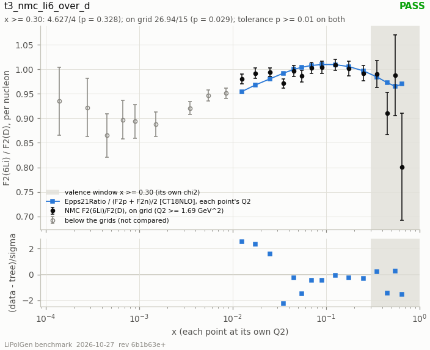

- **status:** **PASS**
- **vendored data (sha256 of every byte):** `data/hepdata_ins394050_table1.csv` `1f2c36b02972c13482a252c0a13bea734496439db92c60829c337d0a964e254b`

### t4_djangoh_rad_noRad

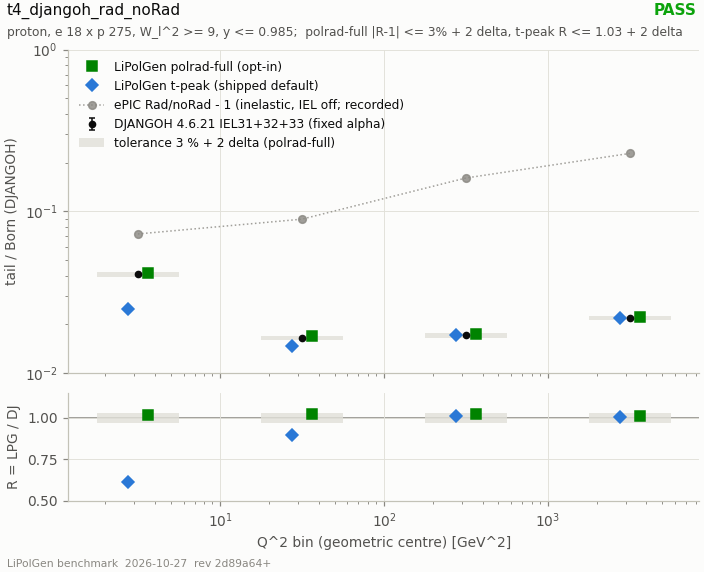

- **status:** **PASS**
- **reason:** polrad-full (two-sided) within 3 % + 2 delta of DJANGOH's exact O(alpha) proton elastic tail in all four bins (R 1.0199 / 1.0261 / 1.0219 / 1.0098); the shipped t-peak passes its one-sided CEILING only (R 0.6118 / 0.8968 / 1.0112 / 1.0067): it is 39 % / 10 % below the exact tail at Q2 = 1-10 / 10-100 GeV2, and its R &gt; 1 in bins 3-4 is the tail table's +2 % (--diagnostics)
- **vendored data (sha256 of every byte):** `data/djangoh_eltail_ep18x275.json` `8c0bd1ee4bb176db9e3d1601c43413ba41bd0d93581d11d20c29478ae05731c7`; `data/djangoh_rad_norad_ep18x275.json` `2fd4b9b6bb2c0de7c7a9b338ad58cc3cbc221c768d0ce2f257ac6f57139be8fa`
- **config:** beams = e- 18 x p 275 GeV (LiPolGen config 2; DJANGOH EL-BEAM 18, PR-BEAM 275); window = Q2_lo &lt;= Q2_l &lt; Q2_hi, 1e-5 &lt;= x_l &lt;= xmax_b, 1e-4 &lt;= y_l &lt;= 0.985 (W_l^2 &gt;= 9 implied); xmax_b = 0.1096 / 0.5518 / 0.9249 / 0.95; x_min = 1e-05; y_min = 0.0001; y_max = 0.985; W2_min = 9; tol_numerical = 0.03; n_delta = 2; design_block_sha256 = fbe067892c7d3b8d6de27f32ce1c52138bd80162b24a7b1677dc6d412af2c91b; djangoh = 4.6.21 (spiesber/DJANGOH e356b84), cteq61 = LHAPDF 10150, RNDM-SEEDS 0 0, INT-POINTS 100000, LPARIN(3) = 2; rc_ff = zero coherent vertex; qe_kf_gev = 0; tail_max.t-peak = 10; tail_max.polrad-full = 10; clipped_node_fraction.t-peak = 0; clipped_node_fraction.polrad-full = 0.00424328; unpol_sf.t-peak = UnpolSfSource.Toy; unpol_sf.polrad-full = UnpolSfSource.Toy

| sub-row | status | values / reason |
|---|---|---|
| `t-peak[Q2 1-10]` | **PASS** | name = t-peak[Q2 1-10]; R = 0.611819; allowance = 0.0307467; test = R &lt;= 1.0307 (lower bound); tail_lipolgen_ub = 0.0143049; tail_djangoh_ub = 0.0233809; fraction_lipolgen = 0.024919; fraction_djangoh = 0.0407293; fraction_lipolgen_own_born = 0.0169589; clipped_tail_fraction = 0; shortfall_1_minus_R = 0.388181 |
| `polrad-full[Q2 1-10]` | **PASS** | name = polrad-full[Q2 1-10]; R = 1.01989; allowance = 0.0307467; test = abs(R - 1) &lt;= 0.0307; tail_lipolgen_ub = 0.0238459; tail_djangoh_ub = 0.0233809; fraction_lipolgen = 0.0415394; fraction_djangoh = 0.0407293; fraction_lipolgen_own_born = 0.0282701; clipped_tail_fraction = 0 |
| `recorded[Q2 1-10]` | **RECORDED** (recorded, not in the verdict) | name = recorded[Q2 1-10]; djangoh_running_alpha_over_fixed = 1.01517; djangoh_fraction_running_alpha = 0.0413473; strip_born_share = 0.0465556; strip_tail_share_t-peak = -1.04313e-05; strip_tail_share_polrad-full = 0.00523191; born_q2max_direct_over_subtraction = 0.999972; tail_q2max_direct_over_q2min_only = 1; lipolgen_own_born_over_djangoh_born = 1.46938 |
| `history_epic[Q2 1-10]` | **RECORDED** (recorded, not in the verdict) | **reason:** ePIC Rad/noRad: inelastic O(alpha) with the elastic tail OFF and W_h &gt;= 3 GeV; LiPolGen ratios on the W_l^2 &gt;= 9 window -- disjoint pieces, no tolerance; name = history_epic[Q2 1-10]; epic_rad_over_norad = 1.07245; lipolgen_t-peak_ratio = 1.01617; lipolgen_polrad-full_ratio = 1.0271 |
| `t-peak[Q2 10-100]` | **PASS** | name = t-peak[Q2 10-100]; R = 0.896808; allowance = 0.0309598; test = R &lt;= 1.0310 (lower bound); tail_lipolgen_ub = 0.000996772; tail_djangoh_ub = 0.00111147; fraction_lipolgen = 0.0147393; fraction_djangoh = 0.0164353; fraction_lipolgen_own_born = 0.013209; clipped_tail_fraction = 0; shortfall_1_minus_R = 0.103192 |
| `polrad-full[Q2 10-100]` | **PASS** | name = polrad-full[Q2 10-100]; R = 1.02613; allowance = 0.0309598; test = abs(R - 1) &lt;= 0.0310; tail_lipolgen_ub = 0.00114051; tail_djangoh_ub = 0.00111147; fraction_lipolgen = 0.0168648; fraction_djangoh = 0.0164353; fraction_lipolgen_own_born = 0.0151138; clipped_tail_fraction = 0 |
| `recorded[Q2 10-100]` | **RECORDED** (recorded, not in the verdict) | name = recorded[Q2 10-100]; djangoh_running_alpha_over_fixed = 1.01328; djangoh_fraction_running_alpha = 0.0166536; strip_born_share = 0.00279092; strip_tail_share_t-peak = 4.68892e-07; strip_tail_share_polrad-full = 1.05647e-05; born_q2max_direct_over_subtraction = 1.00002; tail_q2max_direct_over_q2min_only = 1; lipolgen_own_born_over_djangoh_born = 1.11585 |
| `history_epic[Q2 10-100]` | **RECORDED** (recorded, not in the verdict) | **reason:** ePIC Rad/noRad: inelastic O(alpha) with the elastic tail OFF and W_h &gt;= 3 GeV; LiPolGen ratios on the W_l^2 &gt;= 9 window -- disjoint pieces, no tolerance; name = history_epic[Q2 10-100]; epic_rad_over_norad = 1.08941; lipolgen_t-peak_ratio = 1.01317; lipolgen_polrad-full_ratio = 1.01507 |
| `t-peak[Q2 100-1000]` | **PASS** | name = t-peak[Q2 100-1000]; R = 1.01116; allowance = 0.0308831; test = R &lt;= 1.0309 (lower bound); tail_lipolgen_ub = 5.57778e-05; tail_djangoh_ub = 5.51624e-05; fraction_lipolgen = 0.0172895; fraction_djangoh = 0.0170987; fraction_lipolgen_own_born = 0.0149703; clipped_tail_fraction = 0; shortfall_1_minus_R = -0.0111558 |
| `polrad-full[Q2 100-1000]` | **PASS** | name = polrad-full[Q2 100-1000]; R = 1.02192; allowance = 0.0308831; test = abs(R - 1) &lt;= 0.0309; tail_lipolgen_ub = 5.63715e-05; tail_djangoh_ub = 5.51624e-05; fraction_lipolgen = 0.0174735; fraction_djangoh = 0.0170987; fraction_lipolgen_own_born = 0.0151297; clipped_tail_fraction = 0 |
| `recorded[Q2 100-1000]` | **RECORDED** (recorded, not in the verdict) | name = recorded[Q2 100-1000]; djangoh_running_alpha_over_fixed = 1.01512; djangoh_fraction_running_alpha = 0.0173572; strip_born_share = 4.08094e-06; strip_tail_share_t-peak = -2.1603e-08; strip_tail_share_polrad-full = 0.00052982; born_q2max_direct_over_subtraction = 0.999996; tail_q2max_direct_over_q2min_only = 1; lipolgen_own_born_over_djangoh_born = 1.15492 |
| `history_epic[Q2 100-1000]` | **RECORDED** (recorded, not in the verdict) | **reason:** ePIC Rad/noRad: inelastic O(alpha) with the elastic tail OFF and W_h &gt;= 3 GeV; LiPolGen ratios on the W_l^2 &gt;= 9 window -- disjoint pieces, no tolerance; name = history_epic[Q2 100-1000]; epic_rad_over_norad = 1.16063; lipolgen_t-peak_ratio = 1.01497; lipolgen_polrad-full_ratio = 1.01514 |
| `t-peak[Q2 1000-10000]` | **PASS** | name = t-peak[Q2 1000-10000]; R = 1.00675; allowance = 0.0307745; test = R &lt;= 1.0308 (lower bound); tail_lipolgen_ub = 1.5285e-06; tail_djangoh_ub = 1.51826e-06; fraction_lipolgen = 0.0220358; fraction_djangoh = 0.0218881; fraction_lipolgen_own_born = 0.0206862; clipped_tail_fraction = 0; shortfall_1_minus_R = -0.00674599 |
| `polrad-full[Q2 1000-10000]` | **PASS** | name = polrad-full[Q2 1000-10000]; R = 1.00979; allowance = 0.0307745; test = abs(R - 1) &lt;= 0.0308; tail_lipolgen_ub = 1.53312e-06; tail_djangoh_ub = 1.51826e-06; fraction_lipolgen = 0.0221024; fraction_djangoh = 0.0218881; fraction_lipolgen_own_born = 0.0207487; clipped_tail_fraction = 0.000546453 |
| `recorded[Q2 1000-10000]` | **RECORDED** (recorded, not in the verdict) | name = recorded[Q2 1000-10000]; djangoh_running_alpha_over_fixed = 1.02063; djangoh_fraction_running_alpha = 0.0223396; strip_born_share = 4.66239e-06; strip_tail_share_t-peak = 5.39408e-08; strip_tail_share_polrad-full = 0.000404064; born_q2max_direct_over_subtraction = 0.999994; tail_q2max_direct_over_q2min_only = 1; lipolgen_own_born_over_djangoh_born = 1.06524 |
| `history_epic[Q2 1000-10000]` | **RECORDED** (recorded, not in the verdict) | **reason:** ePIC Rad/noRad: inelastic O(alpha) with the elastic tail OFF and W_h &gt;= 3 GeV; LiPolGen ratios on the W_l^2 &gt;= 9 window -- disjoint pieces, no tolerance; name = history_epic[Q2 1000-10000]; epic_rad_over_norad = 1.22797; lipolgen_t-peak_ratio = 1.02069; lipolgen_polrad-full_ratio = 1.02076 |
| `control[Rad=0, Q2 1-10]` | **PASS** (recorded, not in the verdict) | name = control[Rad=0, Q2 1-10]; sigma_nb = 628.04; epic_readme_nb = 627.885; ratio_minus_1 = 0.000246316; pull = 1.74172 |
| `control[Rad=1, Q2 1-10]` | **PASS** (recorded, not in the verdict) | name = control[Rad=1, Q2 1-10]; sigma_nb = 673.65; epic_readme_nb = 673.378; ratio_minus_1 = 0.000404095; pull = 0.773448 |
| `control[Rad=0, Q2 10-100]` | **PASS** (recorded, not in the verdict) | name = control[Rad=0, Q2 10-100]; sigma_nb = 67.986; epic_readme_nb = 67.9728; ratio_minus_1 = 0.000194676; pull = 1.37656 |
| `control[Rad=1, Q2 10-100]` | **PASS** (recorded, not in the verdict) | name = control[Rad=1, Q2 10-100]; sigma_nb = 74.031; epic_readme_nb = 74.05; ratio_minus_1 = -0.000256616; pull = -0.543339 |
| `control[Rad=0, Q2 100-1000]` | **PASS** (recorded, not in the verdict) | name = control[Rad=0, Q2 100-1000]; sigma_nb = 3.2401; epic_readme_nb = 3.23964; ratio_minus_1 = 0.000142936; pull = 1.01071 |
| `control[Rad=1, Q2 100-1000]` | **PASS** (recorded, not in the verdict) | name = control[Rad=1, Q2 100-1000]; sigma_nb = 3.7603; epic_readme_nb = 3.76001; ratio_minus_1 = 7.82972e-05; pull = 0.152917 |
| `control[Rad=0, Q2 1000-10000]` | **PASS** (recorded, not in the verdict) | name = control[Rad=0, Q2 1000-10000]; sigma_nb = 0.070161; epic_readme_nb = 0.0701594; ratio_minus_1 = 2.32643e-05; pull = 0.164504 |
| `control[Rad=1, Q2 1000-10000]` | **PASS** (recorded, not in the verdict) | name = control[Rad=1, Q2 1000-10000]; sigma_nb = 0.086138; epic_readme_nb = 0.0861533; ratio_minus_1 = -0.000177072; pull = -0.355042 |

### t4_pythia_ep_closure

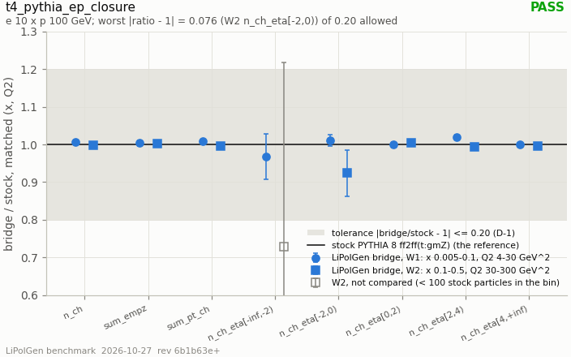

- **status:** **PASS**; expensive (opt-in)
- **config:** expensive = true; n_events = 20000; seed = 20260926; beam_config = 1; pythia_version_used = 8.317; pythia_version_pinned = 8.317; pythia_libraries = /home/cpeng/Projects/polli/deps/install/lib/libpythia8.so; pdf_pset = 13; n_sub = 4; eta_edges = -inf / -2 / 0 / 2 / 4 / inf; min_stock_counts = 100; stock_settings_added = SpaceShower:QEDshowerByQ = off

| sub-row | status | values / reason |
|---|---|---|
| `W1/n_ch` | **PASS** | window = W1; observable = n_ch; stock = 8.1441; stock_err = 0.0233189; bridge = 8.20351; bridge_err = 0.019703; ratio = 1.0073; ratio_err = 0.0037645; distance = 0.00729505; bridge_raw = 8.3075; stock_raw = 8.1441; ratio_raw = 1.02006; n_stock_particles = n/a; compared = true |
| `W1/sum_empz` | **PASS** | window = W1; observable = sum_empz; stock = 2.73527; stock_err = 0.0194881; bridge = 2.74493; bridge_err = 0.0064404; ratio = 1.00353; ratio_err = 0.00752765; distance = 0.00353297; bridge_raw = 2.90458; stock_raw = 2.73527; ratio_raw = 1.0619; n_stock_particles = n/a; compared = true |
| `W1/sum_pt_ch` | **PASS** | window = W1; observable = sum_pt_ch; stock = 3.8483; stock_err = 0.0110834; bridge = 3.88154; bridge_err = 0.00983322; ratio = 1.00864; ratio_err = 0.00386883; distance = 0.00863876; bridge_raw = 3.91528; stock_raw = 3.8483; ratio_raw = 1.0174; n_stock_particles = n/a; compared = true |
| `W1/n_ch_eta[-inf,-2)` | **PASS** | window = W1; observable = n_ch_eta[-inf,-2); stock = 0.0283; stock_err = 0.00129036; bridge = 0.0274033; bridge_err = 0.00114868; ratio = 0.968315; ratio_err = 0.0599736; distance = 0.0316846; bridge_raw = 0.03175; stock_raw = 0.0283; ratio_raw = 1.12191; n_stock_particles = 566; compared = true |
| `W1/n_ch_eta[-2,0)` | **PASS** | window = W1; observable = n_ch_eta[-2,0); stock = 0.6862; stock_err = 0.00840446; bridge = 0.693477; bridge_err = 0.00549713; ratio = 1.0106; ratio_err = 0.0147439; distance = 0.0106047; bridge_raw = 0.74295; stock_raw = 0.6862; ratio_raw = 1.0827; n_stock_particles = 13724; compared = true |
| `W1/n_ch_eta[0,2)` | **PASS** | window = W1; observable = n_ch_eta[0,2); stock = 2.49785; stock_err = 0.0132001; bridge = 2.49663; bridge_err = 0.0114792; ratio = 0.99951; ratio_err = 0.00700139; distance = 0.000490194; bridge_raw = 2.53945; stock_raw = 2.49785; ratio_raw = 1.01665; n_stock_particles = 49957; compared = true |
| `W1/n_ch_eta[2,4)` | **PASS** | window = W1; observable = n_ch_eta[2,4); stock = 2.9469; stock_err = 0.0129962; bridge = 3.00318; bridge_err = 0.0132006; ratio = 1.0191; ratio_err = 0.00634547; distance = 0.0190966; bridge_raw = 3.0044; stock_raw = 2.9469; ratio_raw = 1.01951; n_stock_particles = 58938; compared = true |
| `W1/n_ch_eta[4,+inf)` | **PASS** | window = W1; observable = n_ch_eta[4,+inf); stock = 1.98485; stock_err = 0.0083818; bridge = 1.98283; bridge_err = 0.00839894; ratio = 0.998982; ratio_err = 0.00597514; distance = 0.00101778; bridge_raw = 1.98895; stock_raw = 1.98485; ratio_raw = 1.00207; n_stock_particles = 39697; compared = true |
| `W2/n_ch` | **PASS** | window = W2; observable = n_ch; stock = 7.4037; stock_err = 0.0207336; bridge = 7.38264; bridge_err = 0.0184182; ratio = 0.997155; ratio_err = 0.00373987; distance = 0.00284517; bridge_raw = 7.4489; stock_raw = 7.4037; ratio_raw = 1.00611; n_stock_particles = n/a; compared = true |
| `W2/sum_empz` | **PASS** | window = W2; observable = sum_empz; stock = 1.99536; stock_err = 0.0121428; bridge = 2.00161; bridge_err = 0.00363994; ratio = 1.00313; ratio_err = 0.0063713; distance = 0.00313219; bridge_raw = 2.05983; stock_raw = 1.99536; ratio_raw = 1.03231; n_stock_particles = n/a; compared = true |
| `W2/sum_pt_ch` | **PASS** | window = W2; observable = sum_pt_ch; stock = 6.19403; stock_err = 0.0186702; bridge = 6.16328; bridge_err = 0.0157376; ratio = 0.995037; ratio_err = 0.00393079; distance = 0.00496323; bridge_raw = 6.20385; stock_raw = 6.19403; ratio_raw = 1.00159; n_stock_particles = n/a; compared = true |
| `W2/n_ch_eta[-inf,-2)` | **NOT COMPARED** | window = W2; observable = n_ch_eta[-inf,-2); stock = 0.00025; stock_err = 0.000111792; bridge = 0.000182074; bridge_err = 9.10119e-05; ratio = 0.728294; ratio_err = 0.488459; distance = 0.271706; bridge_raw = 0.0002; stock_raw = 0.00025; ratio_raw = 0.8; n_stock_particles = 5; compared = false |
| `W2/n_ch_eta[-2,0)` | **PASS** | window = W2; observable = n_ch_eta[-2,0); stock = 0.0388; stock_err = 0.00196085; bridge = 0.0358614; bridge_err = 0.00155116; ratio = 0.924263; ratio_err = 0.0614823; distance = 0.0757371; bridge_raw = 0.03875; stock_raw = 0.0388; ratio_raw = 0.998711; n_stock_particles = 776; compared = true |
| `W2/n_ch_eta[0,2)` | **PASS** | window = W2; observable = n_ch_eta[0,2); stock = 2.52325; stock_err = 0.0152584; bridge = 2.53452; bridge_err = 0.0105762; ratio = 1.00447; ratio_err = 0.00737996; distance = 0.00446787; bridge_raw = 2.6071; stock_raw = 2.52325; ratio_raw = 1.03323; n_stock_particles = 50465; compared = true |
| `W2/n_ch_eta[2,4)` | **PASS** | window = W2; observable = n_ch_eta[2,4); stock = 3.33595; stock_err = 0.0137433; bridge = 3.31303; bridge_err = 0.0135194; ratio = 0.993129; ratio_err = 0.00575882; distance = 0.00687143; bridge_raw = 3.29615; stock_raw = 3.33595; ratio_raw = 0.988069; n_stock_particles = 66719; compared = true |
| `W2/n_ch_eta[4,+inf)` | **PASS** | window = W2; observable = n_ch_eta[4,+inf); stock = 1.50545; stock_err = 0.00756283; bridge = 1.49904; bridge_err = 0.00745683; ratio = 0.995743; ratio_err = 0.00703967; distance = 0.00425726; bridge_raw = 1.5067; stock_raw = 1.50545; ratio_raw = 1.00083; n_stock_particles = 30109; compared = true |

### t5_delta_moment_bound

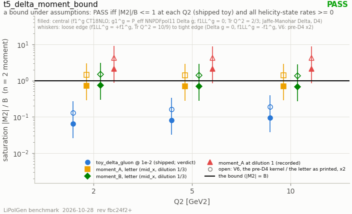

- **status:** **PASS**
- **vendored data (sha256 of every byte):** `data/delta_moment_bound_sources.json` `794d1429662a41bf717a7269071d9e3bdafa6c8f4933a92557e38807912218e7`
- **config:** lipolgen = 0.1.0; python = 3.10.12; data_file_sha256 = 794d1429662a41bf717a7269071d9e3bdafa6c8f4933a92557e38807912218e7; tr_q2 = 0.666667; f1ll_band = 1; ds16_over_tree = 1; pre_d4_over_jm = 2; quad_rel_tol = 1e-07; pythia = 8.317; lhapdf_sets = CT18NLO member 0 (sha256 375db856d2f8) / NNPDFpol11_100 member 0 (sha256 c64ba5fe3067)

| sub-row | status | values / reason |
|---|---|---|
| `toy_1e-2[shipped]` | **PASS** | name = toy_1e-2[shipped]; status_central = pass; status_v6 = pass; q2 = 2 / 5 / 10; m2 = 0.000123835 / 0.000131079 / 0.000138046; bound = 0.00192156 / 0.00163312 / 0.00146766; saturation = 0.0644448 / 0.0802629 / 0.0940587; margin = 0.935555 / 0.919737 / 0.905941; saturation_v6 = 0.12889 / 0.160526 / 0.188117; saturation_tight = 0.271923 / 0.336911 / 0.393658; saturation_loose = 0.0260124 / 0.0323732 / 0.0379216; f1ll_critical = -1.92312 / -1.88633 / -1.85564; f1ll_critical_dg0 = -1.86753 / -1.83539 / -1.80734; f1ll_critical_v6 = -1.79065 / -1.72172 / -1.66298; m2_numerical_error = 0 / 2.71051e-20 / 5.42101e-20; m2_tail_x_lo = 6.53196e-14 / 1.54757e-13 / 2.98878e-13; saturation_dg0 = 0.0662362 / 0.0823074 / 0.0963304; saturation_ll_minus = 0.125495 / 0.156635 / 0.183783; saturation_ll_plus = 0.043354 / 0.0539553 / 0.0632026; saturation_nf4 = 0.0386669 / 0.0481577 / 0.0564352; saturation_ss90 = 0.0322224 / 0.0401314 / 0.0470294; saturation_epps21 = 0.066095 / 0.0820879 / 0.0960447; saturation_peff_naive = 0.0640417 / 0.0798016 / 0.0935454; scale_measured = 0.01 |
| `helicity_positivity[shipped kernel]` | **PASS** | name = helicity_positivity[shipped kernel]; source = Cosyn, Roldan Tomei, Sosa, Zec, EPJ A 61 (2025) 83, Eq. (2): -2 &lt;= A_T &lt;= 1; n_points = 567; n_rates = 1701; w_min = 0.9494; a_t_min = -0.1012; a_t_max = 0.0506002; w_min_at = x=0.9 Q2=2 y=0.95 theta_S=90 phi'=90 m=+0 |
| `moment_A[letter]` | **RECORDED** (recorded, not in the verdict) | name = moment_A[letter]; status_central = pass; status_v6 = fail; q2 = 2 / 5 / 10; m2 = -0.00137331 / -0.0011411 / -0.00103031; bound = 0.00192156 / 0.00163312 / 0.00146766; saturation = 0.714685 / 0.698724 / 0.702012; margin = 0.285315 / 0.301276 / 0.297988; saturation_v6 = 1.42937 / 1.39745 / 1.40402; saturation_tight = 3.01559 / 2.93296 / 2.93809; saturation_loose = 0.288475 / 0.281823 / 0.28303; f1ll_critical = -0.586492 / -0.617901 / -0.610369; f1ll_critical_dg0 = -0.530896 / -0.566955 / -0.562065; f1ll_critical_v6 = 0.882612 / 0.815144 / 0.827566; m2_numerical_error = 4.33681e-19 / 2.1684e-19 / 0; m2_tail_x_lo = 3.41171e-16 / 6.47252e-16 / 1.08942e-15; saturation_dg0 = 0.734552 / 0.716522 / 0.718968; saturation_ll_minus = 1.39173 / 1.36358 / 1.37168; saturation_ll_plus = 0.480791 / 0.469705 / 0.471716; saturation_nf4 = 0.428811 / 0.419234 / 0.421207; saturation_ss90 = 0.357343 / 0.349362 / 0.351006; saturation_epps21 = 0.732986 / 0.714612 / 0.716835; saturation_peff_naive = 0.710216 / 0.694708 / 0.698181; variant = mid_x; q2_ref = 4.474; dilution = 1/3; a_solved = -0.292399; a_printed = -0.2924; a_reproduced = true; saturation_model_lo_alpha_s = 0.816845 / 0.800276 / 0.802612 |
| `moment_B[letter]` | **RECORDED** (recorded, not in the verdict) | name = moment_B[letter]; status_central = pass; status_v6 = fail; q2 = 2 / 5 / 10; m2 = -0.00141814 / -0.00113557 / -0.000989679; bound = 0.00192156 / 0.00163312 / 0.00146766; saturation = 0.738015 / 0.695338 / 0.674326; margin = 0.261985 / 0.304662 / 0.325674; saturation_v6 = 1.47603 / 1.39068 / 1.34865; saturation_tight = 3.11403 / 2.91875 / 2.82221; saturation_loose = 0.297891 / 0.280458 / 0.271867; f1ll_critical = -0.538536 / -0.624845 / -0.66708; f1ll_critical_dg0 = -0.48294 / -0.573899 / -0.618776; f1ll_critical_v6 = 0.978523 / 0.801256 / 0.714144; m2_numerical_error = 2.1684e-19 / 0 / 2.1684e-19; m2_tail_x_lo = 3.17034e-26 / 2.53864e-26 / 2.21249e-26; saturation_dg0 = 0.75853 / 0.713051 / 0.690612; saturation_ll_minus = 1.43716 / 1.35697 / 1.31758; saturation_ll_plus = 0.496486 / 0.467429 / 0.453112; saturation_nf4 = 0.442809 / 0.417203 / 0.404595; saturation_ss90 = 0.369007 / 0.347669 / 0.337163; saturation_epps21 = 0.756913 / 0.711149 / 0.688563; saturation_peff_naive = 0.733399 / 0.691342 / 0.670645; variant = mid_x; dilution = 1/3; saturation_model_lo_alpha_s = 0.843509 / 0.796399 / 0.770958 |
| `moment_A[dilution 1]` | **RECORDED** (recorded, not in the verdict) | name = moment_A[dilution 1]; status_central = fail; status_v6 = fail; q2 = 2 / 5 / 10; m2 = -0.00411994 / -0.0034233 / -0.00309094; bound = 0.00192156 / 0.00163312 / 0.00146766; saturation = 2.14406 / 2.09617 / 2.10604; margin = -1.14406 / -1.09617 / -1.10604; saturation_v6 = 4.28811 / 4.19234 / 4.21207; saturation_tight = 9.04677 / 8.79888 / 8.81427; saturation_loose = 0.865424 / 0.845469 / 0.84909; f1ll_critical = 2.35172 / 2.24819 / 2.2655; f1ll_critical_dg0 = 2.40731 / 2.29913 / 2.31381; f1ll_critical_v6 = 6.75903 / 6.54732 / 6.57931; m2_numerical_error = 0 / 4.33681e-19 / 8.67362e-19; m2_tail_x_lo = 1.02351e-15 / 1.94175e-15 / 3.26827e-15; saturation_dg0 = 2.20366 / 2.14957 / 2.1569; saturation_ll_minus = 4.17519 / 4.09073 / 4.11503; saturation_ll_plus = 1.44237 / 1.40912 / 1.41515; saturation_nf4 = 1.28643 / 1.2577 / 1.26362; saturation_ss90 = 1.07203 / 1.04809 / 1.05302; saturation_epps21 = 2.19896 / 2.14384 / 2.1505; saturation_peff_naive = 2.13065 / 2.08412 / 2.09454 |
| `moment_B[dilution 1]` | **RECORDED** (recorded, not in the verdict) | name = moment_B[dilution 1]; status_central = fail; status_v6 = fail; q2 = 2 / 5 / 10; m2 = -0.00425442 / -0.00340672 / -0.00296904; bound = 0.00192156 / 0.00163312 / 0.00146766; saturation = 2.21404 / 2.08601 / 2.02298; margin = -1.21404 / -1.08601 / -1.02298; saturation_v6 = 4.42809 / 4.17203 / 4.04595; saturation_tight = 9.34209 / 8.75625 / 8.46664; saturation_loose = 0.893674 / 0.841373 / 0.815602; f1ll_critical = 2.49558 / 2.22736 / 2.09537; f1ll_critical_dg0 = 2.55118 / 2.2783 / 2.14367; f1ll_critical_v6 = 7.04676 / 6.50566 / 6.23904; m2_numerical_error = 0 / 4.33681e-19 / 4.33681e-19; m2_tail_x_lo = 9.51103e-26 / 7.61593e-26 / 6.63747e-26; saturation_dg0 = 2.27559 / 2.13915 / 2.07184; saturation_ll_minus = 4.31148 / 4.07091 / 3.95274; saturation_ll_plus = 1.48946 / 1.40229 / 1.35934; saturation_nf4 = 1.32843 / 1.25161 / 1.21379; saturation_ss90 = 1.10702 / 1.04301 / 1.01149; saturation_epps21 = 2.27074 / 2.13345 / 2.06569; saturation_peff_naive = 2.2002 / 2.07403 / 2.01194 |
| `bound_side[central]` | **RECORDED** (recorded, not in the verdict) | name = bound_side[central]; q2 = 2 / 5 / 10; p_eff = 0.270409; tr_q2 = 0.666667; ds16_over_tree = 1; pre_d4_over_jm = 2; alpha_s = 0.354535 / 0.283893 / 0.24742; xg = 0.397602 / 0.422961 / 0.436704; xg_epps21 = 0.387399 / 0.413318 / 0.427456; xdg = 0.040873 / 0.0398439 / 0.0390053; g1_moment = 0.0110524 / 0.0107742 / 0.0105474; B = 0.00192156 / 0.00163312 / 0.00146766; B_dg0 = 0.00186959 / 0.00159255 / 0.00143305; B_ll_minus = 0.000986767 / 0.000836844 / 0.000751135; B_ll_plus = 0.00285636 / 0.0024294 / 0.00218418; B_nf4 = 0.0032026 / 0.00272187 / 0.0024461; B_ss90 = 0.00384313 / 0.00326624 / 0.00293532; B_epps21 = 0.00187359 / 0.00159681 / 0.00143731; B_peff_naive = 0.00193366 / 0.00164256 / 0.00147571; B_tight = 0.000910808 / 0.000778122 / 0.000701349; B_loose = 0.0047606 / 0.004049 / 0.0036403; x_g1_above_half_f1 = 0.949365 / 0.943115 / 0.941198; x_g1_above_f1 = 0.971302 / 0.969385 / 0.968115; xg_share_above_x_half = 2.1093e-07 / 9.69646e-08 / 5.24987e-08 |

### t5_epios_source_modes

- **status:** **PASS**
- **vendored data (sha256 of every byte):** `data/epios2026_table2_deuteron_source_modes.json` `8492859b8fe98a61af5a00333da6ef151e98883d934fecaf023c7009dbd1320a`

### t5_est_identity

- **status:** **PASS**
- **vendored data (sha256 of every byte):** `data/est_identity_sources.json` `32d6f70d57a3b5bc816229ded9d9f6dbc3412598e70b4978c28c61c12ef8ac6b`

### t5_sum_rules

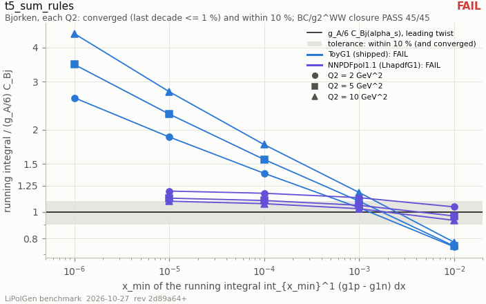

- **status:** **FAIL**

| sub-row | status | values / reason |
|---|---|---|
| `bc_ww` | **PASS** | n_cells = 45; n_within = 45; max_ratio = 0.666801; worst_cell.target = p; worst_cell.q2 = 2; worst_cell.x_min = 0.001 |
| `bjorken[toyg1]` | **FAIL** | per_q2.2.0.reference.q2 = 2; per_q2.2.0.reference.nf = 4; per_q2.2.0.reference.alpha_s = 0.358817; per_q2.2.0.reference.c_bj = 0.822753; per_q2.2.0.reference.gamma = 0.174876; per_q2.2.0.reference.err = 0.00462445; per_q2.2.0.reference.err_g_a = 0.000178263; per_q2.2.0.reference.err_alpha_s = 0.00145436; per_q2.2.0.reference.err_truncation = 0.00438618; per_q2.2.0.verdict.last_decade_step = 0.128925; per_q2.2.0.verdict.distance = 0.283232; per_q2.2.0.verdict.distance_rel = 1.61961; per_q2.2.0.verdict.converged = false; per_q2.2.0.verdict.within = false; per_q2.2.0.verdict.ok = false; per_q2.5.0.reference.q2 = 5; per_q2.5.0.reference.nf = 4; per_q2.5.0.reference.alpha_s = 0.285006; per_q2.5.0.reference.c_bj = 0.87219; per_q2.5.0.reference.gamma = 0.185384; per_q2.5.0.reference.err = 0.00232788; per_q2.5.0.reference.err_g_a = 0.000188975; per_q2.5.0.reference.err_alpha_s = 0.00074298; per_q2.5.0.reference.err_truncation = 0.00219802; per_q2.5.0.verdict.last_decade_step = 0.219819; per_q2.5.0.verdict.distance = 0.457638; per_q2.5.0.verdict.distance_rel = 2.46859; per_q2.5.0.verdict.converged = false; per_q2.5.0.verdict.within = false; per_q2.5.0.verdict.ok = false; per_q2.10.0.reference.q2 = 10; per_q2.10.0.reference.nf = 4; per_q2.10.0.reference.alpha_s = 0.247637; per_q2.10.0.reference.c_bj = 0.894197; per_q2.10.0.reference.gamma = 0.190062; per_q2.10.0.reference.err = 0.00153939; per_q2.10.0.reference.err_g_a = 0.000193743; per_q2.10.0.reference.err_alpha_s = 0.000503248; per_q2.10.0.reference.err_truncation = 0.00144184; per_q2.10.0.verdict.last_decade_step = 0.331185; per_q2.10.0.verdict.distance = 0.6651; per_q2.10.0.verdict.distance_rel = 3.49939; per_q2.10.0.verdict.converged = false; per_q2.10.0.verdict.within = false; per_q2.10.0.verdict.ok = false |
| `bjorken[nnpdfpol11]` | **FAIL** | per_q2.2.0.reference.q2 = 2; per_q2.2.0.reference.nf = 4; per_q2.2.0.reference.alpha_s = 0.358817; per_q2.2.0.reference.c_bj = 0.822753; per_q2.2.0.reference.gamma = 0.174876; per_q2.2.0.reference.err = 0.00462445; per_q2.2.0.reference.err_g_a = 0.000178263; per_q2.2.0.reference.err_alpha_s = 0.00145436; per_q2.2.0.reference.err_truncation = 0.00438618; per_q2.2.0.verdict.last_decade_step = 0.00378394; per_q2.2.0.verdict.distance = 0.0337965; per_q2.2.0.verdict.distance_rel = 0.19326; per_q2.2.0.verdict.converged = false; per_q2.2.0.verdict.within = false; per_q2.2.0.verdict.ok = false; per_q2.5.0.reference.q2 = 5; per_q2.5.0.reference.nf = 4; per_q2.5.0.reference.alpha_s = 0.285006; per_q2.5.0.reference.c_bj = 0.87219; per_q2.5.0.reference.gamma = 0.185384; per_q2.5.0.reference.err = 0.00232788; per_q2.5.0.reference.err_g_a = 0.000188975; per_q2.5.0.reference.err_alpha_s = 0.00074298; per_q2.5.0.reference.err_truncation = 0.00219802; per_q2.5.0.verdict.last_decade_step = 0.00408475; per_q2.5.0.verdict.distance = 0.0230361; per_q2.5.0.verdict.distance_rel = 0.124262; per_q2.5.0.verdict.converged = false; per_q2.5.0.verdict.within = false; per_q2.5.0.verdict.ok = false; per_q2.10.0.reference.q2 = 10; per_q2.10.0.reference.nf = 4; per_q2.10.0.reference.alpha_s = 0.247637; per_q2.10.0.reference.c_bj = 0.894197; per_q2.10.0.reference.gamma = 0.190062; per_q2.10.0.reference.err = 0.00153939; per_q2.10.0.reference.err_g_a = 0.000193743; per_q2.10.0.reference.err_alpha_s = 0.000503248; per_q2.10.0.reference.err_truncation = 0.00144184; per_q2.10.0.verdict.last_decade_step = 0.00427738; per_q2.10.0.verdict.distance = 0.018204; per_q2.10.0.verdict.distance_rel = 0.0957794; per_q2.10.0.verdict.converged = false; per_q2.10.0.verdict.within = true; per_q2.10.0.verdict.ok = false |
| `fsi_unitarity` | **BLOCKED** | **reason:** not definable in the tree as built (no GlauberFsiWeight option realises int dGamma S[FSI + FSI^2] = 0: the default is absorptive by design, elastic_gain would be a tune, weight_normalised is a division, the table stops at k_max); tree_side.channel = li6_alpha_channel() defaults (Hulthen beta 0.3); tree_side.sigma_xn_mb = 40; tree_side.survival = 0.520239; tree_side.int_w_minus_1 = -0.479761; tree_side.sigma_tot_cluster_mb = 131.045; tree_side.sigma_el_cluster_mb = 35.2237; tree_side.elastic_gain = 1; tree_side.k_max_gev = 1.2; tree_side.w_max = 50; tree_side.clipped_grid_fraction = 0 |

### t5_weighted_unweighted

- **status:** **PASS**

### t6_hepmc3_convention

- **status:** **PASS**
- **config:** n_events = 100; seed = 20260926; tol = 1e-09; lipolgen = 0.1.0; pyhepmc = 2.16.1; pythia_charge_table = 8.317; hepmc3_file_version = 3.03.00

| sub-row | status | values / reason |
|---|---|---|
| `C01` | **PASS** | clause = C01; doc_lines = 16-19; anchor_line = 16; anchor_found = true; what = Asciiv3 only: HepMC::Version / Asciiv3-START header, END trailer, every requested event readable; n_checked = 8; files = 8; n_violations = 0; first_violation = n/a; failing_files = |
| `C02` | **PASS** | clause = C02; doc_lines = 28-29; anchor_line = 28; anchor_found = true; what = every event in GEV and MM; n_checked = 800; files = 8; n_violations = 0; first_violation = n/a; failing_files = |
| `C03` | **PASS** | clause = C03; doc_lines = 33-37; anchor_line = 33; anchor_found = true; what = exactly two status-4 particles, e (11) and the run's ion code, both incoming at ONE vertex that has no other incoming p…; n_checked = 800; files = 8; n_violations = 0; first_violation = n/a; failing_files = |
| `C04` | **PASS** | clause = C04; doc_lines = 36-37; anchor_line = 37; anchor_found = true; what = every nuclear PDG code is a well-formed 10LZZZAAAI (L = 0, I = 0, 1 &lt;= Z &lt;= A); n_checked = 1370; files = 8; n_violations = 0; first_violation = n/a; failing_files = |
| `C05` | **PASS** | clause = C05; doc_lines = 39-55; anchor_line = 55; anchor_found = true; what = every non-beam particle has a production vertex in the event; every vertex has an incoming particle; n_checked = 800; files = 8; n_violations = 0; first_violation = n/a; failing_files = |
| `C06` | **PASS** | clause = C06; doc_lines = 56-60; anchor_line = 58; anchor_found = true; what = e' and gamma\* are outgoing at the primary vertex (and the alpha on an alpha tag); X is produced at its own downstream v…; n_checked = 800; files = 8; n_violations = 0; first_violation = n/a; failing_files = |
| `C07` | **PASS** | clause = C07; doc_lines = 70-73; anchor_line = 71; anchor_found = true; what = every status is 1, 2, 3 or 4; n_checked = 800; files = 8; n_violations = 0; first_violation = n/a; failing_files = |
| `C08` | **PASS** | clause = C08; doc_lines = 72-78; anchor_line = 72; anchor_found = true; what = exactly one pdg-92 X per event, always status 3; n_checked = 800; files = 8; n_violations = 0; first_violation = n/a; failing_files = |
| `C09` | **PASS** | clause = C09; doc_lines = 77-81; anchor_line = 78; anchor_found = true; what = exactly one status-3 gamma\* with negative (spacelike) mass; on coherent files exactly one status-3 990 with mass -sqrt\|…; n_checked = 800; files = 8; n_violations = 0; first_violation = n/a; failing_files = |
| `C10` | **PASS** | clause = C10; doc_lines = 87-93; anchor_line = 91; anchor_found = true; what = the beam electron and e' carry generated_mass 0.51099895e-3 (rel 1e-9); n_checked = 800; files = 8; n_violations = 0; first_violation = n/a; failing_files = |
| `C11` | **PASS** | clause = C11; doc_lines = 95-109; anchor_line = 95; anchor_found = true; what = the role table: status-3 pdg in {22, 990, 92, 2212, 2112, ions}, status-4 in {11, ions}; per channel the rows it writes…; n_checked = 800; files = 8; n_violations = 0; first_violation = n/a; failing_files = |
| `C12` | **PASS** | clause = C12; doc_lines = 111-121; anchor_line = 111; anchor_found = true; what = alpha tags: the struck cluster's end vertex emits &gt;= 1 status-1 partner (p, n or ion) and exactly one status-3 struck n…; n_checked = 200; files = 2; n_violations = 0; first_violation = n/a; failing_files = |
| `C13` | **PASS** | clause = C13; doc_lines = 123-147; anchor_line = 130; anchor_found = true; what = four-momentum from the file: sum(status 1) == sum(beams) on a hadronized record, + X when X alone carries the HFS; neve…; n_checked = 800; files = 8; n_violations = 0; first_violation = n/a; failing_files = |
| `C14` | **PASS** | clause = C14; doc_lines = 123-147 (charge); anchor_line = 140; anchor_found = true; what = charge from the file's PDG codes (Z of an ion code, PYTHIA ParticleData otherwise): sum(status 1) == sum(beams) whereve…; n_checked = 700; files = 7; n_violations = 0; first_violation = n/a; failing_files = |
| `C15` | **PASS** | clause = C15; doc_lines = 151-179; anchor_line = 151; anchor_found = true; what = all 24 named attributes on every event, each parsing as its listed HepMC3 type; n_checked = 800; files = 8; n_violations = 0; first_violation = n/a; failing_files = |
| `C16` | **PASS** | clause = C16; doc_lines = 156-168; anchor_line = 156; anchor_found = true; what = spin_J in {1, 1.5}; lam_e in {-1, 0, +1}; struck_cluster_m NaN on inclusive files and finite on tagged ones; channel = …; n_checked = 800; files = 8; n_violations = 0; first_violation = n/a; failing_files = |
| `C17` | **PASS** | clause = C17; doc_lines = 181-189; anchor_line = 188; anchor_found = true; what = a GenCrossSection on every event, index 0 finite and &gt; 0, its error finite and &gt;= 0; n_checked = 800; files = 8; n_violations = 0; first_violation = n/a; failing_files = |
| `C18` | **PASS** | clause = C18; doc_lines = 191-193; anchor_line = 193; anchor_found = true; what = a particle 'pol' attribute is a double and never the sentinel 9.0; n_checked = 1600; files = 8; n_violations = 0; first_violation = n/a; failing_files = |
| `C19` | **PASS** | clause = C19; doc_lines = 197-199; anchor_line = 197; anchor_found = true; what = ONE GenRunInfo block in the file (one tool line, one weight-name line, both before the first event); every event report…; n_checked = 8; files = 8; n_violations = 0; first_violation = n/a; failing_files = |
| `C20` | **PASS** | clause = C20; doc_lines = 201-202; anchor_line = 201; anchor_found = true; what = exactly one ToolInfo, name LiPolGen, version = lipolgen.__version__; n_checked = 8; files = 8; n_violations = 0; first_violation = n/a; failing_files = |
| `C21` | **PASS** | clause = C21; doc_lines = 203-210; anchor_line = 203; anchor_found = true; what = weight names: 'nominal' at 0, then spin_weight_1..N consecutive; the first event carries exactly that many values; n_checked = 8; files = 8; n_violations = 0; first_violation = n/a; failing_files = |
| `C22` | **PASS** | clause = C22; doc_lines = 211-228; anchor_line = 217; anchor_found = true; what = --rc tensor-band: the rc names APPENDED after the spin block, exactly rc_tensor_lo rc_tensor_hi rc_tail then the _k tri…; n_checked = 1; files = 1; n_violations = 0; first_violation = n/a; failing_files = |
| `C23` | **PASS** | clause = C23; doc_lines = 230-232; anchor_line = 230; anchor_found = true; what = --rc off: no rc_\* name, and 1 + N weight values; n_checked = 7; files = 7; n_violations = 0; first_violation = n/a; failing_files = |

## Planned, not wired

Nothing below is a measurement. The first table is this run's BLOCKED rows and sub-rows, with the reason each one gives; the other two are read verbatim from `BENCHMARK_PLAN.md` (§4's rows that have no harness, and §6, what cannot be benchmarked until data exists).

### Blocked in this run

| row | status | reason |
|---|---|---|
| `t5_sum_rules[fsi_unitarity]` | **BLOCKED** | not definable in the tree as built (no GlauberFsiWeight option realises int dGamma S[FSI + FSI^2] = 0: the default is absorptive by design, elastic_gain would be a tune, weight_normalised is a division, the table stops at k_max) |

### `BENCHMARK_PLAN.md` §4 rows with no harness (status column, verbatim)

| # | benchmark | tier | status (the plan's words) |
|---|---|---|---|
| 2 | **Cosyn–Weiss II Table II — re-derive the A_T∥ ↔ A_zz^wf mapping** | T2 | **resolved and fixed 2026-09-06** (not a harness; §5.1). The CW TABLE II gate is `tests/test_tagged.cpp` *"the Cosyn-Weiss deuteron tensor gate"* |
| 8 | **George–Knutson η — retitle** | T3 | **recorded, not a harness.** Code comments relabelled 2026-09-23 (`include/lipolgen/cluster_config.hpp`, three `///` blocks); doc sites G-1 … G-16 applied 2026-09-23; the T22 test name now says what it checks; G-17 (the Mäntysaari draft) left to the author, registry row 21 |

### `BENCHMARK_PLAN.md` §6 — what cannot be benchmarked until data exists (verbatim)

| # | observable | closest proxy | distance |
|---|---|---|---|
| U-1 | b₁(⁶Li), b₂(⁶Li) | b₁ᵈ (HERMES; CDKS/Miller) | A = 2 → 6 through `LI6_B1_PER_NUCLEON` = 2/6 — a modelling ASSUMPTION (inert α), not a convention |
| U-2 | tagged tensor asymmetry with an α/t spectator | Cosyn–Weiss A_T∥ with a NUCLEON spectator | different spectator, different wave function; and see §5.1 |
| U-3 | coherent ⁶Li tensor cos 2φ / a₂ | Mäntysaari *et al.* polarized-DEUTERON a₂(\|t\|) | the deuteron's quadrupole is 3.5× ⁶Li's and of the opposite sign; O5 is a closed-form estimate, not a Good–Walker amplitude |
| U-4 | ⁷Li rank-2 sector | Jaffe–Manohar (formalism only); Fu–Sun–Dong GPD forward limits | no number for ⁷Li anywhere; the sector is identically zero in-tree |
| U-5 | b₃, b₄, Δ (double-helicity-flip gluon) | Detmold–Shanahan lattice A₂ for the φ meson | a different hadron |
| U-6 | tensor-sector radiative corrections | Gakh–Shekhovtsova (zero citations, one Q² panel, deuteron) | no calculation for any A > 2 |
| U-7 | cluster-spectator Glauber FSI | Ciofi degli Atti–Kaptari ³He(e,e′d)X | the only cluster-spectator FSI calculation; a d spectator on A = 3 |
| U-8 | the α–d D-wave from data | George–Knutson η | refuted as a benchmark; η is a relabelling of the quadrupole dial |
| U-9 | A_zz(⁶Li) inclusive | the relation A_zz = −(2/3) b₁/F₁ (four sources agree) | a convention gate on the RELATION, not on either side |
| U-10 | ⁶Li elastic FF shape in the RC tail | F_q(0), F_m(0) on measured moments | the C0 SHAPE is a model band (now: the UVa density is a data-derived shape, and it lies OUTSIDE the [ho, vmc-ft] band on every priced tail number — `../open_items/run_2026-09-23/phase_B2_nuclear.md` §3.3) |
| U-11 | the spin bookkeeping | nothing external today | #1 above (wired 2026-09-23): the bookkeeping now has an external anchor, EPIOS Table II, passing at residual 0; the anchor is for an atomic-beam deuteron source, not for lithium |
| U-12 | polarized ⁶Li QE/elastic tails | 133 unpolarized QE points | the tensor QE tail is priced, not computed |
