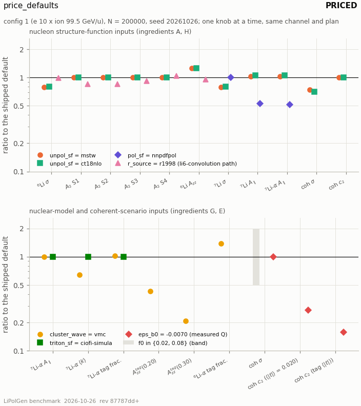

<!-- SPDX-License-Identifier: GPL-3.0-or-later -->
# Run 2026-10-26 — phase A: the baseline on a machine with the LHAPDF sets, and the default-input price table of the ranked observables

*Worker A, 2026-10-26; `PLAN.md` phase A (A1, A2 folded into it, A3).
Inputs: `phase_0_environment.md` (read first; contradicted only where §3 says
why); the supervising session's logs in the session scratch directory — the
C++ suite tail, the pytest tail, and the first `make_report.py --all
--compare docs/benchmarking/REPORT.json` with the LHAPDF sets (18:11:57–18:12:40
UTC) and its `REPORT.md` / `REPORT.json`; this worker's re-runs of
`t4_pythia_ep_closure.py` and `t6_hepmc3_convention.py` from the repository
root (19:11–19:13 UTC); and `validation/price_defaults.py`, written for A3.
No default, tolerance, registry label or reference number moved; no harness
was edited; nothing was committed. Every number carries its window; a knob
that did not run is a label, never a number.*

## 0. In one paragraph

On this machine the 13 C++ and 39 pytest failures of the 2026-09-26/27
machine — every one "Info file not found for PDF set" — are gone (416 / 416
cases; 1269 passed / 158 skipped / 0 failed). The first report with the
LHAPDF sets measured the CT18NLO and NNPDFpol11 sub-rows for the first time:
CT18NLO fails absolute F₂ᵈ (3401.8/146, mean model/data 1.086) and passes
F₂ᵈ/F₂ᵖ (215.5/189, p = 0.090); ToyG1-on-CT18NLO and NNPDFpol11 fail world
g₁ᵈ; NNPDFpol11's Bjorken integral fails both of its criteria, and its own
numbers say why — the truncated integral is 98.0–98.2 % of g_A/6 at every
Q², so the "distance" is the missing C_Bj of a leading-order formula, not the
fit. Row 4 passes again. T4 and T6 were BLOCKED only by PYTHIA 8.317's
cwd-relative loader; re-run after the workaround both PASS (T4 worst 0.076 at
W2 n_ch_eta[−2,0), 0.924 ± 0.062; T6 23/23). The A3 price table (config 1,
N = 200 000, seed 20261026) says: claim 1's cos 2φ amplitude does not see F₂
(the same double in every cell, to 8.9e−16; the super-bin averages move
≤ 0.23 %) but sees R by **−14.7 / −15.2 / −7.8 / +4.2 %** at the four
sweet-spot super-bins — about twice the "−3 … −8 %" `08_channel_priority.md`
carried, which was a function-level point and not the sweet spots (both at fixed Δ/F₁, §4.3's phase F correction); A_zz moves
×1.2524 / ×1.2604 and σ ×0.7985 / ×0.7934 under CT18NLO / MSTW (README.md's
costs, reproduced); A_∥ moves ×0.532 (inclusive ⁷Li) and ×0.514 (tagged ⁷Li α)
under NNPDFpol1.1; the tagged ⁶Li α A_zz^tag moves ×0.430 / ×0.209 at
k = 0.20 / 0.30 GeV under the VMC wave; the coherent c₂ moves ×0.270 (at the
generated ⟨|t|⟩) and ×0.158 (at the 0.20 GeV tag ⟨|t|⟩) at the measured
quadrupole, and f₀ moves the rate alone (×0.5 / ×2). The shipped Δ gives an
amplitude of −(1.06–1.43) × 10⁻³ per unit P_zz — the opposite sign of the
letter's `moment_A` amplitudes and 4–7× smaller.

## 1. A1 — the tallies against 2026-09-27

| gate | this machine, 2026-10-26 (`0cea6c0` + the phase-0 edits; Python 3.10.12, numpy 2.2.6, scipy 1.15.3; HepMC3 3.3.0, LHAPDF 6.5.5 with CT18NLO / NNPDFpol11_100 / EPPS21nlo_CT18Anlo_Li6, PYTHIA 8.317) | the 2026-09-26/27 machine (no LHAPDF set, PYTHIA 8.312; `../run_2026-09-26/SUMMARY.md`'s gate table and the committed `../../benchmarking/REPORT.md`) | move |
|---|---|---|---|
| `build/lipolgen_tests` | **416 cases / 416 passed / 0 failed / 0 skipped; 17 242 712 assertions, 0 failed** | 416 / 403 / 13 failed; 17 241 417 assertions, 0 failed — all 13 "Info file not found for PDF set" (CT18NLO 9, NNPDFpol11_100 2, EPPS21nlo_CT18Anlo_Li6 2) | −13 failures; +1 295 assertions |
| `python3 -m pytest python/tests -q` | **1269 passed / 158 skipped / 0 failed**, 2 warnings (both an `IntegrationWarning` from `t5_sum_rules.py`'s `quad`, in `test_bench_t5_closures.py`), 466.97 s | 39 failed / 1209 passed / 163 skipped, 288.3 s — all 39 "Info file not found for PDF set" | 1427 collected against 1411 (+16 tests added since); −39 failures; −5 skips |
| `make_report.py --all` (the 18 harnesses) | **5 pass / 8 fail / 5 blocked / 0 blocked (environment) / 0 error / 0 skipped (opt-in)**, generated 2026-10-26T18:12:39Z, before the PYTHIA workaround | 6 / 8 / 3 / 1 / 0 / 0, generated 2026-09-27T14:23:30Z (`ed4f9ff` + dirty) | §2 |

Row by row, the report's statuses moved in three places: row 4
(`t3_nmc_li6_over_d`) BLOCKED (ENVIRONMENT) → PASS, and T4 and T6 PASS →
BLOCKED — the latter two an artefact of PYTHIA 8.317's Python module, which
executes every file of a `python/` directory in the current working directory
at import (`phase_0_environment.md`, "PYTHIA 8.317's Python module cannot be
imported from the repository root"). Re-run after `_report.py`'s
`import_pythia8()` workaround, both PASS (§2.2). **The tally the tree should
therefore give is 7 pass / 8 fail / 3 blocked / 0 blocked (environment) /
0 error — an inference from two runs (the 18:12 UTC `--all` and the two
single-harness re-runs at 19:11–19:12 UTC), not a measured `--all`**; phase
E1's regeneration is the measurement, and it will also carry every harness the
other workers add.

## 2. A2 — every status change and headline move

### 2.1 The first `--compare` (18:12 UTC: the LHAPDF sets present, PYTHIA 8.317 not importable from the root)

46 lines printed, **38 changes counted** (`make_report.py`'s `compare`: the 8
"new (informational)" sub-row lines do not count): 5 MOVED, 3 STATUS,
22 SUBROW (6 status changes and 16 gone), 8 SUBMOVED.

| harness [sub-row] | the compare's own word | the number now |
|---|---|---|
| `t1_g1d_world` | MOVED (headline) | the `ct18nlo` and `nnpdfpol` sub-rows read FAIL with numbers instead of BLOCKED (environment: LHAPDF set … not installed) |
| `t1_g1d_world[ct18nlo]` | SUBROW BLOCKED → FAIL; SUBMOVED | ToyG1 on CT18NLO's F₁ (`LhapdfSF`), on the DIS cut above CT18NLO's own floor Q² = 1.677 GeV²: **COMPASS 20.18/11 (p = 0.043 — passes on its own), HERMES 64.30/11 (p = 1.5e−9), E143 58.96/24 (p = 9.0e−5)**; world 143.43/46 (p = 6.1e−12) |
| `t1_g1d_world[ct18nlo/compass, /hermes, /e143, /smc]` | SUBROW new (informational) ×4 | SMC, recorded and not in the verdict: 14.13/11 (p = 0.23) |
| `t1_g1d_world[nnpdfpol]` | SUBROW BLOCKED → FAIL; SUBMOVED | `LhapdfG1(NNPDFpol11_100)`, floor Q² = 1: **COMPASS 45.00/15 (p = 7.7e−5), HERMES 52.58/15 (p = 4.5e−6), E143 50.96/28 (p = 0.0050)**; world 148.53/58 (p = 7.0e−10) |
| `t1_g1d_world[nnpdfpol/compass, /hermes, /e143, /smc]` | SUBROW new (informational) ×4 | SMC 13.42/12 (p = 0.34) |
| `t1_nmc_f2d` | MOVED | `ct18nlo 3401.8/146 (p = 0)` |
| `t1_nmc_f2d[ct18nlo]` | SUBROW BLOCKED → FAIL; SUBMOVED | 146 DIS points: χ² 3401.76 (full covariance 4553.94), **mean model/data 1.0862**, worst pull +12.27 at x = 0.05, Q² = 2.5 GeV²; all 158 points 3523.99, mean 1.0789 |
| `t1_nmc_f2d_over_f2p` | MOVED | `ct18nlo 215.5/189 (p = 0.0904; frozen hook 239.5)` |
| `t1_nmc_f2d_over_f2p[ct18nlo]` | SUBROW BLOCKED → **PASS**; SUBMOVED | 189 DIS points: 215.51 (p = 0.090); covariance 226.20 (p = 0.033); legacy diagonal 214.69, legacy covariance 202.52 (p = 0.24); the Q²-frozen hook 239.52 (p = 0.0075); worst pull −3.07 at x = 0.18, Q² = 5.49; mean difference −0.00122 |
| `t2_deuteron_static[cdbonn]`, `[hulthen]` | SUBMOVED ×2 | `q_d_quad_error` 7.38298e−15 → 7.43849e−15 and 1.22347e−13 → 1.22291e−13: a quadrature error estimate in its 15th digit (numpy 2.2.6 here, 2.4.6 there); no verdict and no headline moved |
| `t3_nmc_li6_over_d` (plan row 4) | STATUS BLOCKED (ENVIRONMENT) → **PASS** | 4.6269/4 on x ≥ 0.30 (p = 0.328); 26.941/15 on the 15 on-grid points (p = 0.029) — the 2026-09-23 numbers (`validation/benchmarks/README.md`, row 4) |
| `t4_pythia_ep_closure` | STATUS PASS → BLOCKED; MOVED; SUBROW gone ×16 | "not run -- environment: pythia8 Python module not importable (stock side)"; all 16 sub-rows (W1 and W2 × `n_ch`, `sum_empz`, `sum_pt_ch` and the five η bins) gone — the loader defect |
| `t5_sum_rules[bjorken[nnpdfpol11]]` | SUBROW BLOCKED → FAIL; SUBMOVED | Γ_p−n = 0.2087 / 0.2084 / 0.2083 at Q² = 2 / 5 / 10 GeV² against g_A/6·C_Bj = 0.1749 / 0.1854 / 0.1901: **+19.3 / +12.4 / +9.6 %**; `converged` false at all three Q² (§3) |
| `t6_hepmc3_convention` | STATUS PASS → BLOCKED; MOVED; SUBROW `[C14]` PASS → BLOCKED; SUBMOVED `[C14]` | 22/22 clauses (C14, the charge from PYTHIA's particle table, needs `pythia8`); C14 files 7 → 0, `n_checked` 700 → 0 — the loader defect |

### 2.2 T4 and T6 after the `import_pythia8` workaround (this worker, from the repository root)

- `python3 validation/benchmarks/t4_pythia_ep_closure.py` — exit 0, 14.2 s
  wall: **PASS**, max |bridge/stock − 1| = **0.076** (W2 n_ch_eta[−2,0)) over
  15 compared sub-rows, 0 fail; ⟨n_ch⟩ W1 1.007, W2 0.997; "PYTHIA used 8.317
  (pinned 8.317)", `PDF:pSet 13`, 20 000 + 20 000 events per window.
- `python3 validation/benchmarks/t6_hepmc3_convention.py` — exit 0, 4.7 s:
  **PASS**, 23/23 clauses on 8 files, 800 events; C14 checked on 700 events;
  four-momentum worst residual 4.19e−13 of the beam energy; doc sha256
  `56d3a91a…` (at authoring the same).
- `LIPOLGEN_BENCH=1 python3 validation/benchmarks/make_report.py --only
  t4_pythia_ep_closure --only t6_hepmc3_convention --out-dir <scratch>
  --compare docs/benchmarking/REPORT.json` — 2 pass; **17 changes, all T4**:
  MOVED 0.023 → 0.076 (⟨n_ch⟩ W1 1.003 → 1.007, W2 0.998 → 0.997) and 16
  SUBMOVED (the committed row is PYTHIA 8.312's). T6 printed no line: the
  committed row and this one are the same.

### 2.3 The T4 sub-rows on PYTHIA 8.317 — where the 0.076 sits

Copied from the harness's own printout (ratio = matched bridge/stock, ± its
statistical error, raw = unmatched ratio; e 10 × p 100 GeV, seed 20260926):

| window | observable | stock | bridge | ratio | ± | raw | status |
|---|---|---|---|---|---|---|---|
| W1 x 0.005–0.1, Q² 4–30 | n_ch | 8.1441 | 8.2035 | 1.0073 | 0.0038 | 1.0201 | PASS |
| W1 | sum_empz | 2.7353 | 2.7449 | 1.0035 | 0.0075 | 1.0619 | PASS |
| W1 | sum_pt_ch | 3.8483 | 3.8815 | 1.0086 | 0.0039 | 1.0174 | PASS |
| W1 | n_ch_eta[−inf,−2) | 0.0283 | 0.0274 | 0.9683 | 0.0600 | 1.1219 | PASS (566 stock particles) |
| W1 | n_ch_eta[−2,0) | 0.6862 | 0.6935 | 1.0106 | 0.0147 | 1.0827 | PASS (13 724) |
| W1 | n_ch_eta[0,2) | 2.4979 | 2.4966 | 0.9995 | 0.0070 | 1.0167 | PASS (49 957) |
| W1 | n_ch_eta[2,4) | 2.9469 | 3.0032 | 1.0191 | 0.0063 | 1.0195 | PASS (58 938) |
| W1 | n_ch_eta[4,+inf) | 1.9849 | 1.9828 | 0.9990 | 0.0060 | 1.0021 | PASS (39 697) |
| W2 x 0.1–0.5, Q² 30–300 | n_ch | 7.4037 | 7.3826 | 0.9972 | 0.0037 | 1.0061 | PASS |
| W2 | sum_empz | 1.9954 | 2.0016 | 1.0031 | 0.0064 | 1.0323 | PASS |
| W2 | sum_pt_ch | 6.1940 | 6.1633 | 0.9950 | 0.0039 | 1.0016 | PASS |
| W2 | n_ch_eta[−inf,−2) | 0.0003 | 0.0002 | 0.7283 | 0.4885 | 0.8000 | NOT COMPARED (5 stock particles) |
| W2 | **n_ch_eta[−2,0)** | 0.0388 | 0.0359 | **0.9243** | 0.0615 | 0.9987 | PASS (776) — **the 0.076** |
| W2 | n_ch_eta[0,2) | 2.5232 | 2.5345 | 1.0045 | 0.0074 | 1.0332 | PASS (50 465) |
| W2 | n_ch_eta[2,4) | 3.3359 | 3.3130 | 0.9931 | 0.0058 | 0.9881 | PASS (66 719) |
| W2 | n_ch_eta[4,+inf) | 1.5054 | 1.4990 | 0.9957 | 0.0070 | 1.0008 | PASS (30 109) |

The worst distance is the W2 backward bin, a low-count bin: 0.924 ± 0.062 is
1.2σ from 1 (on 8.312 it read 0.977 ± 0.068 on 762 stock particles). Both
sides moved with the PYTHIA version — the stock ⟨n_ch⟩ in W1 8.0267 → 8.1441
(+1.5 %), the bridge's 8.0539 → 8.2035 (+1.9 %) — and the largest
significance against 1 is W1 n_ch_eta[2,4) at 1.0191 ± 0.0063 (3.0σ), ten
times inside the declared 0.20. Recorded; no tolerance is at issue.

## 3. What the CT18NLO and NNPDFpol11 verdicts mean for ingredients A and H

**Ingredient A (unpolarized F₂ and R).** CT18NLO fails absolute F₂ᵈ
(3401.8/146 on the DIS cut above its Q₀² = 1.677 GeV², mean model/data 1.086,
worst +12.3σ at x = 0.05, Q² = 2.5) while the ratio F₂ᵈ/F₂ᵖ passes
(215.5/189, p = 0.090). Phase 0's reading — `LhapdfSF` evaluates an NLO set
with the leading-order F₂ = x Σ e_q² (q + q̄) (`src/lhapdf/lhapdf_sf.cpp:7-12`),
so the 8.6 % excess has the size of the missing coefficient functions and
target-mass / higher-twist terms at Q² ≈ 2–5 GeV², which a ratio cancels and an
absolute comparison does not — is consistent with every number here and is
not contradicted. With MSTW2008 LO (416.5/155, mean 1.025) and the toy
(8307.9/155, mean 1.060), **no shipped unpolarized backend passes absolute
F₂ᵈ; the ratio passes for MSTW (p = 0.044) and CT18NLO (p = 0.090).** What
that means for the ranked observables is priced in §4: claim 1's cos 2φ
amplitude does not see F₂ at all — on toy, MSTW and CT18NLO the per-cell
amplitude is the same double (max relative difference 8.9e−16 over the 3051
accepted cells) and the four super-bin averages move by ≤ 0.23 %, through the
cell weights only — while R moves it by −14.7 / −15.2 / −7.8 / +4.2 %. So the
CT18NLO verdicts bear on claim 1 through the rate alone (σ ×0.7985) and on
paper 2's A_zz through ×1.2524; for rank 1, ingredient A's lever is R (on the shipped toy's Δ ∝ F₁; per unit Δ it is F₂ — §4.3's phase F correction), and R
still has no data comparison anywhere in the tree as committed (phase C1's
job).

**Ingredient H (polarized g₁).** NNPDFpol11 fails world g₁ᵈ on all three
in-verdict sets (COMPASS 45.0/15, p = 7.7e−5; HERMES 52.6/15; E143 51.0/28,
p = 0.005). Phase 0 read that as pointing at the harness's deuteron
construction (the D-state factor) or at the F₁ it divides by before the PDF.
Two measured facts sharpen the reading without contradicting it.
(i) The harness's other D-state reading, the recorded `dis_no_dstate` column,
is **worse** on all three (COMPASS 56.39/15, HERMES 67.48/15, E143 61.92/28):
the factor read the other way does not rescue NNPDFpol11 — which convention
the papers state is phase D1's to read. (ii) The Bjorken sub-row says what the
evaluation misses: Γ_p−n = 0.2087 / 0.2084 / 0.2083 at Q² = 2 / 5 / 10 GeV² is
**98.2 / 98.1 / 98.0 % of g_A/6 = 0.21255 at every Q²** (the harness's
g_A = 1.2753), and its distance from g_A/6·C_Bj, +19.3 / +12.4 / +9.6 %, is
Γ/(g_A/6)/C_Bj − 1 with C_Bj = 0.823 / 0.872 / 0.894 — the Q² dependence of the
"failure" is the Q² dependence of 1/C_Bj. `LhapdfG1` builds
g₁ = ½ Σ e_q² (Δq + Δq̄) over d, u, s (`src/lhapdf/lhapdf_sf.cpp:7-12`): a
leading-order isovector moment carries no coefficient function, so it
integrates to the fit's own triplet moment — here ≈ g_A, Q²-independent —
where the reference carries C_Bj. The same leading-order evaluation (no
C_q ⊗ Δq, no C_g ⊗ ΔG) is a candidate for part of the g₁ᵈ χ² — a reading for
phase D, not a verdict; every FAIL stands as measured.

**A correction to `phase_0_environment.md`, and why.** Its bullet on
`t5_sum_rules[bjorken[nnpdfpol11]]` says "converged (last decade ≤ 0.4 %),
outside 10 % at the two lower Q²". The row's own `REPORT.json` says
`converged = false` at all three Q²: the last decade (x from 10⁻⁵ to 10⁻⁴)
adds 0.003784 / 0.004085 / 0.004277 to the integral, i.e. **2.16 / 2.20 /
2.25 % of Γ_ref, against the declared ≤ 1 %**
(`validation/benchmarks/t5_sum_rules.py:214` `BJ_CONV_REL`, applied in
`bjorken_verdict`, `validation/benchmarks/t5_sum_rules.py:469-479`; 207 and 462-472 until phase F added header lines above them). The
"0.4 %" reads like the absolute step 0.0043 taken as a percentage. The
sub-row's FAIL does not move; its reason is both criteria at Q² = 2 and 5 and
the convergence criterion alone at Q² = 10 (within 10 % there, at +9.6 %).

**For `08_channel_priority.md` ingredient H**: g₁ moves A_∥ on ranks 3 and 5 —
priced in §4 at **×0.514 (tagged ⁷Li α) and ×0.532 (inclusive ⁷Li)**, toy →
NNPDFpol1.1, the largest single-knob move on A_∥ in the table — between two
backends neither of which passes the g₁ᵈ data (ToyG1 107.8/15 on COMPASS,
NNPDFpol11 45.0/15) and one of which (ToyG1) has no convergent Bjorken
integral at all. The price is real; which side of it is right, nothing in the
tree decides.

## 4. A3 — the price table

### 4.1 The command, the window, the definitions

```
cd /home/cpeng/Projects/polli/PoliGen && source env.sh
python3 validation/price_defaults.py --plot      # the six families, N = 200 000, seed 20261026: ~190 s on 4 shared cores
python3 validation/price_defaults.py --events 2000 --families li6-incl    # python/tests/test_price_defaults.py's subset
```

`validation/price_defaults.py` is a recipe, not a harness (its name does not
match `t[1-6]_*.py`; no reference, no tolerance, no verdict); its docstring
states the window and the definitions in full. In short: beam
`default_configs(<isotope>)[1]` (e 10 GeV × ion 99.5 GeV/u); the shipped
scenario (x_max = 1.0) except on the `li6-convolution` rows (x_max = 0.95,
which that backend needs: `docs/USAGE.md` §2a "The top x cell"); optics
`yr-high-acceptance`; `lg.run(events = 200 000, seed = 20261026)` in
fixed-count mode with lg.run's own fill defaults P_z = 0.7, P_zz = 0.6,
P_e = 0.7 (read by `helicity-flip` only), `pzz_mode` ladder; one knob at a
time from the shipped default, except `--pol-sf × --unpol-sf` on inclusive ⁷Li,
which the plan asks for as a product.

- **A₂(S)** — the cos 2φ′ amplitude per unit P_zz, a₂,eff/P_zz, on the
  `transverse-tensor` fill (θ_S = π/2, the plan's one category), in the four
  sweet-spot **super-bins** of the letter: the 40 × 30 analysis-map cell of
  highest cos 2φ significance in its Q² band, padded by one bin (the sibling's
  `money_cos2phi.py` `superbin_edges(pad=1)`), copied from the sibling's
  `paper/figs/fig1.json` "superbins" — S1 x ∈ [0.0200, 0.0398), Q² ∈ [1, 1.660)
  GeV² (centre 0.0282, 1.135); S2 [0.00794, 0.0158) × [1, 1.660) (0.0112,
  1.135); S3 [0.0501, 0.100) × [2.138, 4.573) (0.0708, 3.127); S4 [0.100,
  0.1995) × [9.779, 20.91) (0.141, 14.30) — over 35 / 35 / 56 / 49 of
  LiPolGen's accepted sampler cells, selected by cell centre as the sibling's
  `superbin_mask` does. a₂,eff is `InclusiveSampler::effective_modulation`
  restricted to those cells (`src/core/sampler.cpp:370-397`), re-done from
  `state_tables` because the binding exposes no mask, and checked against the
  unmasked library call to 1e−12 on every run. It is the sibling's own
  estimator target (`money_cos2phi.py` `measure`, "truth" = a2_eff / pzz).
- **A_zz** — `estimators.azz_thirds` on meta's `tensor-thirds` per-category
  cross sections; **A_∥** — `estimators.apar_flip` on meta's `helicity-flip`
  per-category cross sections, P_e = P_z = 0.7.
- **⟨k⟩** — the mean of the generated spectator `k` column, ± std/√N; **the
  RP tag fraction** — routes 1 and 4 of the generated `route` column
  (`rp_accepted`).
- **A_zz^tag(k)** — `azz_tensor_curve_weighted` of the run's own `TaggedModel`
  with `acceptance_weights` at the run's own optics, `n_phi = 32` (the setting
  of `../../benchmarking/07_cw_sign_investigation.md` §6.4), at the grid cells
  nearest k = 0.20 and 0.30 GeV (0.1979, 0.3012).
- **c₂** — of the recoil weight 1 + c₂ cos 2(φ_t − φ_S) on the
  `transverse-tensor` fill (P_zz = 0.6). c₂ is linear in |t|, so its
  expectation over the generated spectrum is c₂ at the spectrum's exact mean
  |t| (B e^(−B|t|) renormalised on [0, 0.2], B = 50: 0.019991 GeV²); also at
  the tag ⟨|t|⟩ = 0.06 GeV² of the letter's 0.20 GeV envelope
  (`CoherentScenario::mean_t_tagged`); and the generated modulation
  2 Σ w cos 2(φ_t − φ_S) / Σ w (the default azimuth is uniform and the
  modulation is the event weight: `src/core/coherent.cpp:373-388`,
  `include/lipolgen/pipeline.hpp:879` `coherent_weighted_azimuth`).
- **σ** — `meta["sigma_pb"]`, the rate line.

**Exact and sampled.** σ, the per-category cross sections, A₂, A_zz, A_∥,
A_zz^tag and the model c₂ are N-independent functions of the configuration.
⟨k⟩, the tag fractions and the generated c₂ are sampled and carry their
errors. In fixed-count mode the per-category event counts are a
largest-remainder rounding of N in proportion to the exact cross sections
(`src/core/pipeline.cpp:1848-1869`), so a counting A_zz or A_∥ on the
returned columns carries rounding, not statistics; the prices use meta.

### 4.2 The table (verbatim from the script, N = 200 000, seed 20261026)

#### Inclusive 6Li -- A2(S), the cos 2phi' amplitude of claim 1 (rank 1), and the run-level A_zz of paper 2 (rank 4)

*Window:* 6Li, channel inclusive; A2 on plan transverse-tensor (P_zz = 0.6, theta_S = pi/2), A_zz and sigma on plan tensor-thirds (P_z = 0.7, P_zz = 0.6); x_max 1.0; N = 200000, seed 20261026.

| setting | provenance | sigma [pb] (tensor-thirds) | A_zz (run level) | A2(S1) x 0.028, Q2 1.14 | A2(S2) x 0.011, Q2 1.14 | A2(S3) x 0.071, Q2 3.13 | A2(S4) x 0.141, Q2 14.3 |
|---|---|---|---|---|---|---|---|
| unpol_sf = toy (shipped default) | default | 591846.1689 | -5.193231e-04 | -1.302914e-03 | -1.062562e-03 | -1.429079e-03 | -1.329088e-03 |
| unpol_sf = mstw | read | 469556.4513 (x0.79338) | -6.545739e-04 (x1.26044) | -1.303734e-03 (x1.00063) | -1.062814e-03 (x1.00024) | -1.429031e-03 (x0.99997) | -1.326043e-03 (x0.99771) |
| unpol_sf = ct18nlo | read | 472571.9179 (x0.79847) | -6.503970e-04 (x1.25239) | -1.304391e-03 (x1.00113) | -1.063663e-03 (x1.00104) | -1.429067e-03 (x0.99999) | -1.326727e-03 (x0.99822) |
| pol_sf = nnpdfpol (transverse-tensor) | not-read: not read under this run's fill; bit-identical to the default: yes | -- | -- | -- | -- | -- | -- |
| pol_sf = nnpdfpol (tensor-thirds) | not-read: not read under this run's fill; bit-identical to the default: yes | -- | -- | -- | -- | -- | -- |
| r_source = r1998 | refused [1] | -- | -- | -- | -- | -- | -- |
| cluster_wave = vmc | refused [2] | -- | -- | -- | -- | -- | -- |
| triton_sf = ciofi-simula | not-read: not read on channel inclusive; bit-identical to the default: yes | -- | -- | -- | -- | -- | -- |
| eps_b0 = -0.007 | not-read: not read on channel inclusive; bit-identical to the default: yes | -- | -- | -- | -- | -- | -- |
| f0 = 0.02 | not-read: not read on channel inclusive; bit-identical to the default: yes | -- | -- | -- | -- | -- | -- |

- A2 per cell is the same double on every --unpol-sf backend (F2 cancels: max |a2_cell/a2_cell(toy) - 1| = 8.9e-16, 8.9e-16 over the 3051 accepted cells); the super-bin A2 moves only through the cross-section weights sigma_c (1 + w_avg) of its cells.

#### Inclusive 6Li on the opt-in li6-convolution path -- --r-source (refused on the shipped miller b1, so priced here and labelled)

*Window:* 6Li, channel inclusive, --b1-model li6-convolution, --b1-unpol toy, --b1-band-scale 1 unless stated, x_max 0.95 (the backend's top-cell positivity); A2 on transverse-tensor, A_zz and sigma on tensor-thirds; N = 200000, seed 20261026.

| setting | provenance | sigma [pb] (tensor-thirds) | A_zz (run level, band 1) | A2(S1) | A2(S2) | A2(S3) | A2(S4) |
|---|---|---|---|---|---|---|---|
| r_source = unset (the path's default) | default | 591846.1614 | -2.366179e-05 | -1.303079e-03 | -1.062652e-03 | -1.429379e-03 | -1.329362e-03 |
| r_source = sigma-lt | not-read: not read at r_source = sigma-lt; bit-identical to the default: yes | -- | -- | -- | -- | -- | -- |
| r_source = r1998 | read | 587793.9021 (x0.99315) | -2.260981e-05 (x0.95554) | -1.112041e-03 (x0.85340) | -9.016113e-04 (x0.84845) | -1.318046e-03 (x0.92211) | -1.385257e-03 (x1.04205) |

- band: at --b1-band-scale 2, A_zz = -4.7323581e-05 (unset) / -4.5219619e-05 (r1998), ratio 0.955541; at band 0, A_zz = -4.371e-16 / 0.000e+00 (zero on both: no ratio).
- --b1-unpol mstw (the configuration the A = 2 gate passes on): A_zz = -2.0039559e-05 (unset) / -1.9291748e-05 (r1998), ratio 0.962683; sigma 591846.1614 / 587793.9021 pb.
- b1_model at the same window (x_max 0.95): A2(S1..S4) li6-convolution / miller = 1.000127 / 1.000085 / 1.000210 / 1.000206 -- the b1 term reaches A2 only through the cell weights (1 + w_avg).
- R at the super-bin centres: r_sigma_lt 0.1760 / 0.1760 / 0.1694 / 0.1400, r1998 0.3854 / 0.3934 / 0.2587 / 0.0901; (1 + R_sigma_lt) / (1 + R_1998) = 0.8488 / 0.8440 / 0.9291 / 1.0458 -- the small-y limit of the A2 ratio (D_phi = F1 + (1-y)/(x y^2) F2 is F2-dominated there, so A2 ~ F1/F2 ~ 1/(1 + R)).
- the documented FUNCTION-LEVEL points (README.md --r-source row, docs/USAGE.md): at x = 0.05 / 0.10 / 0.30, y = 0.5, Q2 = 2.5 the shared r1998 moves K/D_phi by -3.8357 / +26.3988 / +3.3518 % and Delta/D_phi (the cos 2phi amplitude) by -8.3268 / -6.7268 / -3.1441 % -- reproduced; those points are not the sweet spots.

#### Inclusive 7Li -- A_par of paper 3 (rank 5)

*Window:* 7Li, channel inclusive, plan helicity-flip (P_e = 0.7, P_z = 0.7, ladder fill); x_max 1.0; N = 200000, seed 20261026.

| setting | provenance | sigma [pb] | A_par |
|---|---|---|---|
| pol_sf = toy, unpol_sf = toy (shipped default) | default | 590952.4264 | 5.291881e-04 |
| pol_sf = toy, unpol_sf = mstw | read | 467631.419 (x0.79132) | 5.430351e-04 (x1.02617) |
| pol_sf = toy, unpol_sf = ct18nlo | read | 470360.0619 (x0.79594) | 5.610433e-04 (x1.06020) |
| pol_sf = nnpdfpol, unpol_sf = toy | read | 590952.4264 (x1.00000) | 2.812909e-04 (x0.53155) |
| pol_sf = nnpdfpol, unpol_sf = mstw | read | 467631.419 (x0.79132) | 3.554713e-04 (x0.67173) |
| pol_sf = nnpdfpol, unpol_sf = ct18nlo | read | 470360.0619 (x0.79594) | 3.534091e-04 (x0.66783) |
| r_source = r1998 | refused [1] | -- | -- |
| cluster_wave = vmc | refused [2] | -- | -- |
| triton_sf = ciofi-simula | not-read: not read on channel inclusive; bit-identical to the default: yes | -- | -- |
| eps_b0 = -0.007 | not-read: not read on channel inclusive; bit-identical to the default: yes | -- | -- |
| f0 = 0.02 | not-read: not read on channel inclusive; bit-identical to the default: yes | -- | -- |

#### Tagged 7Li alpha -- A_par on the quasi-free triton and the spectator <k> (paper 2, rank 3)

*Window:* 7Li, channel tagged-7Li-alpha, plan helicity-flip (P_e = 0.7, P_z = 0.7, ladder fill); optics yr-high-acceptance; N = 200000, seed 20261026.

| setting | provenance | sigma [pb] | A_par | <k> generated [GeV] | RP tag fraction (generated) |
|---|---|---|---|---|---|
| shipped default (hulthen, hulthen, toy, toy) | default | 589760.7698 | 1.308589e-03 | 0.28852 +- 0.00042 | 0.97386 +- 0.00036 |
| cluster_wave = vmc | read | 589760.7698 (x1.00000) | 1.308589e-03 (x1.00000) | 0.18608 +- 0.00024 (x0.64494) | 0.99839 +- 0.00009 (x1.02519) |
| triton_sf = ciofi-simula | read | 589760.7698 (x1.00000) | 1.308589e-03 (x1.00000) | 0.28848 +- 0.00042 (x0.99985) | 0.97388 +- 0.00036 (x1.00002) |
| pol_sf = nnpdfpol | read | 589760.7698 (x1.00000) | 6.729351e-04 (x0.51424) | 0.28852 +- 0.00042 (x1.00000) | 0.97386 +- 0.00036 (x1.00000) |
| unpol_sf = mstw | read | 465064.7092 (x0.78857) | 1.340980e-03 (x1.02475) | 0.28852 +- 0.00042 (x1.00000) | 0.97387 +- 0.00036 (x1.00001) |
| unpol_sf = ct18nlo | read | 467410.9207 (x0.79254) | 1.380807e-03 (x1.05519) | 0.28852 +- 0.00042 (x0.99999) | 0.97387 +- 0.00036 (x1.00001) |
| r_source = r1998 | refused [1] | -- | -- | -- | -- |
| eps_b0 = -0.007 | not-read: not read on channel tagged-7Li-alpha; bit-identical to the default: yes | -- | -- | -- | -- |
| f0 = 0.02 | not-read: not read on channel tagged-7Li-alpha; bit-identical to the default: yes | -- | -- | -- | -- |

- --triton-sf is READ here, and on the same seed it moves the T1 final state, not the ranked observables: n_partner differs on 45969 of 200000 events (mean 1.33783 -> 1.5675); struck_virtuality differs on 200000 of 200000 events (mean -0.123556 -> -0.125176); struck_pol differs on 74843 of 200000 events (mean 0.19006 -> 0.18779); the per-category cross sections (so A_par) are bit-identical and <k> moves by its sampling only.

#### Tagged 6Li alpha -- A_zz^tag(k) on the embedded deuteron (paper 2, rank 6)

*Window:* 6Li, channel tagged-6Li-alpha, plan tensor-thirds (P_z = 0.7, P_zz = 0.6); A_zz^tag = azz_tensor_curve_weighted at acceptance_weights(yr-high-acceptance, n_phi = 32), at the TaggedModel cell nearest k; N = 200000, seed 20261026.

| setting | provenance | sigma [pb] | A_zz^tag(k ~ 0.20) | A_zz^tag(k ~ 0.30) | RP tag fraction (generated) |
|---|---|---|---|---|---|
| shipped default (cluster_wave = hulthen) | default | 591846.1689 | -1.2069 | -0.9533 | 0.02466 +- 0.00035 |
| cluster_wave = vmc | read | 591846.1689 (x1.00000) | -0.5191 (x0.43013) | -0.1993 (x0.20903) | 0.03422 +- 0.00041 (x1.38747) |
| unpol_sf = mstw | read | 469556.4513 (x0.79338) | -1.2069 (x1.00000) | -0.9533 (x1.00000) | 0.02466 +- 0.00035 (x1.00000) |
| unpol_sf = ct18nlo | read | 472571.9179 (x0.79847) | -1.2069 (x1.00000) | -0.9533 (x1.00000) | 0.02466 +- 0.00035 (x1.00000) |
| pol_sf = nnpdfpol | not-read: not read under this run's fill; bit-identical to the default: yes | -- | -- | -- | -- |
| triton_sf = ciofi-simula | not-read: not read on channel tagged-6Li-alpha; bit-identical to the default: yes | -- | -- | -- | -- |
| r_source = r1998 | refused [1] | -- | -- | -- | -- |
| eps_b0 = -0.007 | not-read: not read on channel tagged-6Li-alpha; bit-identical to the default: yes | -- | -- | -- | -- |
| f0 = 0.02 | not-read: not read on channel tagged-6Li-alpha; bit-identical to the default: yes | -- | -- | -- | -- |

- the k- and angle-integrated struck-deuteron dilutions (TaggedModel.vector_dilution / tensor_dilution, N-independent): hulthen 0.869943 / 0.921949, vmc 0.970966 / 0.982576 (x1.11613 / x1.06576).  A_zz on sigma_tot is zero by construction on this channel (-2.2e-16 / 2.2e-16), and with NO acceptance weight the same curve reads 7.2e-05 / 9.7e-05 (hulthen) and 3.1e-05 / 2.0e-05 (vmc) at the two k cells: the tensor signal is the cos theta_k shape of the momentum distribution, so A_zz^tag(k) exists only through the acceptance.

#### Coherent 6Li -- c2 of 1 + c2 cos 2(phi_t - phi_S) (claim 2, rank 2)

*Window:* 6Li, channel coherent, plan transverse-tensor (P_zz = 0.6); scenario defaults f0 = 0.04, slope_b = 50, amp = 0.01, eps_b0 = -0.08 unless the row says; |t| <= 0.2 GeV^2; N = 200000, seed 20261026.

| setting | provenance | sigma_coh [pb] | c2 at the spectrum's mean abs(t) (exact) | c2 at the tag mean abs(t) = 0.06 GeV^2 | c2 generated (sampled; no ratio) |
|---|---|---|---|---|---|
| shipped default (eps_b0 = -0.08, f0 = 0.04) | default | 12476.02511 | 0.029989 | 0.078000 | 0.033561 +- 0.003158 |
| eps_b0 = -0.007 (API: coherent={'eps_b0': -0.007}) | read | 12476.02511 (x1.00000) | 0.008099 (x0.27007) | 0.012300 (x0.15769) | 0.011698 +- 0.003158 |
| f0 = 0.02 (--coherent-f0) | read | 6238.012557 (x0.50000) | 0.029989 (x1.00000) | 0.078000 (x1.00000) | 0.033561 +- 0.003158 |
| f0 = 0.08 (--coherent-f0) | read | 24952.05023 (x2.00000) | 0.029989 (x1.00000) | 0.078000 (x1.00000) | 0.033561 +- 0.003158 |
| unpol_sf = mstw | read | 9281.332142 (x0.74393) | 0.029989 (x1.00000) | 0.078000 (x1.00000) | 0.034001 +- 0.003158 |
| unpol_sf = ct18nlo | read | 8806.096207 (x0.70584) | 0.029989 (x1.00000) | 0.078000 (x1.00000) | 0.033796 +- 0.003157 |
| pol_sf = nnpdfpol | not-read: not read on channel coherent-6Li; bit-identical to the default: yes | -- | -- | -- | -- |
| cluster_wave = vmc | refused [3] | -- | -- | -- | -- |
| triton_sf = ciofi-simula | not-read: not read on channel coherent-6Li; bit-identical to the default: yes | -- | -- | -- | -- |
| r_source = r1998 | refused [1] | -- | -- | -- | -- |

- c2 = P_zz (-eps_b0 B |t| / 2 + amp) is linear in |t| (coherent.hpp), so its expectation over the generated spectrum is c2 at the spectrum's exact <|t|> = 0.019991 GeV^2 (B exp(-B|t|) on [0, 0.20], B = 50); the tag <|t|> = 0.0600 GeV^2 is CoherentScenario::mean_t_tagged(0.20 GeV), the letter's envelope; 0 of N coherent recoils reach the pots at the YR envelope.

#### Refusal texts, verbatim (the footnote numbers of the tables above)

- [1] PipelineConfig: r_source = r1998 is read ONLY by b1_model = li6-convolution -- it is the ONE R the alpha-d convolution's own F1 and the kernel's F1/F_L/D(y) are both built from, and miller (a ratio model with no F1 of its own) and cdks (a digitized column) have no numerator R to share -- got b1_model = miller. The flag would not reach the rate but WOULD reach meta["r_source"], so it is refused rather than recorded as a variation that did not run
- [2] PipelineConfig: cluster_wave selects the CLUSTER RELATIVE wave function of a tagged channel and is never read on inclusive -- the inclusive 6Li effective polarization (LI6_CLUSTER_POLARIZATION = 0.811228) and the coherent form factors do not follow it, so accepting it would promise a VMC row and deliver the shipped one, 11.61 % away in the vector sector (open item C5.5). Leave it at Hulthen, or run a tagged channel
- [3] PipelineConfig: cluster_wave selects the CLUSTER RELATIVE wave function of a tagged channel and is never read on coherent-6Li -- the inclusive 6Li effective polarization (LI6_CLUSTER_POLARIZATION = 0.811228) and the coherent form factors do not follow it, so accepting it would promise a VMC row and deliver the shipped one, 11.61 % away in the vector sector (open item C5.5). Leave it at Hulthen, or run a tagged channel

#### Closure of the exact numbers against the generated columns (the default rows; N = 200 000)

- li6-incl S1: exact A2 -1.302914e-03; generated moment on 9723 events 4.5149e-03 +- 2.3787e-02 (pull +0.24)
- li6-incl S2: exact A2 -1.062562e-03; generated moment on 10169 events 3.6945e-02 +- 2.3302e-02 (pull +1.63)
- li6-incl S3: exact A2 -1.429079e-03; generated moment on 6300 events 3.2136e-02 +- 2.9778e-02 (pull +1.13)
- li6-incl S4: exact A2 -1.329088e-03; generated moment on 928 events -8.8306e-02 +- 7.6037e-02 (pull -1.14)
- li6-tag shipped default (cluster_wave = hulthen) k bin 0.20 +- 0.025: model bin average -1.1692; generated RP-accepted n = [97, 122, 274], A_zz -1.1122 +- 0.1119 (pull +0.51)
- li6-tag shipped default (cluster_wave = hulthen) k bin 0.30 +- 0.025: model bin average -0.9436; generated RP-accepted n = [222, 219, 482], A_zz -0.9444 +- 0.0822 (pull -0.01)
- li6-tag cluster_wave = vmc k bin 0.20 +- 0.025: model bin average -0.4310; generated RP-accepted n = [276, 277, 383], A_zz -0.3793 +- 0.0804 (pull +0.64)
- li6-tag cluster_wave = vmc k bin 0.30 +- 0.025: model bin average -0.2033; generated RP-accepted n = [600, 587, 687], A_zz -0.1663 +- 0.0557 (pull +0.66)
- li6-coh shipped default (eps_b0 = -0.08, f0 = 0.04): generated c2 0.0336 +- 0.0032 against the model 0.02996 over the same |t| sample (pull +1.14) and the exact 0.02999; generated <|t|> 0.019964 +- 0.000045 against the exact 0.019991 GeV^2; RP-accepted 0 of N
- li6-coh eps_b0 = -0.007 (API: coherent={'eps_b0': -0.007}): generated c2 0.0117 +- 0.0032 against the model 0.00810 over the same |t| sample (pull +1.14) and the exact 0.00810; generated <|t|> 0.019964 +- 0.000045 against the exact 0.019991 GeV^2; RP-accepted 0 of N



*`docs/benchmarking/figures/price_defaults.png`: the ratio to the shipped
default, one knob at a time, in the fixed palette slots of
`validation/benchmarks/_plots.py`; top, the nucleon structure-function inputs
(ingredients A and H: `mstw`, `ct18nlo`, `nnpdfpol`, and `r1998` on the
li6-convolution path); bottom, the nuclear-model and coherent-scenario inputs
(G and E: `cluster_wave = vmc` in `alt`, `triton_sf = ciofi-simula` in `alt2`,
`eps_b0 = −0.0070` in `alt3`, the f₀ band in grey). Not-read, refused and
environment cells are the table's, never a point.*

### 4.3 Reading it, channel by channel, in `08_channel_priority.md`'s rank order

**Rank 1 — inclusive ⁶Li, the cos 2φ amplitude (claim 1).** *(Marked correction, phase F, 2026-10-26: this holds at fixed Δ/F₁ — the shipped toy's Δ = 10⁻² F₁ x^0.3 (1−x)^4, which moves with R through F₁. Per unit Δ — the letter's extraction, xΔ = −a₂F₂[1 + y²/(2(1−y)(1+R))], `moment_B`, any calculation — R moves a₂ by ≤ 4.4 × 10⁻⁵ at the four cells and F₂ moves it 1:1: toy → CT18NLO ×1.36 / 1.19 / 0.96 / 0.90 at fixed Δ; the letter's `moment_A` moves ×0.83 under F₂ alone, `plans/07` WP1 addendum. `STATUS.md` "Verification".)*
- *F₂ is no lever*: per cell the amplitude is the same double on every
  `--unpol-sf` backend (8.9e−16); the super-bin averages move ×1.00063 /
  ×1.00024 / ×0.99997 / ×0.99771 (MSTW) and ×1.00113 / ×1.00104 / ×0.99999 /
  ×0.99822 (CT18NLO).
- *R is the lever*: **−14.66 / −15.15 / −7.79 / +4.20 %** at S1–S4, `--r-source
  r1998` against `unset` on the opt-in `li6-convolution` path (refused on the
  shipped `miller`, whose b₁ has no R hook — the refusal text is in the table;
  the amplitude itself does not care which b₁ model: li6-convolution / miller
  at the same window = 1.000127 / 1.000085 / 1.000210 / 1.000206). At the
  sweet spots' small y, D_φ = F₁ + (1−y)/(x y²) F₂ is F₂-dominated, so
  A₂ ∝ F₁/F₂ ∝ 1/(1 + R): (1 + R_σLT)/(1 + R_1998) = 0.849 / 0.844 / 0.929 /
  1.046 at the centres (`r_sigma_lt` 0.176 / 0.176 / 0.169 / 0.140 against
  `r1998` 0.385 / 0.393 / 0.259 / 0.090). The sibling's whole chain measured the
  R-alone drift as 0.849 / 0.842 / 0.930 / 1.039 at the same four spots
  (`PolarizedLithiumSim/plans/07_plb_letter_gluonometry.md`, WP1 addendum,
  "Which half of the drift is F₂ and which is R"): **generator and chain agree
  to ≤ 0.9 %**, and `08_channel_priority.md`'s "−3 … −8 % generator-side" was
  `docs/USAGE.md`'s function-level points (x = 0.05 / 0.10 / 0.30 at y = 0.5,
  Q² = 2.5 — not a point of config 1, where y = Q²/(s x) would be 0.013 /
  0.006 / 0.002), reproduced here as −8.3268 / −6.7268 / −3.1441 %. R is a
  15 % input on claim 1's two low-Q² sweet spots, generator-side as in the
  chain; NMC's R at 0.002 < x < 0.12 (phase C1) is the measurement it bears on.
- `--pol-sf`: **not read** on either tensor plan (label "not read under this
  run's fill"; the files are bit-identical to the default's).
- *Δ itself*, which has no CLI flag (`toy_delta_gluon` at 10⁻² is hard-wired;
  `include/lipolgen/sf.hpp:428-430`): A₂ = **−1.303 / −1.063 / −1.429 / −1.329 ×
  10⁻³** per unit P_zz — negative, because Δ_toy = +scale·F₁·x^0.3(1−x)⁴ > 0 and
  the amplitude is −(1−y)/y² Δ/D_φ (the `with_delta` term of
  `tensor_amplitudes`, `src/core/xsec.cpp:280-283`), where the
  letter's `moment_A` (C_BAG = −0.012 < 0) gives +7.42 / +4.35 / +9.49 / +9.52
  × 10⁻³ at the same four spots (the sibling's `plans/07` §7.1 and WP1 table):
  **the opposite sign and 4–7× the magnitude**. The shipped default is a
  discovery scenario with the sign of nothing the letter quotes; ingredient C
  (phase C2's moment bound) is where that belongs, and no default moves here.
- The generated columns cannot resolve A₂ at N = 200 000: the moment estimator
  on the 9 723 / 10 169 / 6 300 / 928 events of S1–S4 has σ = 0.024 / 0.023 /
  0.030 / 0.076 against |A₂| ≈ 1.3 × 10⁻³ (pulls +0.24 / +1.63 / +1.13 / −1.14
  against the exact numbers). The price is read from the amplitude tables the
  sampler drew from.

**Rank 4 — inclusive ⁶Li A_zz (paper 2).** ×1.26044 (MSTW) / ×1.25239
(CT18NLO) at σ ×0.79338 / ×0.79847: README.md's costs reproduced to every digit
it prints. `--r-source r1998`: ×0.95554 on the li6-convolution path (the same
0.955541 at `--b1-band-scale 2`; at band 0 A_zz is zero on both, no ratio) and
×0.96268 with `--b1-unpol mstw` (the configuration the A = 2 gate passes on);
σ ×0.993153 (−0.6847 %). On that path the run-level A_zz is −2.366 × 10⁻⁵, 22×
below Miller's −5.193 × 10⁻⁴ at x_max 1.0 — the convolution camp's
near-cancellation, which the R ratio does not see.

**Rank 5 — inclusive ⁷Li A_∥ (paper 3).** Toy → NNPDFpol1.1 **×0.5316**; the
F₁ backend ×1.0262 (MSTW) / ×1.0602 (CT18NLO) with ToyG1 (built on the
kernel's own UnpolSF, so `--unpol-sf` moves g₁ too) and ×0.6717 / ×0.6678 in
combination with NNPDFpol1.1; σ ×0.7913 / ×0.7959, ×1 under `--pol-sf`.
`--cluster-wave` refused; `--triton-sf`, `eps_b0`, `f0` not read.

**Rank 3 — tagged ⁷Li α, A_∥ and ⟨k⟩.** A_∥ = 1.3086 × 10⁻³ by default;
**×0.5142** under NNPDFpol1.1; ×1.0248 / ×1.0552 under MSTW / CT18NLO (σ ×0.7886
/ ×0.7925). Under `--cluster-wave vmc` and `--triton-sf ciofi-simula` A_∥ is
**bit-identical**: the per-category cross sections depend on neither the α–t
radial form nor the triton breakup. ⟨k⟩ = 0.28852 ± 0.00042 GeV → **0.18608 ±
0.00024 under VMC (×0.645)** — the spectator spectrum is where this channel
sees the wave function — and unchanged by the triton SF (0.28848 ± 0.00042,
the same α–t draw); the RP tag fraction 0.97386 → 0.99839. `--triton-sf` is
read and, on the same seed, moves the T1 final state: `n_partner` on 45 969 of
200 000 events (mean 1.338 → 1.568, the third channel), `struck_virtuality` on
every event (mean −0.12356 → −0.12518 GeV²) and `struck_pol` on 74 843
(mean 0.19006 → 0.18779) — while the per-category cross sections stay
bit-identical, so the A_∥ the rate carries does not follow the `struck_pol` the
breakup assigns. Flagged for the author, not judged (the P_n gate is OPEN,
`08_channel_priority.md` §3.3).

**Rank 6 — tagged ⁶Li α, A_zz^tag(k).** Hulthén **−1.2069 / −0.9533** at
k = 0.1979 / 0.3012 GeV → VMC **−0.5191 / −0.1993** (×0.430 / ×0.209; Hulthén
over VMC ×2.325 / ×4.784): `08_channel_priority.md`'s "×2.3–4.8" and
`07_cw_sign_investigation.md` §6.4's four digits reproduced on the run's own
model and optics. The generated Roman-Pot-accepted events agree: in
k ∈ [0.175, 0.225) −1.112 ± 0.112 against the model's bin average −1.169, in
[0.275, 0.325) −0.944 ± 0.082 against −0.944; VMC −0.379 ± 0.080 against
−0.431 and −0.166 ± 0.056 against −0.203 (the ±0.0125 GeV bins, looked at
first during development, gave pulls −0.16 / +0.91 / +2.78 / −0.33; the
±0.025 GeV bin was chosen for statistics after seeing both, and nothing is
decided by it). Without any acceptance weight the same curve is ≤ 1 × 10⁻⁴ at
both k, and A_zz on σ_tot is zero by construction (±2.2e−16): **A_zz^tag exists
only through the acceptance** — the tensor signal is the cos θ_k shape of the
momentum distribution — so the tag optics is part of the observable's
definition. `--unpol-sf` leaves A_zz^tag unchanged by construction (σ ×0.793 /
×0.798); the k- and angle-integrated dilutions move ×1.116 (vector) / ×1.066
(tensor) under VMC; the RP tag fraction 0.02466 ± 0.00035 → 0.03422 ±
0.00041. `--pol-sf` and `--triton-sf` not read; `--r-source` refused.

**Rank 2 — coherent ⁶Li, c₂ (claim 2).** At the shipped `eps_b0` = −0.08,
c₂ = 0.029989 at the spectrum's mean |t| and 0.0780 at the tag ⟨|t|⟩ = 0.06
GeV²; at the measured-quadrupole −0.0070 (set through `coherent={'eps_b0':
-0.007}`; there is no CLI flag), **0.008099 / 0.012300 (×0.2701 / ×0.1577)** —
the shipped default is ×3.70 / ×6.34 the measured-quadrupole expectation
(`08_channel_priority.md`'s "≈ 6× at the tag ⟨|t|⟩" reproduced). f₀ = 0.02 /
0.08: σ_coh ×0.5 / ×2 exactly and c₂ untouched — the same events (f₀
normalises the rate and nothing else). `--unpol-sf` MSTW / CT18NLO: σ_coh
×0.7439 / ×0.7058 (the coherent fraction weights low x, where the backends part
more than over the inclusive window's ×0.79), c₂ unchanged. The generated c₂
is 0.0336 ± 0.0032 against the exact 0.0300 (+1.1σ) at −0.08 and 0.0117 ±
0.0032 against 0.0081 at −0.0070 — the same events with other weights, so
their difference (0.02186) tracks the exact one (0.02189), not the sampling
noise. No
coherent recoil reaches the Roman Pots at the YR envelope (0 of 200 000) —
the sibling's `plans/10` finding that no published IP6 optics delivers the
0.20 GeV envelope — so the tag-⟨|t|⟩ column is a model number.
`--pol-sf` and `--triton-sf` not read; `--cluster-wave` and `--r-source`
refused.

**The rate line.** σ = 591 846.17 pb (inclusive ⁶Li, `tensor-thirds`;
591 892.27 on `transverse-tensor`), 590 952.43 (inclusive ⁷Li), 589 760.77
(tagged ⁷Li α), 591 846.17 (tagged ⁶Li α — the DIS rate; the RP tag fraction
is the other half of its rate line) and 12 476.03 pb (coherent ⁶Li).

### 4.4 The costs `README.md` (and `docs/USAGE.md`, `08_channel_priority.md`) already quote — reproduced or not

| where | quoted | this table | reproduced |
|---|---|---|---|
| README.md, `--unpol-sf` row | ⁶Li config 1: accepted σ ×0.7985 (ct18nlo) / ×0.7934 (mstw); run-level A_zz ×1.2524 / ×1.2604 | ×0.798471 / ×0.793376; ×1.252394 / ×1.260437 (`tensor-thirds`, P_zz = 0.6, x_max 1.0) | **yes**, every printed digit |
| README.md, `--r-source` row | K/D_φ −3.8357 / +26.3988 / +3.3518 % at x = 0.05 / 0.10 / 0.30, y = 0.5, Q² = 2.5; σ −0.684681 % | −3.8357 / +26.3988 / +3.3518 % from the runs' own kernels; σ −0.68468 % | **yes** |
| docs/USAGE.md, the `--r-source` cos 2φ row | −8.3268 / −6.7268 / −3.1441 % at the same three points | the same | **yes** — and those points are not the sweet spots (§4.3) |
| README.md, `--cluster-wave` row | ⁶Li α-tag fraction 0.0264 → 0.0348 (40 k events, seed 20260829); "on the α-tag channel the opt-in path moves every polarized observable by −2.027 %" | 0.02466 ± 0.00035 → 0.03422 ± 0.00041 (200 k events, seed 20261026); integrated dilutions ×1.116 / ×1.066, A_zz^tag ×0.430 / ×0.209 | the fractions agree with the documented expectations 0.024676 / 0.033810 (`docs/USAGE.md`'s cluster-wave table and its note) at −0.05σ / +1.0σ; README's four digits are one other 40 k sample. The −2.027 % is the 2026-09-04 embedded-deuteron fix on the opt-in path (`docs/USAGE.md`, the "two deuteron wave-function families" table: 0.932500 → 0.913600), not the hulthen → vmc price, which this table gives |
| 08_channel_priority.md §4 A | "toy → CT18NLO ×1.2524 window-level" | ×1.252394 | **yes** |
| 08_channel_priority.md §4 A, §2 rank 1 | "−8.3 / −6.7 / −3.1 % at the sweet spots generator-side"; "R moves the amplitude −3 … −8 % generator-side" | −14.66 / −15.15 / −7.79 / +4.20 % at the four super-bins | **no** — the quoted numbers are the function-level points above; corrected in §5 |
| 08_channel_priority.md §2 rank 6, §4 G | A_zz^tag −1.2069 / −0.9533 (Hulthén), −0.5191 / −0.1993 (AV18) at 0.20 / 0.30; "×2.3–4.8" | the same four numbers; ×2.325 / ×4.784 | **yes** |
| 08_channel_priority.md §3.2, §4 E | c₂ "moves by about 6× at the tag ⟨\|t\|⟩" | ×6.34 at ⟨\|t\|⟩ = 0.06 GeV²; ×3.70 at the generated mean | **yes** |

### 4.5 What the table does not validate

- Nothing here is a comparison with data or with another calculation: every
  number is the generator's own response to its own knobs. A price says how
  much a choice matters, never which choice is right.
- A₂ is per unit P_zz on one transverse fill; the letter's two-fill estimator
  (+0.6, −1.2) changes the error, not the amplitude (the sibling's `plans/07`
  §7.1 two-fill addendum).
- The R price exists only on the `li6-convolution` path: on the shipped
  `miller` b₁ the R is `r_sigma_lt` by construction and `--r-source` is refused,
  so the shipped configuration cannot be run with `r1998` at all.
- One knob at a time from the default (the one product is `--pol-sf ×
  --unpol-sf` on inclusive ⁷Li). Not priced, although READ on some of these
  channels and plans: `--b1-band-scale` beyond the ratio check, `--rc` and its
  sub-knobs, `--fsi`, `--cluster-beta`, `--p-d`, the coherent `amp`, `slope_b`
  and `t_max`, the optics and the run-plan moments.
- Generator level only: no acceptance (except where the observable is defined
  by it, A_zz^tag and the tag fractions), no reconstruction, `--rc off`
  throughout.
- At N = 200 000 the generated columns resolve ⟨k⟩, the tag fractions, the
  generated c₂ and the RP-accepted A_zz^tag; they do not resolve A₂ (σ ≈ 20–60 ×
  |A₂|), and they cannot resolve A_zz or A_∥ at all in fixed-count mode.

## 5. Corrections this record makes to other documents (for the integrator; none edited here)

1. `../../benchmarking/08_channel_priority.md` §2, the rank-1 row: "R moves
   the amplitude −3 … −8 % generator-side (≤ 18 % in the sibling's chain)" is
   the function-level point x = 0.05 / 0.10 / 0.30 at y = 0.5, Q² = 2.5; at the
   four sweet-spot super-bins the generator-side R price is −14.7 / −15.2 /
   −7.8 / +4.2 %, the sibling chain's 0.849 / 0.842 / 0.930 / 1.039 to ≤ 0.9 %.
2. The same document, §4 ingredient A: "−8.3 / −6.7 / −3.1 % at the sweet
   spots generator-side" — as in 1.
3. `phase_0_environment.md`, the `bjorken[nnpdfpol11]` bullet: "converged
   (last decade ≤ 0.4 %)" — not converged at any Q² (2.16 / 2.20 / 2.25 % of
   Γ_ref against ≤ 1 %), §3.

The exact replacement sentences are in this worker's structured return.

## 6. Files and commands

Created: `validation/price_defaults.py` (the recipe; SPDX header; covered by
`validation/check_spdx_headers.py`'s `validation/*.py`);
`python/tests/test_price_defaults.py` (one test: N = 2000, the inclusive-⁶Li
family, exit 0, the table's provenance classes, the default row's
N-independent numbers pinned at rtol 1e−9 and README's two ratios at 1e−6, a
non-empty PNG — or a named skip without matplotlib, as on CI);
`docs/benchmarking/figures/price_defaults.png` (written once, by the
`--plot` run of 19:32:48–19:35:58 UTC; sha256 `00530c0a…a636c146`; a later
full run of the final script into the scratch directory reproduced every
number — 289 of 289 values and every run fingerprint — and the PNG
byte for byte); this record. Modified: nothing else. Read only: the sibling
repository (`paper/figs/fig1.json`, `plans/07_plb_letter_gluonometry.md` §7.1
and WP1, `evgen/scripts/money_cos2phi.py`).

```
cd /home/cpeng/Projects/polli/PoliGen && source env.sh
python3 validation/benchmarks/t4_pythia_ep_closure.py        # exit 0, 14.2 s: PASS, 0.076
python3 validation/benchmarks/t6_hepmc3_convention.py        # exit 0, 4.7 s: PASS, 23/23
LIPOLGEN_BENCH=1 python3 validation/benchmarks/make_report.py --only t4_pythia_ep_closure \
    --only t6_hepmc3_convention --out-dir <scratch>/report_A --compare docs/benchmarking/REPORT.json
                                                             # 2 pass; 17 changes, all T4
python3 validation/benchmarks/t5_sum_rules.py                # read for the bjorken[nnpdfpol11] printout; no edit
python3 validation/price_defaults.py --plot --json <scratch>/price_defaults.json
                                                             # exit 0, 183–190 s; the table above and the figure
python3 -m pytest python/tests/test_price_defaults.py -q     # 1 passed, 3.2–3.9 s
python3 validation/check_spdx_headers.py                     # 130 files, all carry the header
```
